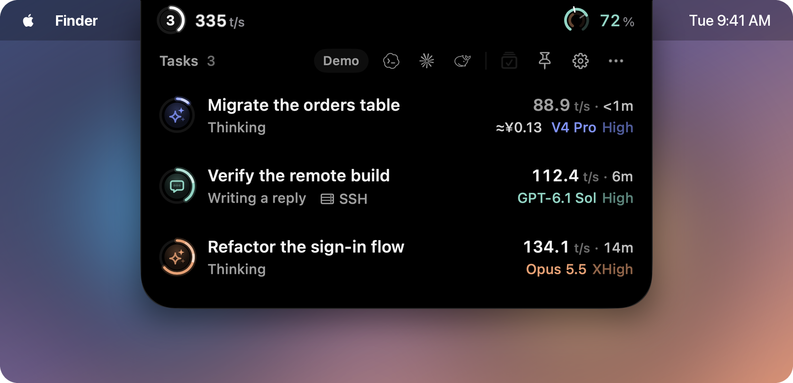
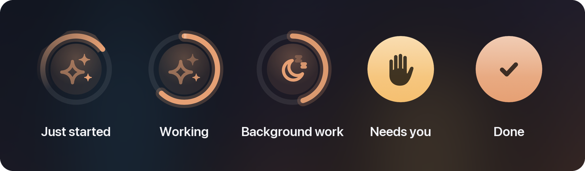
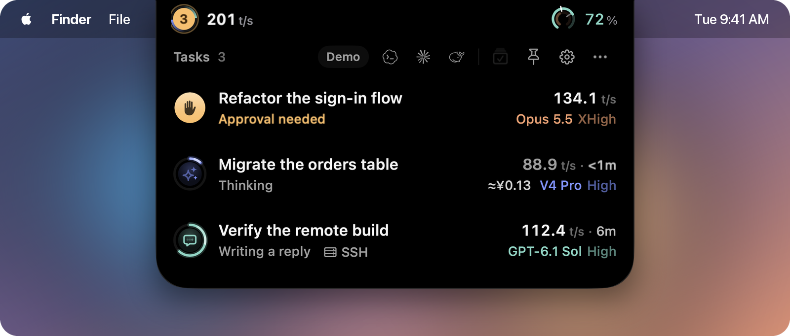
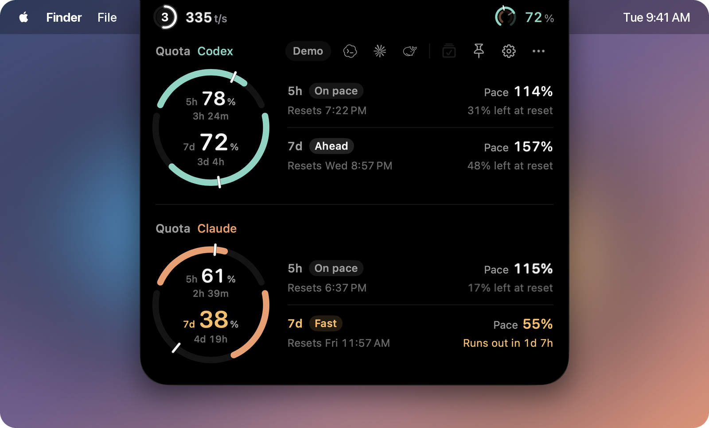
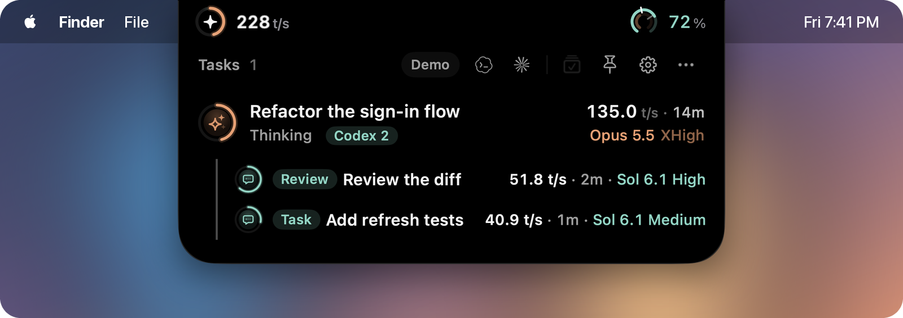
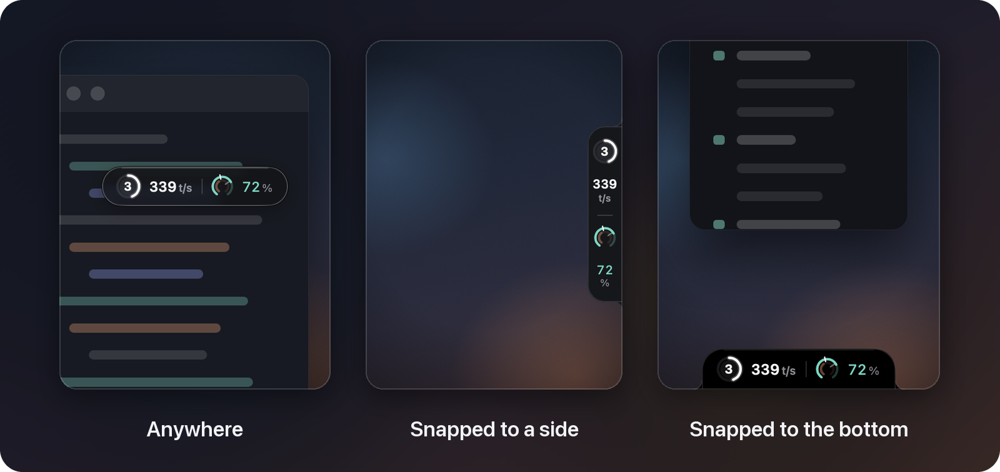

<picture>
  <source media="(prefers-color-scheme: dark)" srcset="docs/assets/readme-title-dark.png">
  
</picture>

<h3>The perfect companion for AI coding.</h3>

No more staring at “Thinking…” or switching windows to see how far it's got. 
Pacer keeps an eye on every task for you, so you stay focused and get more done.

<picture>
  <source media="(prefers-color-scheme: dark)" srcset="docs/assets/readme-agents-dark.png">
  
</picture>

&nbsp;

[Features](#features) · [Supported agents](#supported-agents) · [Install](#install) · [User Guide](docs/guide.md) · [Community](#community) · [简体中文](README.zh-CN.md)

> [!TIP]
> **New in 4.8: Pacer now supports Google Antigravity.** [See what each agent shows](#supported-agents).

## Why Pacer

| Without Pacer | With Pacer |
| --- | --- |
| You stare at *Thinking…* and guess how long is left. | The ring is at 56%. Go do something else. |
| You switch back and find it has waited ten minutes for your approval. | The island turns amber. One click takes you back. |
| You learn the quota is gone when it's gone. | You see early that you're using it too fast. |

## Stop watching the terminal

Codex, Claude Code, DeepSeek Harness, WorkBuddy and Antigravity report how much of your request is done. Each task shows it as a ring around its icon, and the collapsed bar can show the average.

## It raises its hand when you're needed

A task that waits for your approval or reply turns the island amber and moves to the top. A finished task stays until you've seen it. Click any task to open its conversation in the app that runs it.

## Several agents at once, still in order

Tasks on this computer, on your SSH hosts, in WSL and in Claude's cloud Projects share one list, each with its stage, model, speed and turn time. Subagents show under their task.

<table>
<thead>
<tr>
<th></th>
<th> Codex</th>
<th> Claude&nbsp;Code</th>
<th> DeepSeek&nbsp;Harness</th>
<th> WorkBuddy</th>
<th> Antigravity</th>
</tr>
</thead>
<tbody>
<tr><td nowrap><b>Progress ring</b></td><td align="center">✅</td><td align="center">✅</td><td align="center">✅</td><td align="center">✅</td><td align="center">✅</td></tr>
<tr><td nowrap><b>Alert when it needs you</b></td><td align="center">✅</td><td align="center">✅</td><td align="center">✅</td><td align="center">✅</td><td align="center">✅</td></tr>
<tr><td nowrap><b>Speed and model</b></td><td align="center">✅</td><td align="center">✅</td><td align="center">✅</td><td align="center">✅</td><td align="center">✅</td></tr>
<tr><td nowrap><b>Click to jump back</b></td><td align="center">✅</td><td align="center">✅</td><td align="center">✅</td><td align="center">✅</td><td align="center">Opens the app</td></tr>
<tr><td nowrap><b>Usage</b></td><td align="center">5-hour and weekly quota, pace, forecast, banked resets</td><td align="center">5-hour and weekly quota, pace, forecast</td><td align="center">Balance, today's spend by the hour, budgets</td><td align="center">Monthly and extra credits, expiry reminders</td><td align="center">Short-term and weekly quota by model group</td></tr>
<tr><td nowrap><b>Cost of each turn</b></td><td align="center">—</td><td align="center">—</td><td align="center">Estimated</td><td align="center">Credits</td><td align="center">—</td></tr>
<tr><td nowrap><b>Where tasks run</b></td><td align="center">App, CLI, SSH, WSL¹, Dot tasks</td><td align="center">App, CLI, SSH, WSL¹, cloud Projects</td><td align="center">App, CLI</td><td align="center">WorkBuddy and WorkBuddy AI</td><td align="center">App</td></tr>
<tr><td nowrap><b>Collaboration</b></td><td align="center">Called by Claude</td><td align="center">Calls Codex</td><td align="center">—</td><td align="center">—</td><td align="center">—</td></tr>
</tbody>
</table>

¹ On Windows.

**More agents are on the way.** Want one sooner? [Tell us](https://github.com/RyanZhangNTU/codex-pacer/issues/new?template=feature_request.yml).

<b>First-time setup for each agent</b>

 

The welcome guide walks you through these when you first open Pacer.

| | Once |
| --- | --- |
| **Codex** | Allow Pacer's hooks in Codex. Quota needs nothing else. |
| **Claude Code** | Restart running sessions once. Sign in to Claude in Pacer's window to see quota. |
| **DeepSeek Harness** | Sign in to the DeepSeek platform in Pacer's window, or paste an API key, to see the balance. |
| **WorkBuddy** | Trust Pacer's progress tool in WorkBuddy; Pacer shows each click. Sign in to see credits. |
| **Antigravity** | Allow Pacer’s progress tool in Antigravity to see task progress. |
| **SSH hosts** | SSH without a password prompt, and Python 3 on the host. |

## How much is left, and how fast it's going

Codex and Claude show their 5-hour and weekly quota on one ring, with a tick for an even pace and a forecast for the reset. DeepSeek shows your balance and today's spend hour by hour, with budgets if you want them. WorkBuddy shows this month's credits and when extra credits expire. Antigravity shows short-term and weekly quota for each model group.

## Claude calls Codex (Beta)

Turn on **Claude calls Codex** in **Settings → Collaboration**, then just ask Claude, for example "have Codex review this change". Each Codex run shows under the Claude task that started it, with its own progress, speed and model. Hover over a running one to stop it.

## Put it anywhere, make it yours

Keep it at the top center of the screen, or drag it anywhere and let it snap to an edge. Open it on hover or with a click. Choose black, graphite or Liquid Glass, one of four sizes, and what the collapsed bar shows. Each display remembers its own place.

## Install

<table>
<tr>
<td width="50%" valign="top">

Open the DMG and drag **Codex Pacer** into **Applications**.

macOS 14 or later, Apple silicon or Intel. Notarized by Apple.

</td>
<td width="50%" valign="top">

Run the `x64` installer, or `arm64` on an ARM PC. No administrator rights needed.

Windows 10 version 2004 or later, x64 or ARM64.

</td>
</tr>
</table>

> [!NOTE]
> The Windows installer isn't code signed yet. If SmartScreen appears, choose **More info → Run anyway**.

On first launch, a short guide helps you pick a layout and the agents to follow. Pacer then keeps itself up to date. You need at least one of Codex, Claude Code, DeepSeek Harness, WorkBuddy or Antigravity, installed and signed in. Liquid Glass needs macOS 26 or Windows 11 22H2.

## Community

- **Bugs and ideas:** [open an issue](https://github.com/RyanZhangNTU/codex-pacer/issues/new/choose).
- **QQ group (Chinese):** [1131553244](https://qm.qq.com/q/5AieQJsCWY)

## Privacy

- **No account, no analytics.** Pacer reads the logs your agents already write and keeps only what the island shows: task titles, stages, timing and token counts. It never keeps your prompts or replies.
- **Your sign-ins stay in Pacer.** Claude, DeepSeek and WorkBuddy sign in inside Pacer's own window. Pacer never reads other apps' passwords or browser cookies.
- **Nothing left behind.** Anything Pacer adds to your agents' settings is removed when you turn that feature off. **Hide Project Names** keeps task titles off screen when you share it.

## Star history

<a href="https://star-history.com/#RyanZhangNTU/codex-pacer&Date">
  <picture>
    <source media="(prefers-color-scheme: dark)" srcset="https://api.star-history.com/svg?repos=RyanZhangNTU/codex-pacer&type=Date&theme=dark">
    
  </picture>
</a>

## Contributing

To build from source or send a pull request, start with [CONTRIBUTING.md](CONTRIBUTING.md). Report security issues privately as described in [SECURITY.md](SECURITY.md).

 

[MIT](LICENSE). Codex Pacer is an independent project and is not affiliated with OpenAI, Anthropic, DeepSeek or Tencent. Codex, Claude, DeepSeek and WorkBuddy are trademarks of their respective owners. Codex Pacer includes the decompression part of [Zstandard](https://github.com/facebook/zstd) (BSD license).

[Back to top ↑](#readme-top)

