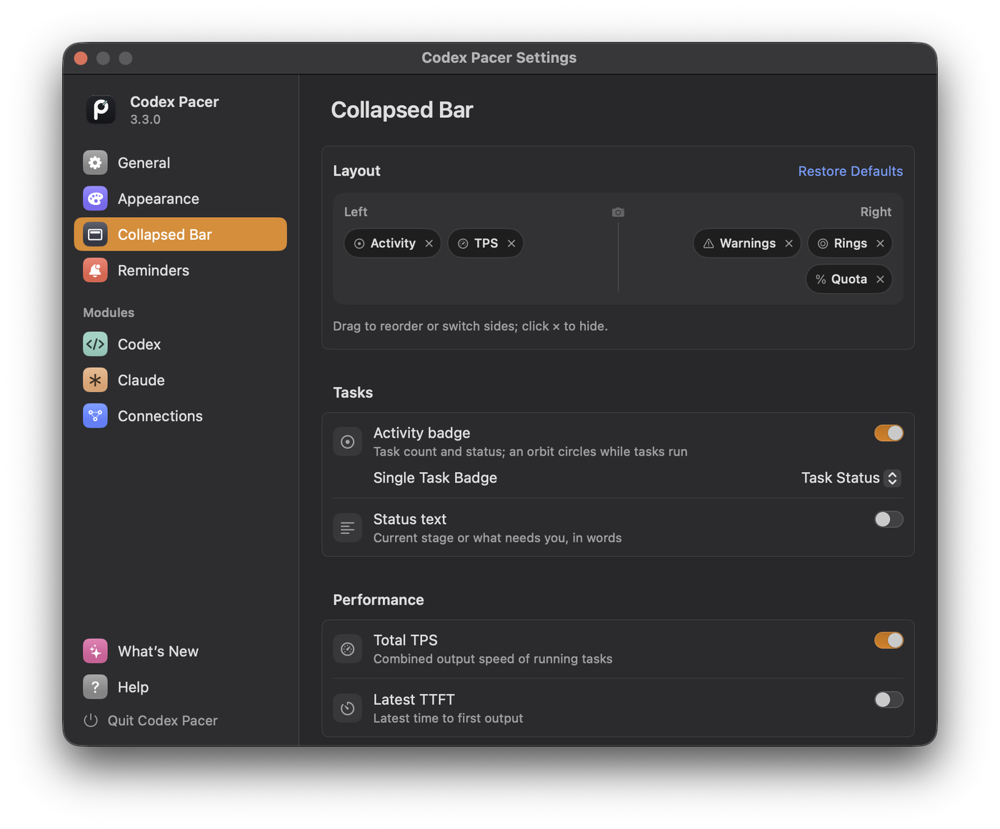
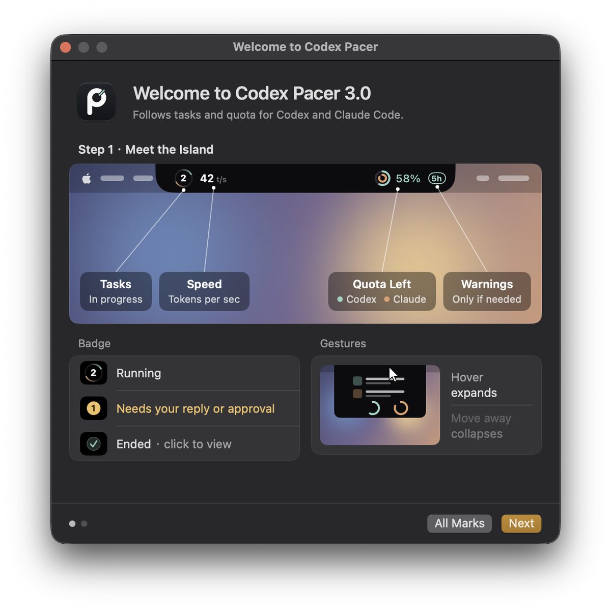

<p align="center">
  
</p>

<h1 align="center">Codex Pacer</h1>

<p align="center">
  A Dynamic Island for your Mac that keeps an eye on <b>Codex</b>, <b>Claude Code</b> and <b>DeepSeek Harness</b>:<br>
  running tasks, output speed, quota pace and balance, right at the notch.
</p>

<p align="center">
  <a href="https://github.com/RyanZhangNTU/codex-pacer/releases/latest"></a>
  
  
  <a href="LICENSE"></a>
</p>

<p align="center">
  <a href="https://github.com/RyanZhangNTU/codex-pacer/releases/latest"><b>Download</b></a>
  &nbsp;·&nbsp; <a href="docs/guide.md">User Guide</a>
  &nbsp;·&nbsp; <a href="README.zh-CN.md">简体中文</a>
</p>


## At a glance

Collapsed, Pacer is a slim bar around the camera that tells you how your agents are doing without opening anything.


| | What it tells you |
| --- | --- |
| **Task badge** | How many tasks are running. An orbit turns while they work, teal for Codex, orange for Claude and blue for DeepSeek. Solid amber means a task is waiting for your reply or approval; a check marks a task that just ended. |
| **Speed** | Combined output of the running tasks, in tokens per second. |
| **Quota** | Remaining quota for Codex and Claude, and the DeepSeek balance or budget. Two rings show the modules you choose; the number alternates between the services. |
| **Warnings** | Appear only when needed: the 5-hour quota is low, an SSH host is disconnected, quota has not updated, or DeepSeek's balance is low, spending spikes or a budget runs out. |

**Hover** to expand, **move away** to collapse, and click the top to keep it open.

## Everything in one panel

- **Every task in one list.** Codex and Claude Code tasks on this Mac, on your SSH hosts and through Codex Remote Control, and DeepSeek Harness tasks on this Mac, each with its current stage, model and reasoning effort, turn time and output speed. Agents a task spawns are grouped under it.
- **Jump back in.** Click a task to open its conversation. An ended task stays as a card until you open it or its retention time passes, so nothing finishes unnoticed.
- **Quota with pace.** Each service has one ring: a shorter upper arc for 5 hours and a longer lower arc for 7 days, each with its own remaining quota, reset countdown and white pace tick. Accounts without a 5-hour limit get a weekly gauge that opens at the bottom. With one service on, its pace, reset time and a forecast sit beside the ring. Switch to the original Classic layout in **Settings → Appearance → Expanded Quota**.
- **DeepSeek by balance or budget.** DeepSeek charges a balance instead of quota windows, so its dial is today on a 24-hour face: what each hour cost, the doubled-price peak hours and the balance in the middle. Switch to daily and weekly budgets and the dial paces them like quota. Pacer checks balance changes against its own estimate, so spend not made on this Mac, such as web searches or another device, counts too, and it warns you when 10 minutes cost more than usual. Each task shows its turn's estimated cost, and with DeepSeek alone the panel adds where today's money went and the last 7 days. The balance comes from a DeepSeek platform sign-in in Pacer's own window or an API key, whichever matches how Harness signs in.
- **History when you want it.** Settings keeps each service's quota curve for the current cycle, plus credits and banked resets when the service reports them.


## Make it yours



- **Arrange the bar.** Drag components between the left and right of the camera, hide what you don't need, choose which module each quota ring shows, and pick 5 hours or 7 days for each service's quota. With DeepSeek alone, a price clock shows the peak hours at a glance.
- **Black or Liquid Glass.** On macOS 26 and later the island can use Liquid Glass, and its clarity follows the system setting.
- **Notch or custom.** Around the notch, or placed yourself on any display: centered below the menu bar or as a narrow strip against the side of the screen in any corner. Full-screen spaces too, if you like.
- **Only what you use.** Turn the Codex, Claude and DeepSeek modules on or off independently.
- **Notifications, if you want them.** macOS notifications when a task needs you or ends, quota or the balance runs low, DeepSeek spending spikes or a budget runs out.
- **In your language.** English and Simplified Chinese.

## Get started



1. [Download the latest release](https://github.com/RyanZhangNTU/codex-pacer/releases/latest) and install it as described below.
2. Open Codex Pacer. A two-step guide explains the island and lets you choose which services to follow and whether Pacer opens at login. You can open it again from **Settings → Help**.
3. To see Claude quota, sign in once in Pacer's own Claude window. Task tracking for Claude Code and SSH hosts sets itself up. For the DeepSeek balance, sign in to the DeepSeek platform in Pacer's window, or paste an API key if Harness uses one.

## Install

Codex Pacer is distributed as a universal DMG signed with Developer ID and notarized by Apple.

1. Double-click the downloaded DMG and drag **Codex Pacer** into **Applications**.
2. Open Codex Pacer from Applications. macOS asks once to confirm an app downloaded from the internet; click **Open**.

After that, Pacer updates itself: it checks daily, installs when you choose to and shows what changed once after an update. **Settings → General → Check for Updates** checks right away. See [Apple's guide to opening apps](https://support.apple.com/102445) for more on Gatekeeper.

## Requirements

- macOS 14 Sonoma or later, on Apple silicon or Intel. Liquid Glass needs macOS 26.
- Codex (app or CLI), Claude Code or DeepSeek Harness, any combination, installed and signed in.
- Python 3 for the setup and SSH helpers; SSH hosts need Python 3.6 or later and non-interactive OpenSSH access.
- For Codex Remote Control tasks, keep the Codex app open and connected to the remote host.

## Privacy

- **Local first.** Pacer has no account and no analytics. It reads the session logs that Codex, Claude Code and DeepSeek Harness already write and keeps only what the island shows: task titles, stages, models, timing and token counts, never the content of your prompts or responses.
- **Your own sign-ins.** Codex quota comes from your Codex CLI. Claude quota comes from Claude Code's status line or a claude.ai session in Pacer's own window. The DeepSeek balance comes from a platform session in Pacer's own window or a key you paste, kept in your keychain. Pacer never reads other apps' Keychain items, credentials or browser cookies.
- **Reversible setup.** For Claude Code, Pacer adds its own hooks and a local-only telemetry endpoint next to your existing settings, and removes them when you turn the Claude module off.
- **Few network requests.** Pacer connects only to your SSH hosts, the services' own quota endpoints and GitHub for updates.
- **Screen sharing.** *Hide Project Names* in Settings replaces task titles on screen.

## Build from source

Requires Xcode 26 or later. Swift Package Manager fetches the only dependency, Sparkle.

```sh
make build                                  # builds the app and prints its path
make test TEST_FILTER='CompletionInboxTests' # runs selected test suites
```

Read [Contributing](CONTRIBUTING.md) to get started, [development notes](docs/development.md) for architecture and data semantics, and [releasing](docs/releasing.md) for packaging. Report security issues privately as described in [SECURITY.md](SECURITY.md).

## License

[MIT](LICENSE). Codex Pacer is an independent project and is not affiliated with OpenAI, Anthropic or DeepSeek. Codex, Claude and DeepSeek are trademarks of their respective owners. Codex Pacer includes the decompression part of [Zstandard](https://github.com/facebook/zstd) (BSD license).
