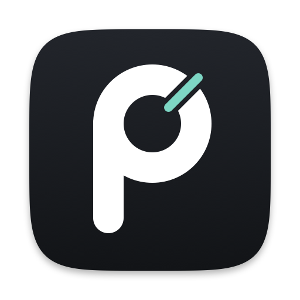
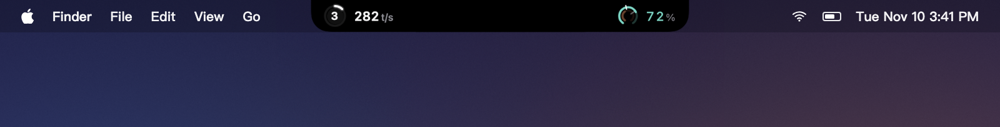
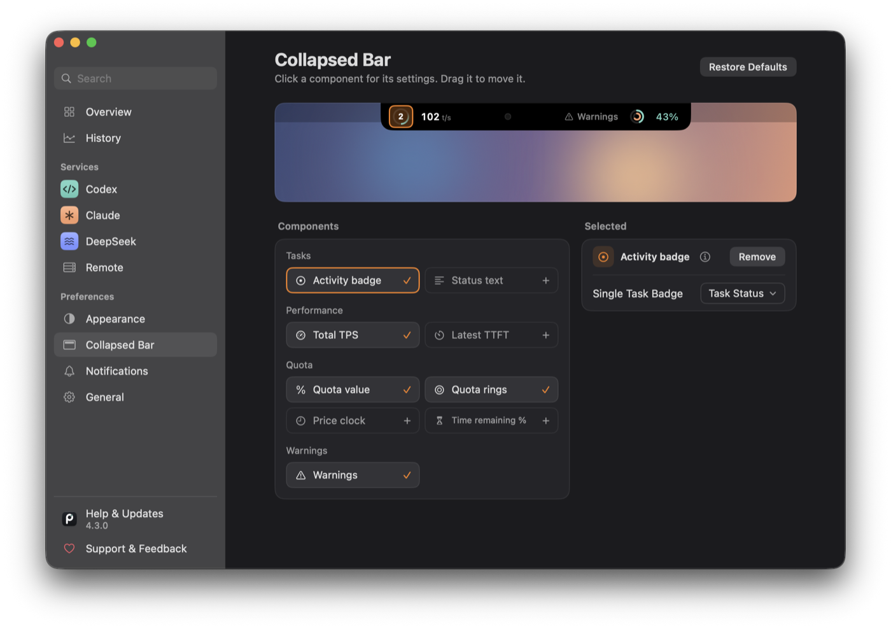

  

<h1 align="center">Codex Pacer</h1>

  A Dynamic Island for <b>Codex</b>, <b>Claude Code</b> and <b>DeepSeek Harness</b>, on Mac and Windows. 
  See every running task, its progress and your quota without leaving what you're doing.

  
  
  
  

  <a href="https://github.com/RyanZhangNTU/codex-pacer/releases/latest"><b>Download</b></a>
  &nbsp;·&nbsp; <a href="docs/guide.md">User Guide</a>
  &nbsp;·&nbsp; <a href="README.zh-CN.md">简体中文</a>

## Features

- **Progress for every task.** Codex, Claude Code and DeepSeek Harness report how much of your request is done. Each task shows it as a ring around its icon, and the collapsed bar can show the average.
- **Every task in one place.** Tasks on this computer, on your SSH hosts, in WSL, through Codex Remote Control and in Claude's cloud Projects, each with its stage, model, speed and turn time.
- **Know when you're needed.** A task waiting for your reply or approval turns the island amber, and a finished task stays until you've seen it. System notifications are optional.
- **Jump back in.** Click a task to open its conversation in the app that runs it.
- **Quota with pace.** Each service's 5-hour and weekly quota on one ring, with a tick that shows whether you're ahead of or behind an even pace, and a forecast for the reset.
- **DeepSeek balance and budgets.** Today's spend on a 24-hour dial with the peak-price hours marked, or daily and weekly budgets paced like quota. Spending elsewhere on your account counts too.
- **Overview and history.** The main window opens on everything that needs you, with each service's quota history.
- **English and Simplified Chinese.**

## Make it yours

Collapsed, Pacer is a slim bar around the camera. **Hover** to expand it, **move away** to collapse it.

- Choose what the bar shows and on which side of the camera, on a live preview.
- Four sizes, and black, graphite or Liquid Glass.
- Keep it at the top center as an island, or drag it anywhere and let it snap to an edge. Each display remembers its own place.

## Install

**Mac.** Download the DMG from the [latest release](https://github.com/RyanZhangNTU/codex-pacer/releases/latest), open it and drag **Codex Pacer** into **Applications**. The app is notarized by Apple.

**Windows.** Download the `x64` installer, or `arm64` on an ARM PC, and run it. No administrator rights are needed. The installer isn't code signed yet, so if SmartScreen appears, choose **More info → Run anyway**.

On first launch a short guide helps you pick a layout and the services to follow. Pacer then updates itself; check any time in **Help & Updates**.

## Requirements

- macOS 14 or later (Apple silicon or Intel), or Windows 10 version 2004 or later (x64 or ARM64). Liquid Glass needs macOS 26 or Windows 11 22H2.
- At least one of Codex, Claude Code or DeepSeek Harness, installed and signed in.
- For SSH hosts: SSH access without a password prompt, and Python 3 on the host.

## Privacy

- No account and no analytics. Pacer reads the logs your agents already write and keeps only what the island shows: task titles, stages, timing and token counts. It never keeps your prompts or replies.
- Claude and DeepSeek sign in inside Pacer's own window. Pacer never reads other apps' passwords or browser cookies.
- Anything Pacer adds to your agents' settings is removed when you turn that feature off.
- **Hide Project Names** keeps task titles off screen when you share it.

## Contributing

Bug reports and ideas are welcome in [Issues](https://github.com/RyanZhangNTU/codex-pacer/issues). To build from source or send a pull request, start with [CONTRIBUTING.md](CONTRIBUTING.md). Report security issues privately as described in [SECURITY.md](SECURITY.md).

## License

[MIT](LICENSE). Codex Pacer is an independent project and is not affiliated with OpenAI, Anthropic or DeepSeek. Codex, Claude and DeepSeek are trademarks of their respective owners. Codex Pacer includes the decompression part of [Zstandard](https://github.com/facebook/zstd) (BSD license).
