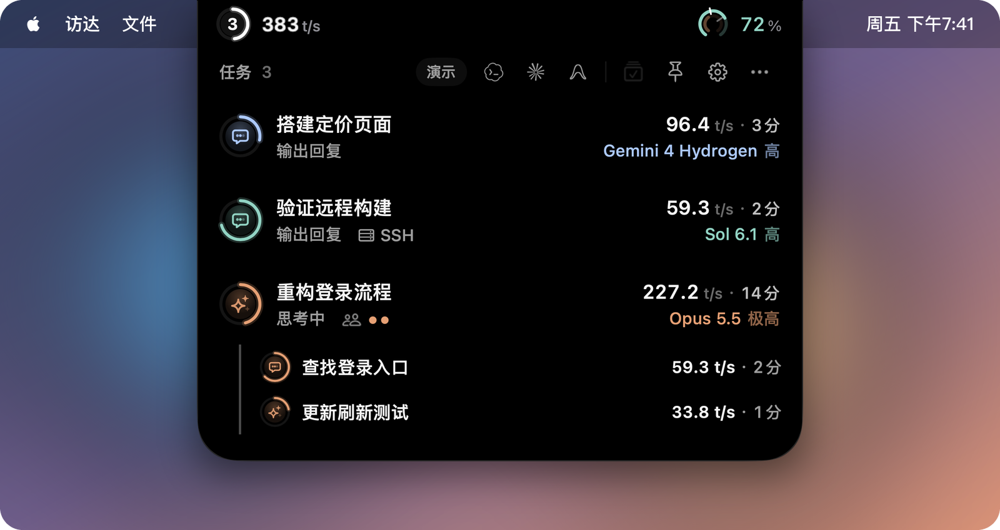
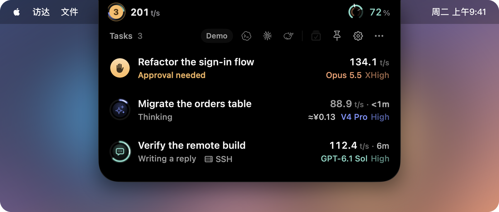
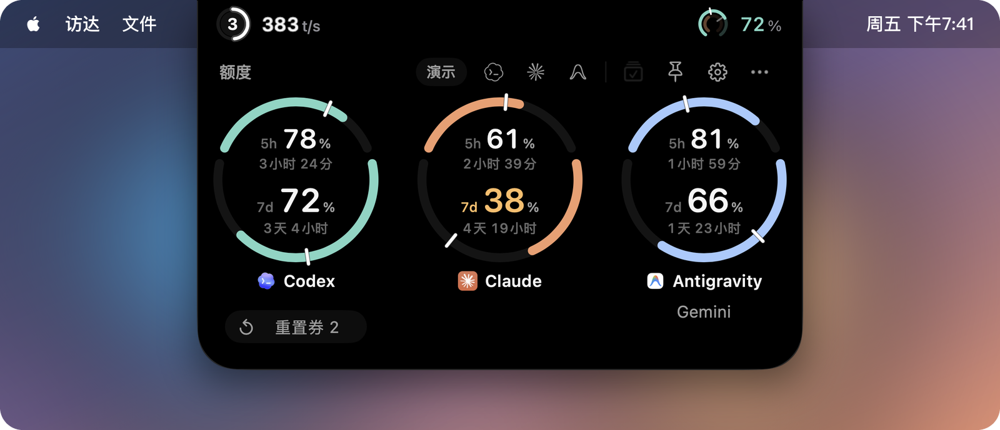
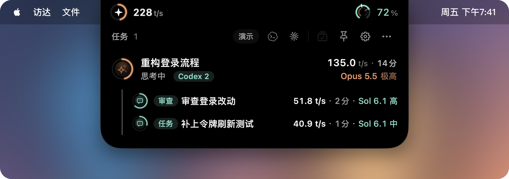
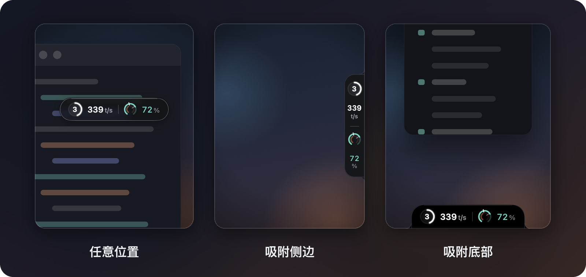

<picture>
  <source media="(prefers-color-scheme: dark)" srcset="docs/assets/readme-title-dark.png">
  
</picture>

<h3>AI Coding 的最佳伴侣</h3>

不用再盯着 Thinking，也不用反复切换窗口看它做到哪了。 
Pacer 替你盯着每个任务的进度，你不再分心，效率自然更高。

<picture>
  <source media="(prefers-color-scheme: dark)" srcset="docs/assets/readme-agents-dark.zh-CN.png">
  
</picture>

&nbsp;

[功能](#features) · [支持的工具](#supported-agents) · [安装](#install) · [使用指南](docs/guide.zh-CN.md) · [交流群](#community) · [English](README.md)

> [!TIP]
> **4.7 新功能：Claude 调用 Codex（Beta）。** 让 Claude Code 请 Codex 审一下改动或接手一个任务，Codex 的进度就显示在 Claude 任务下面。[看看怎么用](#collab)

## 为什么用 Pacer

| 以前 | 现在 |
| --- | --- |
| 盯着“Thinking…”，猜它还要多久 | 圆环走到 56%，先去忙别的 |
| 切回去才发现，它等你批准等了十分钟 | 灵动岛变成琥珀色，点一下就回去 |
| 额度用光了才知道 | 用得太快，提前就知道 |

## 不用再守着终端

Codex、Claude Code、DeepSeek Harness、WorkBuddy 和 Mac 版 Antigravity 会报告你的请求完成了多少，显示为任务图标外的一圈圆环；折叠栏还能显示平均进度。

## 该你出手时，它会举手

任务等你批准或回复时，灵动岛变成琥珀色，这个任务排到最前。做完的任务会一直留着，直到你看过。点一下任务，就回到它所在应用里的对话。

## 几个 AI 一起跑，也不乱

本机、SSH 主机、WSL 和 Claude 云端项目里的任务都在一个列表里，各自显示阶段、模型、速度和本轮用时。

<table>
<thead>
<tr>
<th></th>
<th> Codex</th>
<th> Claude&nbsp;Code</th>
<th> DeepSeek&nbsp;Harness</th>
<th> WorkBuddy</th>
<th> Antigravity (Mac)</th>
</tr>
</thead>
<tbody>
<tr><td nowrap><b>进度圆环</b></td><td align="center">✅</td><td align="center">✅</td><td align="center">✅</td><td align="center">✅</td><td align="center">✅</td></tr>
<tr><td nowrap><b>需要你时提醒</b></td><td align="center">✅</td><td align="center">✅</td><td align="center">✅</td><td align="center">✅</td><td align="center">✅</td></tr>
<tr><td nowrap><b>速度与模型</b></td><td align="center">✅</td><td align="center">✅</td><td align="center">✅</td><td align="center">✅</td><td align="center">✅</td></tr>
<tr><td nowrap><b>点一下就回去</b></td><td align="center">✅</td><td align="center">✅</td><td align="center">✅</td><td align="center">✅</td><td align="center">打开应用</td></tr>
<tr><td nowrap><b>用量</b></td><td align="center">5 小时和每周额度、配速、预测、重置券</td><td align="center">5 小时和每周额度、配速、预测</td><td align="center">余额、今天每小时的花费、预算</td><td align="center">本月积分、额外积分、到期提醒</td><td align="center">按模型组显示短期和每周额度</td></tr>
<tr><td nowrap><b>每轮花费</b></td><td align="center">—</td><td align="center">—</td><td align="center">估算金额</td><td align="center">积分</td><td align="center">—</td></tr>
<tr><td nowrap><b>任务来源</b></td><td align="center">应用、CLI、SSH、WSL¹、Dot 任务</td><td align="center">应用、CLI、SSH、WSL¹、云端项目</td><td align="center">应用、CLI</td><td align="center">WorkBuddy 和 WorkBuddy AI</td><td align="center">Mac 应用</td></tr>
<tr><td nowrap><b>协作</b></td><td align="center">被 Claude 调用</td><td align="center">调用 Codex</td><td align="center">—</td><td align="center">—</td><td align="center">—</td></tr>
</tbody>
</table>

¹ Windows 上。

**更多工具正在适配中。** 想先用上哪一个？[告诉我们](https://github.com/RyanZhangNTU/codex-pacer/issues/new?template=feature_request.yml)。

<b>各家第一次怎么设置</b>

 

第一次打开 Pacer 时，欢迎引导会带你完成这些。

| | 只需一次 |
| --- | --- |
| **Codex** | 在 Codex 里允许 Pacer 的 hooks。额度不需要额外设置。 |
| **Claude Code** | 把正在运行的会话重启一次。在 Pacer 窗口里登录 Claude 才能看额度。 |
| **DeepSeek Harness** | 在 Pacer 窗口里登录 DeepSeek 开放平台，或填入 API key，才能看余额。 |
| **WorkBuddy** | 在 WorkBuddy 里信任 Pacer 的进度工具，Pacer 会一步步告诉你点哪里。登录后能看积分。 |
| **Antigravity（Mac）** | 在 Antigravity 中允许 Pacer 的进度工具，即可显示任务进度。 |
| **SSH 主机** | 能免密码连接，且主机上装有 Python 3。 |

## 额度还剩多少，用得快不快

Codex 和 Claude 一个圆环同时看 5 小时和每周额度，刻度告诉你比匀速快还是慢，还会预计重置时剩多少。DeepSeek 显示余额和今天每小时的花费，也能设预算。WorkBuddy 显示本月积分，以及额外积分什么时候到期。

## Claude 调用 Codex（Beta）

在“设置 → 协作”里打开“Claude 调用 Codex”，然后直接跟 Claude 说，比如“让 Codex 审一下这次改动”。每次 Codex 运行都显示在发起它的 Claude 任务下面，有自己的进度、速度和模型，悬停就能停止。

## 放在哪、长什么样，随你

可以作为灵动岛留在屏幕顶部中央，也可以拖到任意位置，靠近边缘会自动吸附。纯黑、石墨或液态玻璃，四种大小，折叠栏显示什么也由你定。每块屏幕单独记住位置。

## 安装

<table>
<tr>
<td width="50%" valign="top">

打开 DMG，把 **Codex Pacer** 拖入“应用程序”。

macOS 14 及以上，Apple 芯片或 Intel。已通过 Apple 公证。

</td>
<td width="50%" valign="top">

运行 `x64` 安装包，ARM 电脑用 `arm64`。无需管理员权限。

Windows 10 2004 及以上，x64 或 ARM64。

</td>
</tr>
</table>

> [!NOTE]
> Windows 安装包暂未做代码签名。如果出现 SmartScreen 提示，点**更多信息 → 仍要运行**。

首次打开时，简短的引导会帮你选择摆放方式和要追踪的工具，之后 Pacer 会自动更新。需要已安装并登录 Codex、Claude Code、DeepSeek Harness、WorkBuddy 或 Antigravity（Mac）中的至少一个。液态玻璃需要 macOS 26 或 Windows 11 22H2。

## 交流群

<table>
<tr>
<td width="200" align="center">

</td>
<td valign="middle">

**QQ 群：[1131553244](https://qm.qq.com/q/5AieQJsCWY)**

用 QQ 扫码，或搜索群号加入。使用问题、新功能想法都可以在群里聊。

问题和建议也欢迎在 [Issues](https://github.com/RyanZhangNTU/codex-pacer/issues/new/choose) 中反馈。

</td>
</tr>
</table>

## 隐私

- **没有账号，不做统计上报。** Pacer 读取代理本来就会写下的日志，只保留灵动岛要显示的内容：任务标题、阶段、时间和 token 数，从不保存你的提示词或回复。
- **登录只在 Pacer 里。** Claude、DeepSeek 和 WorkBuddy 在 Pacer 自己的窗口里登录。Pacer 不读取其他应用的密码或浏览器 Cookie。
- **不留痕迹。** Pacer 添加到代理设置里的内容，关闭对应功能时会一并移除。共享屏幕时，“隐藏项目名称”会把任务标题从屏幕上隐去。

## Star 趋势

<a href="https://star-history.com/#RyanZhangNTU/codex-pacer&Date">
  <picture>
    <source media="(prefers-color-scheme: dark)" srcset="https://api.star-history.com/svg?repos=RyanZhangNTU/codex-pacer&type=Date&theme=dark">
    
  </picture>
</a>

## 参与贡献

想从源码构建或提交 PR，请先阅读 [CONTRIBUTING.md](CONTRIBUTING.md)。安全问题请按 [SECURITY.md](SECURITY.md) 私下报告。

 

[MIT](LICENSE)。Codex Pacer 是独立项目，与 OpenAI、Anthropic、DeepSeek 和腾讯无关。 Codex、Claude、DeepSeek 和 WorkBuddy 是其各自所有者的商标。Codex Pacer 包含 [Zstandard](https://github.com/facebook/zstd) 的解压部分（BSD 许可）。

[回到顶部 ↑](#readme-top)

