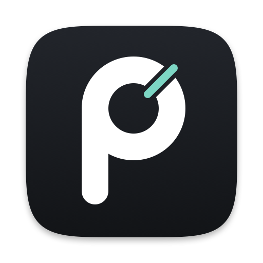
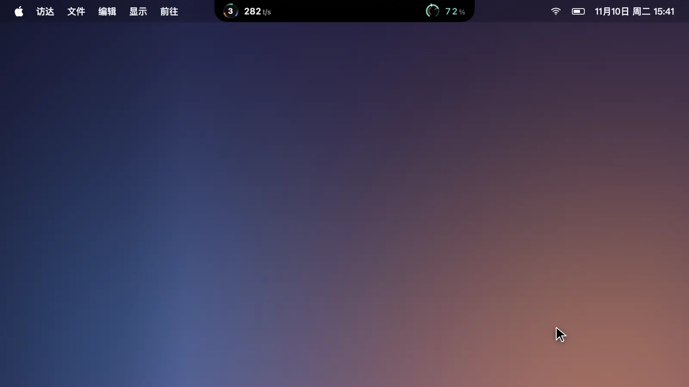
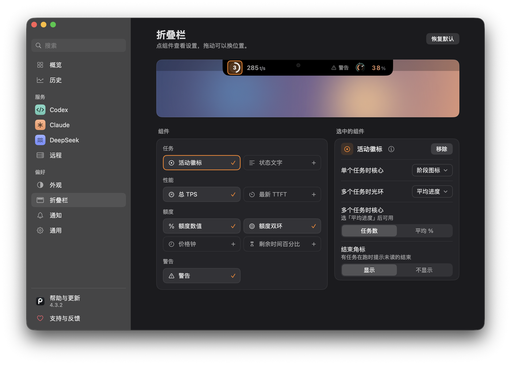

  

<h1 align="center">Codex Pacer</h1>

  为 <b>Codex</b>、<b>Claude Code</b> 和 <b>DeepSeek Harness</b> 打造的灵动岛，支持 Mac 和 Windows。 
  正在运行的任务、进度和额度，抬眼就能看到，不用打断手头的事。

  
  
  
  

  <a href="https://github.com/RyanZhangNTU/codex-pacer/releases/latest"><b>下载</b></a>
  &nbsp;·&nbsp; <a href="docs/guide.zh-CN.md">使用指南</a>
  &nbsp;·&nbsp; <a href="README.md">English</a>

## 功能

- **每个任务都有进度。** Codex、Claude Code 和 DeepSeek Harness 会报告你的请求完成了多少，显示为任务图标外的一圈圆环；折叠栏还能显示平均进度。
- **所有任务都在一处。** 本机、SSH 主机、WSL、Codex Remote Control 和 Claude 云端项目里的任务，都显示当前阶段、模型、速度和本轮用时。
- **需要你时会提醒。** 任务等你回复或审批时，灵动岛变成琥珀色；任务结束后会一直留着，直到你看过为止。也可以开启系统通知。
- **一点就回到对话。** 点击任务，在运行它的应用里打开对应对话。
- **额度带配速。** 每个服务一个圆环，同时显示 5 小时和每周额度；刻度告诉你用得比匀速快还是慢，并预计重置时还剩多少。
- **DeepSeek 余额与预算。** 用 24 小时钟面显示今天的花费，并标出高峰价时段；也可以设每日、每周预算，像额度一样显示配速。账户在别处产生的花费也会算进去。
- **概览与历史。** 主窗口一打开就是需要你处理的事，还能查看每个服务的额度历史。
- **支持简体中文和英文。**

## 按你的习惯来

折叠时，Pacer 是摄像头两侧的一条细栏。**悬停**展开，**移开**收起。

- 在实时预览上选择折叠栏显示哪些内容、放在摄像头哪一侧。
- 四种大小，纯黑、石墨或液态玻璃材质。
- 可以作为灵动岛留在顶部中央，也可以选“自由拖动”放到任意位置，靠近屏幕边缘会自动吸附。每块屏幕单独记住位置。

## 安装

**Mac。** 从[最新版本](https://github.com/RyanZhangNTU/codex-pacer/releases/latest)下载 DMG，打开后把 **Codex Pacer** 拖入“应用程序”。应用已通过 Apple 公证。

**Windows。** 下载 `x64` 安装包（ARM 电脑下载 `arm64`）并运行，无需管理员权限。安装包暂未做代码签名，如果出现 SmartScreen 提示，点**更多信息 → 仍要运行**。

首次打开时，简短的引导会帮你选择摆放方式和要追踪的服务。之后 Pacer 会自动更新，也可以随时在“帮助与更新”中检查。

## 系统要求

- macOS 14 及以上（Apple 芯片或 Intel），或 Windows 10 2004 及以上（x64 或 ARM64）。液态玻璃需要 macOS 26 或 Windows 11 22H2。
- 已安装并登录 Codex、Claude Code 或 DeepSeek Harness 中的至少一个。
- 使用 SSH 主机时：能免密码连接，且主机上装有 Python 3。

## 隐私

- 没有账号，不做统计上报。Pacer 读取代理本来就会写下的日志，只保留灵动岛要显示的内容：任务标题、阶段、时间和 token 数，从不保存你的提示词或回复。
- Claude 和 DeepSeek 在 Pacer 自己的窗口里登录。Pacer 不读取其他应用的密码或浏览器 Cookie。
- Pacer 添加到代理设置里的内容，关闭对应功能时会一并移除。
- 共享屏幕时，“隐藏项目名称”会把任务标题从屏幕上隐去。

## 参与贡献

欢迎在 [Issues](https://github.com/RyanZhangNTU/codex-pacer/issues) 中反馈问题和建议。想从源码构建或提交 PR，请先阅读 [CONTRIBUTING.md](CONTRIBUTING.md)。安全问题请按 [SECURITY.md](SECURITY.md) 私下报告。

## 许可证

[MIT](LICENSE)。Codex Pacer 是独立项目，与 OpenAI、Anthropic 和 DeepSeek 无关。Codex、Claude 和 DeepSeek 是其各自所有者的商标。Codex Pacer 包含 [Zstandard](https://github.com/facebook/zstd) 的解压部分（BSD 许可）。
