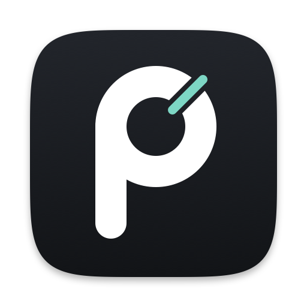
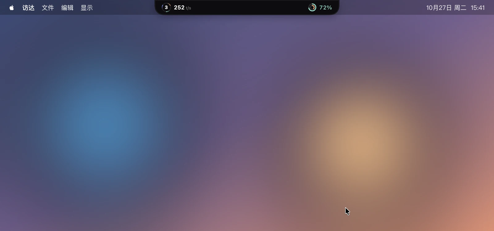
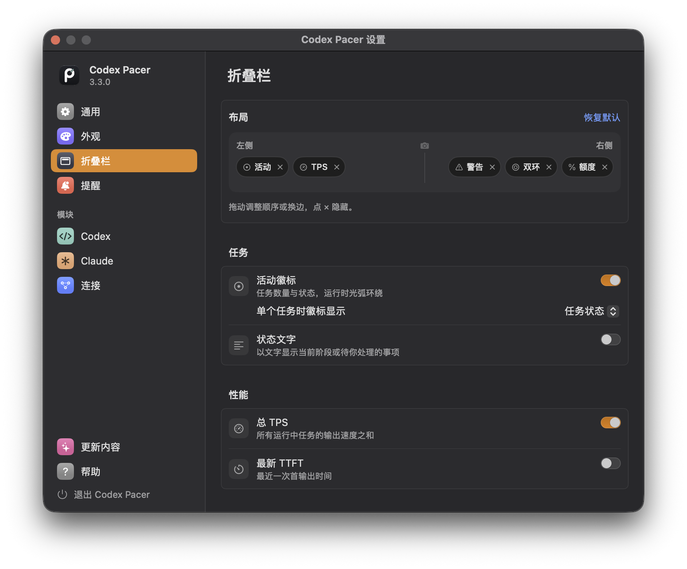
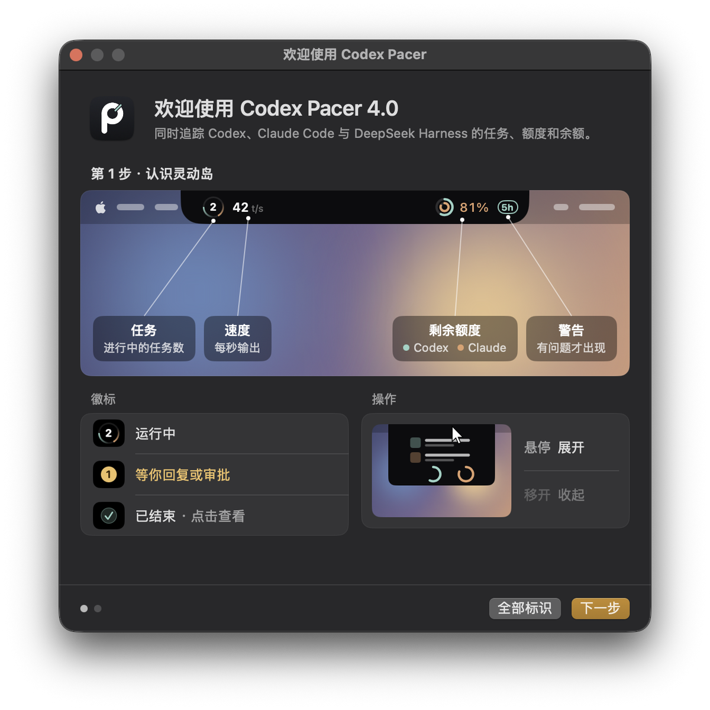

<p align="center">
  
</p>

<h1 align="center">Codex Pacer</h1>

<p align="center">
  Mac 上的灵动岛，帮你盯着 <b>Codex</b> 和 <b>Claude Code</b>：<br>
  正在运行的任务、输出速度和额度配速，抬眼就能看到。
</p>

<p align="center">
  <a href="https://github.com/RyanZhangNTU/codex-pacer/releases/latest"></a>
  
  
  <a href="LICENSE"></a>
</p>

<p align="center">
  <a href="https://github.com/RyanZhangNTU/codex-pacer/releases/latest"><b>下载</b></a>
  &nbsp;·&nbsp; <a href="docs/guide.zh-CN.md">使用指南</a>
  &nbsp;·&nbsp; <a href="README.md">English</a>
</p>



## 一眼看清

折叠时，Pacer 是摄像头两侧的一条细栏，不用展开就知道代理们进展如何。


| | 含义 |
| --- | --- |
| **任务徽标** | 正在运行的任务数。任务进行时有光弧环绕，青绿色是 Codex，暖橙色是 Claude。变成实心琥珀色表示有任务等你回复或审批；出现对勾表示有任务刚刚结束。 |
| **速度** | 所有运行中任务的合计输出速度，单位为 token/秒。 |
| **额度** | Codex 与 Claude 的剩余额度。双环同时显示两者，数值在两者之间交替。 |
| **警告** | 有问题时才出现：5 小时额度不足、SSH 主机未连接，或额度没有按时更新。 |

**悬停**展开，**移开**收起，点击顶部可以固定展开。

## 一个面板看全部

- **所有任务一个列表。** 本机、SSH 主机以及 Codex Remote Control 上的 Codex 与 Claude Code 任务，都显示当前阶段、已运行时长、输出速度和首输出时间。任务派生的子代理归在它下面。
- **一点就回到对话。** 点击任务打开对应会话。任务结束后会保留一张卡片，直到你打开它或保留时间到期，不会错过任何一次结束。
- **额度带配速。** 每个圆环显示 7 天窗口的剩余额度；白色刻度标出按时间均匀使用时应剩的位置，旁边标注“充裕”“正常”或“偏快”，下方是 5 小时窗口和重置倒计时。
- **需要时再看历史。** 设置里保留每个服务当前周期的额度曲线；服务提供时，还能看到 Credit 和重置券。

## 按你的习惯来



- **自定义折叠栏。** 在摄像头左右两侧拖动组件、隐藏不需要的组件，并为每个服务选择显示 5 小时还是 7 天额度。
- **纯黑或液态玻璃。** macOS 26 及以上可使用液态玻璃，通透程度跟随系统设置。
- **刘海或悬浮。** 可选自动、刘海或悬浮，任意显示器都能用，也可以在全屏空间中显示。
- **只开需要的模块。** Codex 和 Claude 模块可以分别开启或关闭。
- **通知随你。** 可选择在任务需要你处理、任务结束或额度不足时发送 macOS 通知。
- **支持中英文。** 简体中文与英文。

## 开始使用



1. [下载最新版本](https://github.com/RyanZhangNTU/codex-pacer/releases/latest)，按下方步骤安装。
2. 打开 Codex Pacer。两步入门引导会介绍灵动岛，并让你选择要追踪的服务以及是否登录时打开。之后可以在“设置 → 帮助”中再次打开。
3. 想看 Claude 额度，只需在 Pacer 自带的 Claude 窗口中登录一次。Claude Code 和 SSH 主机上的任务追踪会自动配置好。

## 安装

Codex Pacer 以通用 DMG 发布，已使用 Developer ID 签名并通过 Apple 公证。

1. 双击下载的 DMG，把 **Codex Pacer** 拖入“应用程序”。
2. 从“应用程序”中打开 Codex Pacer。macOS 会询问一次是否打开从互联网下载的应用，点击“打开”即可。

之后 Pacer 会自行更新：每天检查一次，由你决定何时安装，更新后会显示一次更新内容。在“设置 → 通用 → 检查更新”中可以立即检查。关于 Gatekeeper 的更多说明见 [Apple 支持文档](https://support.apple.com/zh-cn/102445)。

## 系统要求

- macOS 14 Sonoma 及以上，Apple 芯片或 Intel。液态玻璃需要 macOS 26。
- 已安装并登录 Codex（应用或 CLI）、Claude Code，或两者都有。
- 配置工具和 SSH helper 需要 Python 3；SSH 主机需要 Python 3.6 及以上，并能免交互地通过 OpenSSH 连接。
- 追踪 Codex Remote Control 任务时，需要保持 Codex 应用开启并连接到远程主机。

## 隐私

- **本地优先。** Pacer 没有账号，也不做任何统计上报。它读取 Codex 和 Claude Code 本来就会写下的会话日志，只保留灵动岛需要显示的内容：任务标题、阶段、时间和 token 数，从不保存你的提示词或回复内容。
- **用你自己的登录。** Codex 额度通过你的 Codex CLI 读取；Claude 额度来自 Claude Code 的状态栏数据，或 Pacer 专用窗口中的 claude.ai 会话。Pacer 不读取其他应用的钥匙串条目或浏览器 Cookie。
- **配置可以撤回。** 对于 Claude Code，Pacer 会在你现有设置旁追加自己的 hooks 和仅限本机的遥测端点；关闭 Claude 模块时会移除这些内容。
- **很少的网络请求。** Pacer 只连接你的 SSH 主机、各服务自己的额度接口，以及用于检查更新的 GitHub。
- **共享屏幕时。** 设置中的“隐藏项目名称”会替换屏幕上的任务标题。

## 从源码构建

需要 Xcode 26 及以上。Swift Package Manager 会拉取唯一的依赖 Sparkle。

```sh
make build                                  # 构建应用并输出路径
make test TEST_FILTER='CompletionInboxTests' # 运行指定的测试套件
```

参与开发请先阅读[贡献指南](CONTRIBUTING.md)，架构和数据语义见[开发说明](docs/development.md)，打包发布见[发布流程](docs/releasing.md)。安全问题请按 [SECURITY.md](SECURITY.md) 私下报告。

## 许可证

[MIT](LICENSE)。Codex Pacer 是独立项目，与 OpenAI 和 Anthropic 无关。Codex 和 Claude 是其各自所有者的商标。
