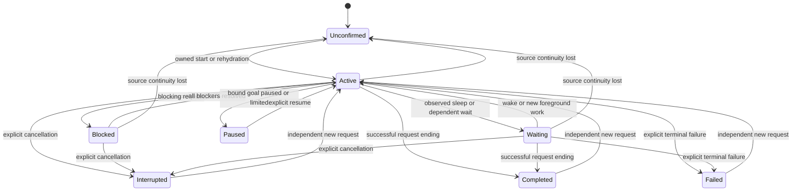

# Codex task lifecycle and progress ring proposal

The implementation is based on `develop` at `194b59d`, which has the shared Claude ring on both Windows and macOS. Codex uses those renderers with its own setting and reporting tool. The state model distinguishes a user's request from the Codex turns that serve it.

The number should remain the model's estimate of the current request, as it does for Claude. Token consumption, elapsed time, completed tools and checklist steps do not establish a completion percentage.

The [Chinese state and animation mapping](codex-task-state-animation.zh-CN.md) specifies task icons, ring modes, transition timing and acceptance examples.

## Baseline research

The findings below describe Pacer `5cadcbb` before implementation. The installed npm CLI reported `0.166.0`; the Desktop-bundled executable reported `0.167.0-alpha.3.2`. Both generated their app-server TypeScript definitions with an isolated `CODEX_HOME`. The public source baseline is [Codex 0.166.0 at commit 6ff1e1c](https://github.com/openai/codex/tree/6ff1e1ca3b30fc8b914720681fcf5fe62e95f856). The Desktop binary is a separate build; its generated protocol does not establish the shape of private Desktop IPC snapshots.

| Finding | Evidence and consequence |
| --- | --- |
| The shared ring already supports provider selection. | `TaskPresentationOptions.progressRingProviders` and `TaskProgressRing.make` accept Codex. `PacerEngine` currently enables only Claude. Windows already renders the projected fields. |
| macOS needs a renderer as well as settings wiring. | The current `PacerIsland/TaskRowView.swift` draws `StatusGlyph` without consuming `presentation.progressRing`. The remote Mac progress-ring branch is outside this baseline. |
| Live failures are handled, but log failures lose their outcome. | `SessionActivity.consumeLive` recognizes `turn/completed.status == failed`. Its log path treats every `task_complete` as completed and clears `turnFailed`. Codex's [TurnCompleteEvent](https://github.com/openai/codex/blob/6ff1e1ca3b30fc8b914720681fcf5fe62e95f856/codex-rs/protocol/src/protocol.rs#L2373) includes an optional terminal `error`. `SessionLogProbe.sanitize` also discards it. |
| Modern logs carry more than raw response items. | Codex's [rollout persistence policy](https://github.com/openai/codex/blob/6ff1e1ca3b30fc8b914720681fcf5fe62e95f856/codex-rs/rollout/src/policy.rs#L128) persists `item_completed` items in paginated history. Pacer currently uses those records only for first-output timing of reasoning/messages. Sleep, tool and progress-report items need separate bounded projections. |
| Request lineage exists but is discarded. | [TurnStartedEvent and TurnAttribution](https://github.com/openai/codex/blob/6ff1e1ca3b30fc8b914720681fcf5fe62e95f856/codex-rs/protocol/src/turn_input.rs#L81) carry root/parent/trigger attribution. `SessionLogProbe`, `RealtimeProbe` and `DesktopWireProjection` currently omit the relevant lineage. Root lineage can cross threads, so it cannot by itself authorize a child's percentage to update its parent. |
| Sleep is observable without guessing from text. | Both installed schemas include a `sleep` item. Codex's [sleep handler](https://github.com/openai/codex/blob/6ff1e1ca3b30fc8b914720681fcf5fe62e95f856/codex-rs/core/src/tools/handlers/sleep.rs#L102) emits item start/end around an interruptible sleep. Pacer's tool classification omits it, along with image generation and context compaction. |
| Goals introduce a lifecycle above turns. | The [goal status enum](https://github.com/openai/codex/blob/6ff1e1ca3b30fc8b914720681fcf5fe62e95f856/codex-rs/protocol/src/protocol.rs#L4306) includes active, paused, blocked, usageLimited, budgetLimited and complete. Pacer has no goal projection. |
| A checklist update is available, but optional. | [The update_plan handler](https://github.com/openai/codex/blob/6ff1e1ca3b30fc8b914720681fcf5fe62e95f856/codex-rs/core/src/tools/handlers/plan.rs#L87) sends a checklist update and rejects the tool in Plan mode. It cannot provide a universal progress denominator. |
| Async attention is already independent of execution. | `CodexLogAttention` and Desktop request projection can show a question while work continues. The ring currently receives the effective phase but not that independent attention set. |

Nine synthetic checks exercised the existing Python functions embedded in `SessionLogProbe.swift` and `RealtimeProbe.swift`. They confirmed loss of log terminal errors, log lineage, paginated sleep, paginated MCP reports, live lineage, live checklist updates, live goal updates and live MCP arguments; live failed status survived. These are parser characterizations, not an end-to-end Codex or UI test.

## Complete the request state model

Keep the existing `ActivityPhase` wire values for physical turn execution. Add a Codex request reducer in Core that holds execution, attention, continuation evidence and progress independently. Its immutable snapshot supplies task grouping, the completion inbox and row presentation. Request scope is explicit: one turn, a verified continuation chain, or a bound goal. An active goal's failed attempt can update the turn outcome while the goal remains open; it must not silently end the goal request.

Add optional request-lifecycle and reporting-capability fields to the engine row where the existing phase cannot express the distinction. A paused goal must not be encoded as a fabricated input request or successful turn. Update `ActivityTaskGroup`, `ActivityOverview`, completion notification policy and `CompletionInbox` together so the task count, ending card and ring agree.

The proposed request identity is `(provider, source namespace, owning thread, request generation)`. Reuse the source-home/account namespace rules used by `CompletionInbox`. Bind the generation to verified root-turn attribution when available; otherwise use the observed owning turn. Keep the active turn ID and per-item IDs separately. Never infer ownership from the most recently active chat, a filename alone, or a root ID shared by a child.

A newly typed request that starts independent work resets its estimate. A steer, an answer to the current question or a verified continuation can revise the existing request, including lowering its estimate. Compaction and reconnect do not create a request. Where attribution is absent, keep turn-scoped behavior instead of carrying a number across an unproven boundary. Label that completion as the observed turn ending; do not claim that unobserved background work or an objective has finished.

| Request state | Entry evidence | Exit and presentation |
| --- | --- | --- |
| Unconfirmed | Initial discovery, connection loss, invalid revision, unsupported snapshot, `notLoaded` or `systemError` without an authoritative ending | Rehydrate from a verified snapshot or owned log anchor. Hide live ring motion; preserve a previously verified ending. |
| Starting | Owned `task_started`, `turn/started`, or active runtime metadata | Enter the observed work stage. Active metadata without a turn ID may show the pending comet; it cannot accept a numeric report yet. |
| Thinking or responding | Reasoning/message lifecycle or generated-text presence | `working`; preserve the estimate. Commentary, partial answers and final-answer items do not independently end a turn. |
| Executing | Non-reporting tool start; outstanding tool IDs form a bounded set | Return to work only when matching items finish. A tool failure or declined approval does not itself fail the request. |
| Long step | The oldest outstanding ordinary tool has run for at least 30 seconds | `longStep`. Keep each item's start time so completing an older parallel tool updates the threshold correctly. |
| Blocking on a person | Runtime waiting flags, a synchronous input call, or a verified blocking approval request | `attention`. Track approval and input blockers as a set; resolving one cannot clear another. Preserve the estimate. |
| Async question outstanding | An accepted async question or matching Desktop request | Preserve execution and expose attention separately. Use the attention ring style while keeping the task's running stage and rate. Clear by request identity, reply or authoritative ending. |
| Sleeping or awaiting dependent work | An active sleep item, a blocking agent-wait operation, or verified same-request continuation evidence | `waiting` only while there is no foreground generation or ordinary tool execution. Preserve the estimate; resume on matching wake/work evidence. |
| Retrying | A correlated retryable error, including `willRetry: true` | Keep the request active and its estimate intact. Resume on activity; only a terminal outcome can fail it. |
| Compacting | Context-compaction item or correlated compact hooks | Keep the same request and estimate. Show the observed work/wait stage; compaction is not an ending. |
| Goal paused, blocked or limited | A verified goal belonging to the displayed request, after any active foreground turn settles | Static ring with the last estimate and an explicit status. A new `paused` ring mode distinguishes this from an automatic wake or a failed turn. While foreground work continues, retain its execution stage and annotate the goal status. A held goal leaves the list 15 minutes after the turn ends. A continuation after that deadline starts fresh. |
| Completed | An owned successful terminal turn with no verified continuation, or completion of the bound goal after its active work settles | `done`, sweep to 100%, publish one request completion. The estimate never delays a verified ending. |
| Interrupted or failed | Explicit `interrupted`/`turn_aborted`, or `failed`/valid terminal log error, ending the displayed request scope | Keep the last estimate, stop looping motion and retain the existing ending card behavior. Without an estimate, keep the status icon. A physical attempt ending inside an active bound goal updates that attempt without declaring the goal ended. |

Normal execution and independent attention are concurrent facts. Derive ring style in this order: authoritative request ending; unconfirmed source; blocking/async attention; explicit goal pause/limit; proven wait without foreground work; long ordinary tool; ordinary work. Retain the separate status text so an async question does not erase a running build.



This diagram shows execution transitions. Pending async questions overlay any active state; the table specifies compaction, retry and goal details.

### Terminal and continuation rules

1. `item/completed`, a final-answer item, `Stop`, thread idle, a quiet stream, a surviving process and a percentage of 100 cannot establish request completion. [OpenAI's app-server contract](https://learn.chatgpt.com/docs/app-server#events) separates item and turn lifecycle and reports retry errors without ending the turn.
2. Normalize `task_complete.error` into a bounded terminal-error flag; do not retain its message. An explicit failed live status and a terminal log error must produce the same result. A `turn_aborted` carrying error details remains interrupted when that is the explicit upstream outcome.
3. A root-turn ID groups causally related work; it does not promise a future wake or certify that all work is finished. Suppress an intermediate completion only when an active bound goal, owned dependent work or another verified continuation establishes that the request remains open. Detached agents and unrelated scheduled tasks must not hold it open indefinitely.
4. A goal is thread scoped. Bind it explicitly to the request being displayed; ignore historical/unrelated goals. `goal complete` does not override a still-active physical turn. Clearing a goal is a scope change, not evidence that its objective succeeded. Its token-budget ratio is never completion progress.
5. Preserve existing source and retired-turn guards. A stale completion, child report, orphan item or replay cannot revive or replace a newer request. Reconnection hydrates state without replaying old completion notifications.
6. Keep progress, background-work and lifecycle ordering separate. A delayed numeric report can enrich its matching request without advancing `lastObserved`, extending retention, clearing attention or overriding newer lifecycle evidence. A carried estimate keeps its original freshness time.
7. Evaluate a family ring against the owning request and its dependent members. A parent's ended turn with a still-active dependent child must not sweep the family to full. Do not average child percentages or accept child tool calls as the parent's estimate.

## Numeric reporting through Codex MCP

The optional `pacer_progress` stdio MCP server exposes one `report_progress` tool. It accepts an integer `percent` from 0 to 100. Booleans, fractions, strings, values outside the range and extra properties are rejected.

The reporting path is shown below.

```text
MCP tool description  -> report_progress(percent)
Completed MCP item      -> exact server/tool and success check
                         -> source/thread/turn validation
Core progress update    -> owning request reducer
                         -> ActivityTaskRowPresentation
                         -> Windows ring / macOS ring
```

The tool description and MCP initialization response ask for an estimate with the first useful tool batch, after meaningful progress and before a long wait. Short replies can skip the call. The reporter acknowledges the estimate. Pacer associates the call with its source, thread and turn using Codex's own events.

Pacer takes a successful report from a matching completed MCP item, or pairs the exact namespaced legacy function call with the successful tool result. It recognizes both paginated `event_msg.item_completed` and legacy `response_item` shapes. The successful result was verified in real Codex rollouts. A call that is rejected, lacks turn ownership or has a bad argument never becomes an estimate. The reporting call does not count as an ordinary tool step. Pacer's progress projection keeps only bounded identifiers, timestamps and the integer estimate.

Pacer uses explicit sleeps, agent waits and bound goal status to recognize Codex background work.

`turn/plan/updated` may support a separate `N of M checklist steps` detail later. It should neither supply this ring's number nor be confused with plan-mode text. A leading text marker would require a verified display-removal facility; do not introduce one into Codex's visible answers as the default reporting channel.

### Setup and source support

The `codexProgressRing` preference is off by default and independent of `claudeProgressRing`. Enabling it registers Pacer's bundled stdio MCP server in the selected local home. The MCP tool description tells Codex when to report.

The registration sets `omit_tools_from = ["deferred"]`. Codex 0.166 defers MCP tools for models whose metadata has `supports_search_tool`. Such a model finds a deferred tool only through `tool_search`. A `code_mode_only` model is told about it only when `deferred_tool_world_state` is on, which Codex Desktop enables through a remote experiment and the CLI leaves off. A custom provider (a third-party API) with an OpenAI model name uses the bundled catalog, so those sessions never reported. Without the deferred surface, the tool stays in the request's tool list, or in the `exec` description for code-mode models. An owned entry written before this setting is updated in place. Pacer uses Codex's versioned config API to update or remove the entry it owns. Turning the switch off, or choosing another home, stops reporting in the profile it leaves before Codex answers, and a setup still waiting on Codex cannot turn reporting back on. Setup status and retry are in the Codex settings pane. [Codex task progress](codex-progress-setup.md)

Windows deploys the reporter and its pinned Python interpreter to a separate user-data cache. An open Codex session can hold that interpreter while Pacer's installer replaces the application. Uninstall disables cached reporters and removes the owned MCP entry from each recorded profile.

Pacer's observer remains passive: it must not start a turn, answer an approval or replace the user's Desktop app-server connection to inject a tool. A new app-server child would observe its own runtime, not automatically the existing Desktop task. Keep quota RPC separate.

| Source | Initial support | Required validation |
| --- | --- | --- |
| Local CLI and local-execution Desktop | Request states from existing logs and runtime. New local sessions load Pacer's MCP tool. | Test each executable independently. Verify reload behavior, tool discovery, turn metadata and both history formats. |
| SSH and WSL | Same Core reducer; reporting after setup on the execution host | The remote probes forward the sanitized numeric evidence. Real remote-host lifecycle and setup still need host validation. |
| Remote Control | Observable lifecycle and the pending comet when no report is visible | Numeric support requires the allowlisted completed item in the forwarded snapshot or patch. The projection handles it when present; an actual Remote Control session was not tested here. |
| Hosted or cloud-orchestrated execution | Observable lifecycle and pending ring where the existing collector has evidence | Local hooks/MCP availability is not implied by a visible task. [OpenAI documents restrictions on local hooks under cloud orchestration](https://learn.chatgpt.com/docs/extend/mcp#use-mcp-backed-tools-in-chatgpt-web). Advertise numeric support only after an actual supported route is verified. |

Desktop IPC remains private and version sensitive. Preserve version/revision/owner checks and bounded snapshot recovery. The [snapshot-loss investigation](diagnostics/codex-desktop-ipc.md) demonstrates why a connected socket cannot establish complete observation. Expose reporting capability separately from connection status; source failure must not become task failure or success.

## Ring behavior and implementation boundaries

Reuse `pending` and `reported`, with existing working, longStep, attention, waiting, done, interrupted and failed modes. Add a static paused mode for explicitly paused/blocked/limited goals. An unconfirmed source stops live motion and exposes its source status rather than manufacturing an ending.

- No valid estimate: the pending comet circles while observed work is active. A turn ID is required to accept a number, not to display metadata-confirmed pending work.
- Valid estimate: draw the reported fraction, including a later lower value. After 120 seconds without a report, fade only ordinary working mode. Long tools, explicit waits and attention keep the last estimate readable.
- Explicit successful request ending: sweep to full even if no estimate arrived. An active estimate of 100 may fill the numeric arc, but retains its active icon and triggers no completion pulse or notification.
- Interruption/failure: preserve the last estimate, with no completion sweep. Explicit goal pause/limits remain static and use their own labels.
- Windows: reuse `TaskProgressRing.cs`, `AnimationLease` and the real-clock continuity fixes. Verify Codex's provider color and transitions through an actual WPF window, including unload and reduced motion.
- macOS: reuse the renderer from `develop`, with the same Codex setting and completion-only pulse rule. The loopback check below drives the actual Mac app as well as the Windows engine.

The implementation is split across these boundaries:

| Step | Files and behavior | Completion criterion |
| --- | --- | --- |
| Lifecycle evidence | `Activity.swift`, `RuntimeItemKind.swift`, `SessionLogProbe.swift`, `RealtimeProbe.swift`, `DesktopWireProjection.swift` | Normalize terminal failures, owned waits and per-item timing. Keep existing attention, retired-turn and source-continuity checks. |
| Request and progress state | `CodexProgressEvidence.swift`, `SessionActivity`, `ActivitySourceMerger.swift` and task presentation | Merge the estimate without choosing the lifecycle winner. Carry verified continuation estimates, and defer the request ending for an observed bound goal or running dependent work. |
| Reporter setup | `CodexProgressSetup` and `CodexProgressReporter` | Register one read-only tool for the selected local profile. Disable cached connections and remove the owned entry when the switch is off. |
| Host presentation | `PacerEngine.swift`, WPF and macOS settings, and both existing renderers | Use an independent switch and a completion-only pulse for Codex. The renderers consume the same shared mode and fraction. |

## Validation contract

Use synthetic fixtures for parser and reducer coverage. Keep each distinct boundary assertion when consolidating tests.

| Area | Required cases |
| --- | --- |
| Terminal outcomes | Normal completion; failed live status; `task_complete.error`; interruption with optional error; tool failure followed by recovery; retried error; malformed/unknown outcome; orphan and stale terminals. |
| Request identity | Independent prompt reset; steer and question reply; compact; same-root continuation; different thread/host/home; child report; late report from a retired turn; goal replacement, clearing, pause, limits and completion while a physical turn is still active. |
| Waiting and attention | Sync input; async input while building; simultaneous approval/input; one request resolved while another remains; parallel sleep and foreground work; long tool completion revealing a younger tool; no inferred completion from silence or idle. |
| Progress delivery | 0 and 100; lower estimate; bool/string/fraction/overflow rejection; duplicate delivery; late report with newer lifecycle evidence; report tool excluded from ordinary timing; completed versus failed reporting calls; bounded replay and no private-text retention. |
| Transport and history | Legacy and paginated rollouts; local/native and SSH sanitizer parity; Desktop atomic patches and revision gaps; owner replacement; disconnect/reconnect; delayed terminal update; progress merged when another source supplies lifecycle; Remote Control without local file access. |
| Installation | Existing and modified user entries, foreign same-name server, new session loading, partial setup failure, disable and home switch. |
| Presentation | All ring modes and provider colors; family still running after parent turn; no-estimate pending; stale working estimate; delayed completion sweep; lowered estimates through row rebuilds; UI stalls; reduced motion; actual unload/occlusion cleanup and accessibility labels. |

Extend the existing `RuntimeStateTests`, `StreamingRateTests`, `RequestBoundaryTests`, `NativeDesktopTests`, `CodexLogAttentionTests`, `SelfReportedProgressTests` and completion suites where their behavior applies. Run affected Windows engine suites with `scripts/windows/test-engine.ps1 -Filter ...` and the existing `scripts/windows/test-presentation.ps1 -Configuration Release -Group progress` for renderer changes. Use separate Swift scratch paths for concurrent worktrees. Run the applicable macOS checks when its renderer changes.

The [loopback integration check](../scripts/diagnostics/test-codex-progress.py) runs the real Codex executable with a disposable profile and either the Windows Pacer engine or the Mac app. It checks that the model request receives the reporting tool and its guidance, that the ring shows 63% then 41%, and that the terminal outcome either fills the ring or retains 41%. It also checks disable, same-name conflicts and the update of an entry written before `omit_tools_from`. The fixture is a custom provider, as with a third-party API; `--model` selects the metadata Codex applies. The default unknown name gets fallback metadata. Use `gpt-5.5` for a tool-search model and `gpt-5.6-sol` for a code-mode model, which reports from an `exec` script. The Mac host drives the Settings switch and Retry button, then turns the switch off and immediately quits during a slow Codex start to verify that a connected reporter rejects further calls.

Installation and lifecycle changes use the applicable checks in [the release workflow](releasing.md#validation-scope).
