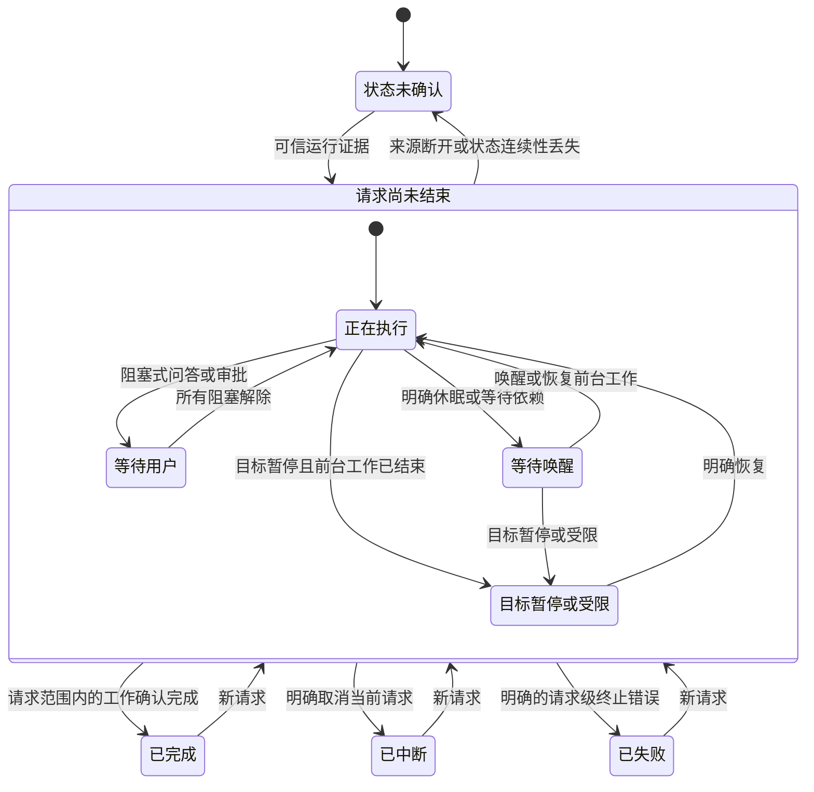

# Codex 任务状态机与动画对应

本文定义 Codex 任务行的状态、中央图标和进度环如何对应，供实现和界面验收使用。圆环跟随用户的一次请求；一个请求可以包含多个 turn，也可以在等待后台工作后继续。

Codex 使用 `develop` 上现有的 Windows 和 macOS 圆环组件，下文标为“新增”的规则属于 Codex。本机开关和数字上报见[使用说明](codex-progress-setup.md)，采集和来源边界见[完整方案](codex-progress-ring.md)。

## 状态如何组织

状态分开记录，再组合成一行展示：

| 层次 | 含义 | 例子 |
| --- | --- | --- |
| turn 执行状态 | 当前这一轮实际在做什么 | 思考、调用工具、输出、等待输入、这一轮结束 |
| 请求生命周期 | 用户交代的这件事是否仍在继续 | 执行中、等待唤醒、目标暂停、完成、中断、失败 |
| 提醒 | 是否有待处理的问答或审批 | 异步问题可以挂着，构建同时继续 |
| 进度信息 | 模型是否给过当前请求的估计 | `pending` 无估计；`reported` 有估计；`stale` 估计过旧 |

现有 `ActivityPhase` 为 `running`、`waitingForInput`、`completed`、`interrupted`、`unknown`；失败由 `interrupted + turnFailed` 表示。运行中的细分阶段由 `ActivityStage` 保存。新增的请求生命周期独立记录，目标暂停不伪装成审批、等待回复或成功结束。

请求身份由 provider、来源绑定、所属主线程和请求代次共同确定。新请求清空百分比；明确属于同一请求的唤醒、追问回复或续跑保留百分比。子任务的进度不能覆盖主任务。无法确认跨 turn 关联时，只展示这一轮的结束，不声称整个目标已经完成。

## 状态机

图中的“正在执行”包含启动、思考、工具调用、输出、重试和压缩上下文。异步提醒叠加显示，不单独把执行状态切到“等待用户”。

| 状态 | 进入依据 | 离开条件 |
| --- | --- | --- |
| 状态未确认 | 初次发现但证据不足、连接丢失、快照修订断裂，或没有明确结束证据的 `notLoaded/systemError` | 取得可信快照、当前 turn 锚点或后续运行证据；已确认的结束卡不受断线影响 |
| 启动 | 当前所属 turn 的 `task_started`、`turn/started`，或确认活跃的运行时元数据 | 出现思考、工具或回复事件 |
| 思考或输出 | 当前 turn 的 reasoning、message 或文本增量事件 | 后续工具、等待或明确结束事件 |
| 执行工具 | 普通工具开始；记录每个尚未结束的工具及其开始时间 | 对应工具结束；单个工具失败不直接把请求判为失败 |
| 长步骤 | 最早仍在运行的普通工具已执行至少 30 秒 | 该工具结束后重新检查剩余工具；不足 30 秒的工具回到普通执行态 |
| 等待用户 | 明确的阻塞式问题或审批，以及对应 waiting flags | 所有阻塞项均已解除；处理一个问题不能清掉另一个审批 |
| 等待后台工作 | 观察到 sleep、阻塞式 agent wait，或明确属于当前请求的后续唤醒；且没有其他前台生成或普通工具正在执行 | 对应唤醒或新前台工作；明确的请求结束仍可直接终止等待 |
| 重试 | 与当前 turn 关联的可重试错误，例如 `willRetry: true` | 恢复执行或收到明确终止结果；重试本身不产生失败卡 |
| 压缩上下文 | 当前请求的 compact 事件 | 压缩结束后继续同一请求，不清空进度 |
| 目标暂停或受限（新增） | 当前请求绑定的 goal 为 paused、blocked、usageLimited 或 budgetLimited | 明确恢复或请求范围改变；前台工作仍在运行时保留其执行状态 |
| 完成 | 普通请求的成功结束，且没有已证实的继续工作；或绑定目标完成且当前执行已收尾 | 保留结束卡，直到已读、过期或新请求开始 |
| 中断或失败 | 明确的请求级取消或终止错误 | 保留结束卡；新请求从无估计开始 |

## 状态与图标及圆环对应

中央图标表达“在做什么”，外圈表达“进度和运行方式”。任务行中央图标保持静态，不额外加入旋转、闪烁或摇摆；动效集中在外圈。

下表列出 Codex 的状态映射。`paused` 用于有明确证据的目标暂停或受限；异步提醒参与圆环模式选择，同时保留任务的执行状态。

| 任务状态 | 中央图标 | 没有估计 `pending` | 已有估计 `reported` |
| --- | --- | --- | --- |
| 启动 | 沙漏 `hourglass` | 虚线环旋转 | `working`，按已有进度显示 |
| 思考 | 星光 `sparkle` | 虚线环旋转 | `working`，弧线上有光点运动 |
| 执行工具 | 终端 `terminal` | 虚线环旋转 | `working`，弧线上有光点运动 |
| 输出回复 | 回复气泡 `text.bubble` | 虚线环旋转 | `working`，弧线上有光点运动 |
| 长步骤 | 保留工具图标 | `longStep`，虚线继续旋转 | 弧线静止，不跑光点、不因估计过旧而淡化 |
| 等待审批 | 举手 `hand.raised` | `attention`，虚线停在当前位置 | 弧线静止，保留百分比 |
| 等待回复 | 问答气泡 `ellipsis.bubble` | `attention`，虚线停在当前位置 | 弧线静止，保留百分比 |
| 异步问题未处理（新增映射） | 问答气泡；状态文字保留“执行工具”等当前动作 | `attention`，虚线静止；执行仍可继续 | 弧线静止；不停止仍在运行的工具，也不清空其状态 |
| 等待唤醒 | 休眠 `zzz` | `waiting`，虚线呼吸，不旋转 | 弧线呼吸，角度保持不变 |
| 重试或压缩上下文 | 保留对应工作阶段图标；没有更具体证据时用星光 | `working`，虚线旋转 | 不自行增加百分比；沿用普通工作态及过旧规则 |
| 目标暂停或受限（新增） | 暂停 `pause.circle`，配明确原因 | `paused`，虚线静止 | 弧线静止；无呼吸、旋转或光点 |
| 请求完成 | 对勾 `checkmark.circle` | 转为 `reported + done`，填充到 100% | `done`，从当前显示值填充到 100% |
| 请求中断 | 暂停 `pause.circle` | 不保留进度环 | `interrupted`，停在最后百分比 |
| 请求失败 | 叉号 `xmark.circle` | 不保留进度环 | `failed`，停在最后百分比 |
| 状态未确认 | `moon` 表示当前无法确认，文字写明连接或来源状态 | 隐藏进度环 | 隐藏进度环；估计仍可在同一请求的恢复后使用 |

光点只在普通工作态、估计未过旧且百分比大于 4%、不足 100% 时运行。0% 至 4% 的弧线太短，不播放光点。模型自报 100% 而请求仍在执行时，弧线可以满，但保留工作图标，不播放完成脉冲、不产生完成提醒。

Codex 只有转入已确认的完成状态时才播放完成脉冲。即使此前已经报过 100%，真正完成时仍可播放一次；重建同一完成行不会重播。Claude 保留原有的到达满环动效。

配色沿用现有任务行：运行中和未读完成用 Codex 色；问答、审批用提示色；失败用危险色；中断和目标暂停用暂停色。已读的完成、中断卡变淡，失败卡保留危险色。Windows 普通配色的对应基准为 `#7DD6C4`、`#FFBD61`、`#FF736B`、`#DBC499`。高对比度遵循宿主主题，同时保留图形和文字区分。

## 动画时序

以下数值取自当前 Windows 进度环，作为 Codex 接入和 macOS 绘制的目标参数。已有动画被新状态打断时，从屏幕当前显示值继续。

| 场景 | 时序与视觉效果 |
| --- | --- |
| 首次出现虚线环 | 250 ms 淡入；环缩放从 85% 到 100%，Cubic EaseOut |
| 给圆环让出空间 | 中央图标从 20 缩到 16 个逻辑像素，250 ms；圆环直径 28，线宽 2 |
| 无估计但正在工作 | 虚线每 6 秒顺时针转一圈；长步骤也使用这一动画 |
| 收到首个估计 | 先用 200 ms 把虚线淡出、底轨淡入，再从 0 扫到目标值 |
| 百分比增加 | 扫动时长为 `300 + 300 × Δp` ms，Cubic EaseOut；`Δp` 为 0 至 1 的变化比例 |
| 百分比下调 | 500 ms 回退，Sine EaseInOut；原位置留下 35% 不透明度的残影，在 600 ms 内淡出 |
| 普通工作态的光点 | 每 2 秒一轮，其中 1.6 秒沿已有弧线运动，余下时间不显示光点 |
| 等待唤醒 | 2.4 秒完成一次呼吸，Sine EaseInOut；弧线不透明度在 100% 与 20% 之间变化；虚线使用 60% 与 12% |
| 离开等待态 | 从当前呼吸亮度在 300 ms 内回到目标亮度，不突然跳亮 |
| 已有估计变旧 | 仅 `working` 超过 120 秒没有新估计时触发；实线弧线在 600 ms 内淡到 45% 不透明度并停止光点 |
| 收到新估计 | 200 ms 恢复普通亮度；估计可以比上次低 |
| 确认完成 | 从当前显示值扫到 100%，沿用增加进度的时长；此前为虚线时，先执行 200 ms 的虚线转底轨 |
| 完成脉冲（新增触发规则） | 填充结束后等 50 ms；180 ms 内放大到 106%，在脉冲开始后 400 ms 回到 100%；每个请求完成只播放一次 |
| 新请求替换旧估计 | 业务百分比立即清空；视觉上可在 300 ms 内把旧弧线退到 0，再用 200 ms 换成虚线；不继承旧请求的百分比 |
| 圆环消失或开关关闭 | 300 ms 淡出；中央图标在 300 ms 内恢复到 20 个逻辑像素 |
| 状态颜色变化 | 250 ms 颜色过渡；减少动态效果时直接切换 |

首次附着到正在执行的请求或恢复历史完成卡时，直接显示已知值，不从 0 重播过去的进度。无估计的请求正常完成，也会填满；无需等待模型补报 100%。

## 冲突时采用哪种展示

优先级依次为：

1. 已确认的请求结束。先清理属于该请求的旧提醒和等待，再显示完成、中断或失败。
2. 来源未确认。对尚未结束的请求隐藏动态圆环；已经确认的结束卡保留。
3. 待处理问答或审批。环使用 attention；异步问题保留真实执行阶段。
4. 明确的目标暂停或限制。前台工作收尾后使用静态 paused。
5. 明确等待后台依赖且没有前台执行。使用 waiting。
6. 有达到 30 秒的普通工具。使用 longStep。
7. 其他正在执行的状态。使用 working。

有多个工具时，只要还有前台工具或模型正在工作，就不能因为一个 sleep 把整行画成休眠。多个问答或审批分别跟踪，只有相应请求真正解除后才能清除提醒。

## 结束与恢复的边界

- 一条回复结束、一个工具结束、线程 idle、Stop、日志安静或模型报到 100%，都不单独触发请求完成。
- 普通请求收到可信成功结束，且没有已证实的继续工作时完成；绑定 goal 或依赖链时，先检查请求范围是否真的结束。单轮失败也不直接宣告仍在进行的 goal 失败。
- `task_complete` 携带终止错误时进入失败；`turn_aborted` 按上游明确的中断结果处理。错误内容不进入界面。
- 压缩、重连和同请求唤醒不清空估计，也不更新估计原本的时间。新请求、其他来源、旧 turn 和子任务的迟到记录不能修改当前请求。
- 父 turn 已结束但当前请求的依赖子任务还在执行时，整组任务不能播放完成动画。子任务百分比不取平均，也不拿来替代主任务估计。
- 进度事件只更新数字，不延长任务存活时间，不清除提醒，不改写执行状态。动画退回旧弧线只是视觉过渡，不能让旧请求重新生效。

## 减少动态效果与动画连续性

减少动态效果开启时，直接显示目标百分比和状态；不旋转、不跑光点、不呼吸、不脉冲。窗口隐藏或被遮挡时停止循环动画。任务行卸载时释放动画时钟；重新显示时恢复当前请求的状态。

同一请求的任务行重建，须延续真实动画时钟中的位置，包括下调进度的 Sine 曲线、呼吸相位和等待中的完成填充。新状态到来时接续当前显示值；旧动画回调不得覆盖新请求。Windows 继续使用 `AnimationLease` 管理时钟；macOS 使用宿主对应机制实现同样语义。

## 验收示例

| 事件序列 | 应看到的结果 |
| --- | --- |
| 开始 → 报 20% → 执行工具 → 报 55% | 虚线转实线，进度增加；普通工作态有光点 |
| 55% → 同一工具达到 30 秒 → 工具结束 | 百分比保持；长步骤停光点；恢复普通执行后继续光点 |
| 55% → sleep → 唤醒 → 报 70% | 呼吸等待；唤醒保留 55%，随后增加到 70% |
| 构建中 → 提出异步问题 → 用户回答 | 显示问答图标和“执行工具”等文字；构建不中断，回答后恢复工作态环 |
| 70% → 重新估计 45% | 500 ms 平滑回退，留下短暂残影 |
| 工作中报 100% → 继续执行 → 确认完成 | 前两步没有完成脉冲；确认结束后播放一次完成反馈 |
| 虚线 → 确认完成 | 虚线转底轨并填到 100%；不等一次额外报告 |
| 45% → 明确失败或取消 | 停在 45%，切换失败或中断图标；不填满、不播放完成脉冲 |
| 45% → 断线 → 同请求重新附着 | 断线时隐藏进度环；证据恢复后显示仍适用的估计，不创建新请求或伪完成 |
| 旧请求 100% → 新请求 | 清空业务估计，显示新请求的虚线；旧完成记录不能触发新请求的脉冲 |

源码对应：[共享圆环状态](../native/Sources/PacerCore/SelfReportedProgress.swift)、[任务图标选择](../native/Sources/PacerCore/ActivityTaskPresentation.swift)、[Windows 圆环动画](../windows/Desktop/TaskProgressRing.cs)、[Windows 任务行](../windows/Desktop/TaskRow.xaml.cs)、[macOS 任务行](../native/Sources/PacerIsland/TaskRowView.swift)。
