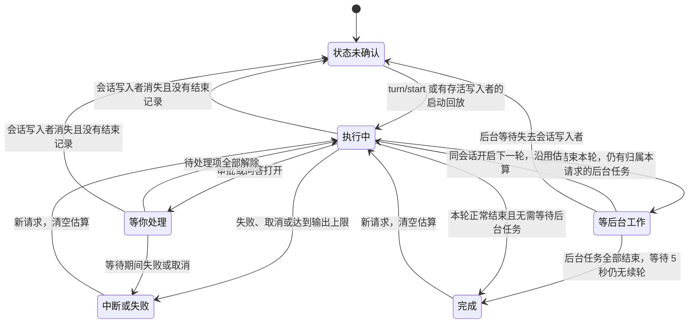

# DeepSeek Harness 任务状态机与动画

在 **设置 → DeepSeek → 显示 DeepSeek 任务进度** 打开进度环。Pacer 在所选 Harness 数据目录配置一个本机 MCP 工具。配置完成后新建 Harness 会话；如果当前进程还没加载配置，退出并重新打开 Harness。工具从 0 到 100 接收一个整数，表示 DeepSeek 对当前请求完成度的估算。进度可以回退。关闭开关会撤回 Pacer 管理的配置，并让已经启动的上报工具停止接收估算。

Pacer 从 Harness 已经写入的 v4 会话日志接收数字。普通调用需要配对的成功结果，`run_code` 内的调用需要成功的子调用记录。Pacer 只保留当前会话、当前轮次的数字。工具调用和响应各自照常进入 Harness 的会话记录。

## 任务状态

一个请求可以经过多轮。`turn/start` 开始执行，`step/start` 进入思考，普通 `tool/call` 进入工具阶段，带有最终文本的 `assistant/message` 进入回复阶段。普通工具和 `run_code` 内的问答都可以使任务暂停等待输入。进度上报只更新数字和上报时间，任务阶段仍由 Harness 的执行事件决定。

后台等待由当前请求工具发起、且归属同一会话的 `job/registered` 确认。`job/settled` 逐个清除后台任务，全部结束后给 Harness 5 秒写入可能的唤醒轮次。等待期间开始的新一轮沿用上一轮的数字。会话或数据目录换了，或者失败、中断后开始新请求，进度重新计算。恢复历史会话时，通过 `session.lock` 确认未结束轮次是否还活着。

## 图标和圆环

Mac 和 Windows 使用和 Codex、Claude 相同的任务行组件。圆环显示在 DeepSeek 的任务图标外，估算和等待状态也会写入该行的辅助功能说明。

| 状态 | 中央图标 | 圆环 |
| --- | --- | --- |
| 开始、思考、工具或回复 | 沙漏、闪光、终端或对话气泡 | 首次上报前转动虚线。收到估算后显示对应弧长，亮点沿弧移动。 |
| 估算变化 | 当前任务图标 | 弧长平滑调整。估算降低时，弧往回收。 |
| 工作中 120 秒没有更新 | 当前任务图标 | 保留弧长，弧变暗，亮点停止。 |
| 前台工具连续运行至少 30 秒 | 终端 | 已上报的弧停在原处。尚无估算时，虚线继续转动。 |
| 等审批或等回复 | 手掌或省略号气泡 | 保留当前弧长或虚线，停止循环动画。 |
| 等后台工作唤醒 | `zzz` | 弧或虚线缓慢呼吸。续跑后恢复工作状态。 |
| 正常完成 | 对勾 | 从当前弧长扫到满环，即使模型没报过数字。 |
| 中断或失败 | 暂停或叉号 | 停在最后一次估算。有数字才画环。 |
| 状态未确认 | 月亮 | 隐藏圆环。 |

打开系统的减少动态效果后，环直接显示目标状态。任务行重建会接上当前弧长。收起窗口或移除任务行后，宿主释放循环动画。预算环和活动徽标各有自己的含义，任务环只显示在任务行。
