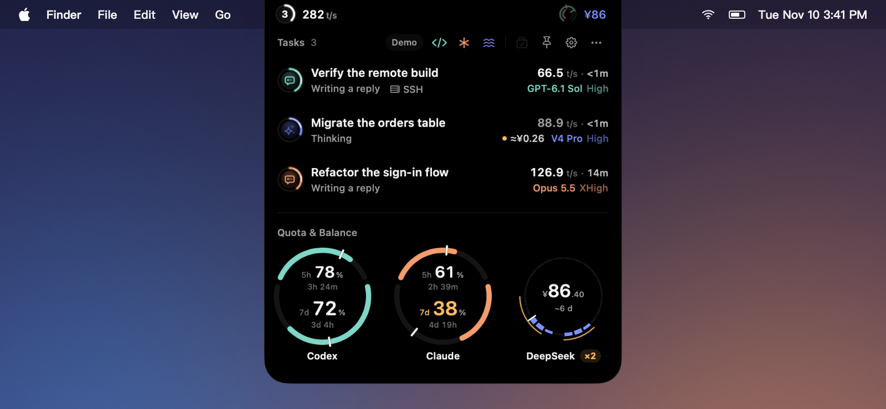
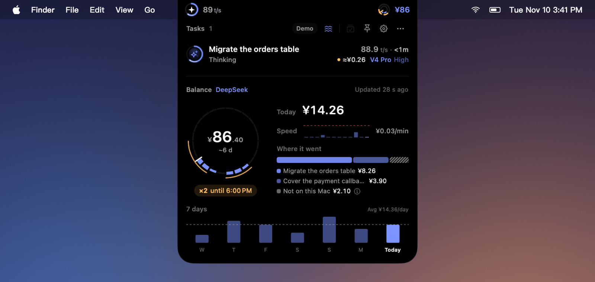

# Codex Pacer User Guide

[简体中文](guide.zh-CN.md) · [README](../README.md)

- [Getting started](#getting-started)
- [The collapsed bar](#the-collapsed-bar)
- [The expanded island](#the-expanded-island)
- [Progress rings](#progress-rings)
- [Quota and balance](#quota-and-balance)
- [Services](#services)
- [The main window](#the-main-window)
- [Privacy](#privacy)
- [Troubleshooting](#troubleshooting)
- [Uninstall](#uninstall)

## Getting started

The first time you open Codex Pacer, a short guide walks you through it:

1. What each part of the collapsed bar means.
2. **Island**, which sits at the top center of the screen around the notch, or **Free Move**, which you drag anywhere.
3. Which services to follow: Codex, Claude and DeepSeek. Pacer turns on the ones it finds installed.
4. Progress rings, notifications and opening at login.

You can open the guide again from **Help & Updates**. After each update, a short **What's New** note shows the highlights once.

Two services need a sign-in for their numbers:

- **Claude quota:** click **Sign in to Claude** and sign in to claude.ai in Pacer's own window.
- **DeepSeek balance:** sign in to the DeepSeek platform in Pacer's window, or paste an API key if DeepSeek Harness uses one.

Codex quota needs nothing extra.

## The collapsed bar

| Part | What it tells you |
| --- | --- |
| **Task badge** | How many tasks are running. Its ring shows which services are working, or their average progress. Amber means a task needs your reply or approval; a check means one just finished. |
| **Speed** | The combined output speed of your running tasks, in tokens per second. |
| **Quota** | Quota left for Codex and Claude, or your DeepSeek balance or budget. |
| **Warnings** | Appear only when something needs attention, such as low quota or a disconnected SSH host. |

**Hover** to expand the island, **move away** to collapse it. Click the top to keep it open, and press Esc to close it.

Choose what the bar shows in **Collapsed Bar**: drag items on the live preview to reorder them or move them to the other side of the camera, and click one to see its options. The badge's ring can show the services that are running, the average progress, or one segment per task.

To move the island, choose **Free Move** in **Appearance**, then drag the bar by its status area. Release it near a screen edge and it snaps there. **Return to Top Center** puts it back. With several displays, each one remembers its own place.

## The expanded island

All your tasks share one list. Tasks that need you come first, then running tasks, then finished ones. Each row shows the task's title and current step, where it runs if not on this computer, its output speed, how long the turn has taken, and the model.

- **Click a task** to open its conversation in the app that runs it.
- **A finished task** stays as a card until you open it, or until its retention time passes (30 minutes by default, set in **Notifications**). **Mark All as Read** clears every finished card at once.
- **Agents a task starts** are grouped under it.
- **App buttons** in the header open Codex, Claude or DeepSeek Harness directly.
- With more than three tasks, use the arrows to page through them.

## Progress rings

Codex, Claude Code and DeepSeek Harness each report how much of your request is done. Pacer draws it as a ring around the task's icon.

| You see | It means |
| --- | --- |
| A comet circling | The task is working and hasn't sent an estimate yet. |
| An arc with light running along it | The latest estimate, while the task works. |
| A breathing ring with a moon | The task is waiting for background work and will continue. |
| An amber disc | The task needs your reply or approval. |
| A full ring and a check | The request is done. |

Estimates are the agent's own guess, so a ring can move back. Rings are on by default; turn them off for each service with **Progress Ring** on its page in the main window. Start a new session after turning a ring on.

On macOS, Pacer labels Dot's Durable Codex tasks assigned to this Mac with `Dot`. Their chats can stay closed. The same Codex **Progress Ring** switch sets up percentage reporting. A busy executor applies the change when it can refresh or reconnect. Turning the ring off stops reporting immediately; the Codex module can still show task state.

## Quota and balance

**Codex and Claude.** Each service has one ring: the upper arc is the 5-hour quota and the lower arc the weekly quota, each with its percentage left and a reset countdown. A white tick marks how much of the time is left: if the arc reaches past the tick, you're ahead of an even pace. Values turn amber when they run low or fast. With only one service on, Pacer also shows its pace and a forecast for the reset.

**DeepSeek.** DeepSeek uses a balance instead of quota. Its dial shows today on a 24-hour face, with what each hour cost and the peak hours, when prices double. The balance sits in the middle. Switch to **Budget** on the DeepSeek page to set daily and weekly budgets, which the dial then paces like quota. Budgets only remind you; Pacer never blocks a request. Each DeepSeek task also shows an estimated cost for its turn.

Spend made elsewhere on your account, such as web searches or another device, is included in today's total and budgets.

## Services

**Codex.** Pacer finds the Codex app or CLI on its own. Tasks from apps that embed Codex show that app's name; hide them with **Sessions from Other Apps**.

**Claude Code.** Task tracking sets itself up when the Claude module is on. Restart running Claude Code sessions once afterwards. With **Show Claude cloud Projects** on, Pacer also follows your cloud Project threads and tells you when one ends or waits for you.

**DeepSeek Harness.** Pacer follows local Harness sessions, their speed and cost.

**SSH hosts and WSL.** Pacer follows the SSH hosts you already use in Codex and Claude, and WSL on Windows. A host needs SSH access without a password prompt and Python 3. If a host disconnects, use **Retry** on the **Remote** page.

**Codex Remote Control.** Keep the Codex app open and connected to the remote host.

## The main window

Click the gear in the expanded island to open the main window.

| Page | What's there |
| --- | --- |
| **Overview** | Anything that needs you, each service at a glance and the running tasks. |
| **History** | Each service's quota over the current period, and DeepSeek's last 7 days. |
| **Codex, Claude, DeepSeek** | Turn each service on or off, sign in, progress rings and custom folders. |
| **Remote** | SSH hosts, WSL and Remote Control. |
| **Appearance** | Theme, accent color, the island's material and size, Island or Free Move, and which display it uses. |
| **Collapsed Bar** | What the bar shows and each item's options. |
| **Notifications** | Which events show on the bar or as system notifications, DeepSeek alerts, and how long finished tasks stay. |
| **General** | Open at Login, the Dock icon, language and **Hide Project Names** for screen sharing. |
| **Help & Updates** | Updates, What's New and help. |

Changes apply right away. When an update is available, it shows in the sidebar and on Overview; **Update and Restart** installs it.

## Privacy

- Pacer has no account and sends no analytics.
- It reads the logs your agents already write and keeps only what the island shows: task titles, stages, timing and token counts. It never keeps your prompts or replies.
- Sign-ins happen in Pacer's own window. Pacer never reads other apps' passwords or browser cookies.
- **Hide Project Names** replaces task titles on screen and in notifications.

## Troubleshooting

- **A service shows no tasks.** Check that the service is on and that its page says it was found. For Claude Code, restart running sessions once after setup.
- **Claude quota or the DeepSeek balance asks you to sign in.** The session has ended. Sign in again on the service's page.
- **A ring keeps circling.** Start a new session of that agent after turning its ring on. Claude cloud Projects can't report estimates, so their ring circles until they finish.
- **An SSH host is disconnected.** Check that you can connect with `ssh <host>` without typing a password, then click **Retry** on the **Remote** page.
- **Speeds look high right after Pacer starts.** The first reading can include earlier output. It settles within a moment.
- **On Windows, tasks stop updating and Pacer asks you to reopen it.** Reopen Pacer. Please also [open an issue](https://github.com/RyanZhangNTU/codex-pacer/issues) and attach the newest file from `%LOCALAPPDATA%\CodexPacer\CrashLogs`. It holds no task content.
- **Windows says the installer is unrecognized.** Choose **More info → Run anyway**. The installer isn't code signed yet.
- **Something else.** [Open an issue](https://github.com/RyanZhangNTU/codex-pacer/issues) with your Pacer and system versions and the steps to reproduce. Hide private task titles and account details in screenshots.

## Uninstall

1. Turn off the Claude module and each **Progress Ring**, so Pacer removes what it added to your agents' settings.
2. Sign out of DeepSeek or remove the API key on the DeepSeek page.
3. Turn off **Open at Login**, then quit Pacer.
4. On a Mac, move Codex Pacer from Applications to the Trash. On Windows, uninstall it from **Apps** in Windows Settings.
