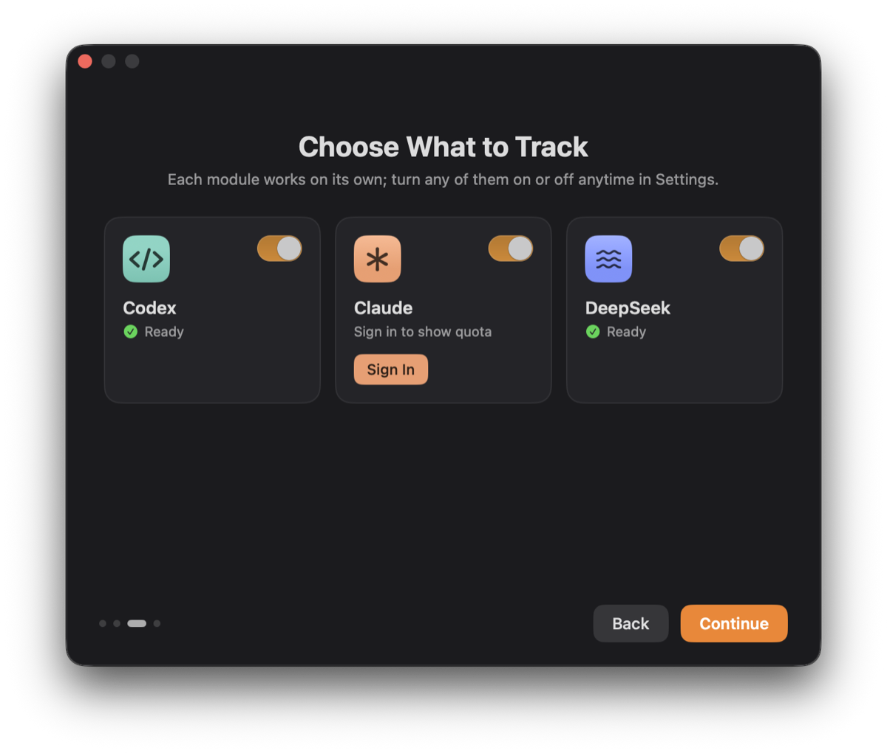

# Codex Pacer User Guide

[简体中文](guide.zh-CN.md) · [README](../README.md)

This guide covers everyday use of Codex Pacer 4. For installation, see the [README](../README.md#install).

- [First launch](#first-launch)
- [The collapsed bar](#the-collapsed-bar)
- [The expanded island](#the-expanded-island)
- [Codex](#codex)
- [Claude Code](#claude-code)
- [DeepSeek Harness](#deepseek-harness)
- [SSH hosts and Remote Control](#ssh-hosts-and-remote-control)
- [Settings](#settings)
- [Notifications](#notifications)
- [Privacy and stored data](#privacy-and-stored-data)
- [Troubleshooting](#troubleshooting)
- [Uninstall](#uninstall)

## First launch

The first time you open Codex Pacer 4, or the first launch after upgrading from 3.x, a short guide appears.

1. **Welcome** labels the parts of the collapsed bar.
2. **Choose a Mode** picks **Island**, which hangs from the top center of the screen around the notch, or **Free Move**, where you drag the bar anywhere and it snaps to a screen edge. Each card shows the island opening or moving, and the choice applies at once.
3. **Choose What to Track** turns the Codex, Claude and DeepSeek modules on or off and shows whether each one is ready.
4. **A Few Choices** covers the task progress rings, system notifications, opening Pacer at login and a shortcut to customize the collapsed bar.

Each module is independent. Pacer turns a module on automatically when it finds that service installed; once you flip a switch, your choice sticks. You can change it any time in **Settings → Codex**, **Settings → Claude** or **Settings → DeepSeek**, and reopen the guide from **Settings → Help & Updates → Help**.

After later 4.x updates, a short **What's New** note appears once instead. It lists the highlights, offers any new setting it mentions in place, and **Release Notes** opens the full list. Settings → Help & Updates → What's New keeps every note to read again.

## The collapsed bar

| Component | Meaning |
| --- | --- |
| Task badge | Number of active tasks. An orbit turns while tasks run, in teal for Codex, orange for Claude and blue for DeepSeek, split evenly between the services that are running. Solid amber: a task needs your reply or approval. A check, cross or pause: a task finished, failed or stopped and you have not looked yet. With one task, the badge can show its status icon instead of the number. |
| Speed (t/s) | Combined output speed of running tasks. |
| Quota rings and value | Two rings for two modules, Codex outside and Claude inside unless you choose otherwise in **Settings → Collapsed Bar**. DeepSeek takes a ring once it has a budget and shows today's or this week's budget left. The number alternates between the services every few seconds and can show remaining quota or pace (quota left divided by time left: 100% lasts exactly until the reset, below 100% is too fast); DeepSeek shows its balance, such as ¥86, or the budget left while its ring shows the budget (`−¥3.2` once over). With only DeepSeek on and no budget ring, a **price clock** takes the rings' place: amber peak hours outside, blue for the hours that cost money today inside, and a white hand at now. |
| Warnings | Shown only while the condition lasts: 5-hour quota below 20% (outlined `5h`) or exhausted (solid `5h`), an SSH host disconnected, or quota not updated. DeepSeek shows only its most urgent alert: a solid `¥` when the balance is used up, a solid flame when the last 10 minutes cost more than the spike line, a solid `D` or `W` when today's or this week's budget is exceeded, an outlined `¥` when the balance is low, and an outlined `D` or `W` at 80% of a budget. Choose which warnings appear, and DeepSeek's lines, in **Settings → Notifications**. |

Optional components include status text, the latest time to first output and, with DeepSeek on, the price clock. Arrange everything in **Settings → Collapsed Bar**. The page shows the bar with your live values: drag a component to reorder it or move it to the other side of the camera, and click one to see its settings beside the list of components, where a click adds or removes it. **Restore Defaults** puts the standard layout back. With the quota rings selected, **Outer** and **Inner** choose which module each ring shows. Each service's **Limit** chooses whether the bar shows its 5-hour or 7-day quota; accounts with only a weekly limit always show 7 days.

Drag the island by its status bar to move it, on the Mac and on Windows. It stays where you release it, or snaps to a screen edge if you release it nearby. The top and bottom edges keep the horizontal bar. The left and right edges turn it into a narrow vertical strip: the left group sits at the top and the right group at the bottom, each number above its unit, and status text stays in the panel. The panel opens toward the free side of the screen, up from the bottom edge and inward from a side, and the island stays clear of the taskbar, the menu bar and the Dock. Pacer remembers the position and the display. **Settings → Appearance → Position** offers **Island** and **Free Move**, each card showing its motion; **Return to Top Center** puts a moved island back. An island placed by an earlier version stays where it was until you move it.

On the Mac, the bar starts around the camera on a display with a notch and stays black so it blends in; on other displays it is a capsule just below the menu bar. An **Island** bar stays at the top center, so choose **Free Move** before dragging it. On Windows, dragging an Island bar switches it to **Free Move**.

## The expanded island

**Hover** over the bar to expand it and **move away** to collapse it. Click the top, or the pin button, to keep it open; press Esc to close it.

### Tasks

Tasks from all services share one list: tasks that need you come first, then running tasks, then ended ones, most recent first within each group. Each row shows:

- the task title and, below it, its current stage (thinking, running a tool, responding, waiting for you, ended), the number of running agents it spawned and the SSH host or Remote Control source when it is not local;
- on the right, the latest output speed and the turn's time: how long it has run, or how long it took once it ended. White numbers were updated in the last 15 seconds; gray numbers are older. Screen readers also announce the time to first output;
- below the speed, the model and its reasoning effort in the service's color. Until the model is known, the service name appears there. DeepSeek tasks also show the turn's estimated cost first, such as `≈¥0.42`.

The icon shows the stage in the service's color, amber when a task needs you and red when it failed. Ended tasks you have opened or marked as read turn gray; unread ones keep their color.

Agents that a task spawns are grouped under it with their running count and combined speed. With more than three tasks, use the arrows beside the page number or Option + ← / → to page through them.

Click a task to open its conversation. Codex tasks open in the Codex app. A task started in another app shows that app's name and switches to it, relaunching the app if it quit. This covers Claude tasks started in a terminal or an editor, and Claude or Codex tasks from apps that embed them, such as a Zotero plugin. Claude Desktop sessions open in Claude Desktop, and Claude sessions on SSH hosts resume in Terminal. DeepSeek tasks bring DeepSeek Harness forward on its session list, since Harness has no link to a single conversation. Pacer only learns which app started a task while the task is running; if it doesn't know, it says so, and the message disappears after 30 seconds. Opening never sends a prompt.

To open Codex, Claude or DeepSeek Harness without a task, use the app buttons just left of the panel controls in the task header, one per enabled module in its color. A click brings that desktop app forward, launching it if needed, without opening a conversation. A module whose desktop app isn't installed shows no button; turn them all off with *Show App Buttons* in **Settings → Appearance**.

When a turn ends, its card stays until you open it, clear it with **Mark All as Read** or the retention time passes (30 minutes by default; set it in **Settings → Notifications**). **Mark All as Read** is the button next to the pin in the expanded island. It clears every ended card on all pages at once and leaves running tasks and anything waiting for your reply or approval. Cleared cards don't come back after a restart.

### Quota

**Settings → Appearance → Quota Style** offers **Split Ring** (the default) and **Classic**. The choice applies immediately and is remembered. Classic keeps the previous weekly rings with 5-hour details underneath, or two period rings when only one service is on.

In Split Ring, each service gets one ring. When it reports a 5-hour limit, the shorter upper arc shows **5h** and the longer lower arc shows **7d**, with each period’s remaining percentage and reset countdown inside the ring. The same layout applies with only one service on.

- Each colored arc shows the quota left in its own window. Its white tick marks the remaining-time fraction; quota beyond the tick is ahead of an even pace.
- When a period has 15% or less left, or is being used too fast, its label and percentage turn amber; the 5-hour arc turns amber too. Screen readers also announce each value's pace verdict, reset date and freshness.
- An unknown value shows a dash and a dotted arc. Accounts without a 5-hour limit show a 7-day gauge that opens at the bottom, with **7d** in the opening.
- With only one service on, its ring sits on the left. On the right, the 5-hour and 7-day groups face their arcs and show the pace verdict and percentage, the reset time and a forecast. The forecast extends your spending so far to the reset: how much will be left, or when quota would run out (in amber). Early in a window it waits for more data. Accounts without a 5-hour limit show pace, reset and forecast as three rows. Codex limits that are neither 5-hour nor 7-day still appear as quota bars.

DeepSeek has a balance instead of quota windows. In **Balance** mode, the default, its ring is a **day dial**: today on a 24-hour face with midnight at the top. Each hour's segment gets thicker the more that hour cost, the white tick is now, and amber arcs outside the dial mark the peak hours, when DeepSeek charges double (weekdays 09:00–12:00 and 14:00–18:00 Beijing time, shown in your time zone). The balance sits in the middle, white normally, amber when low, red when used up and gray when it could not be updated, with about how many days it lasts at your recent average and today's spend below it. With two or three services on, the section is called **Quota & Balance**.

In **Budget** mode the ring is a **budget dial**, split like Codex's 5 hours and week: today on the upper arc and this week on the lower one, each with the amount left and a white tick for the time left, so spending past the tick is ahead of an even pace. Today's arc turns amber when it runs fast. With one budget the dial is a single gauge, and a budget that is exceeded empties its arc on a red track and shows how far over. Budgets only remind you; Pacer never blocks a request.

With only DeepSeek on, the dial sits on the left; during peak hours a chip under it, such as **×2 until 18:00**, says when prices drop. Each block beside and below it appears only when it has something to show, so a quiet day makes a short panel:

- **Today** sits beside the day dial: spend so far. **Where it went** below shows how much of it is not on this Mac. Beside the budget dial, each budget shows its pace, reset and forecast instead.
- **Speed** shows what each 10 minutes of the last two hours cost, with the spend-spike line dashed in red, and the spend per minute. It appears when there was spend in the last two hours.
- **Where it went** splits today's spend between the two largest tasks, the rest and a hatched **Not on this Mac** part: what the account was charged that no task on this Mac accounts for, such as web searches, background requests or another device. Its info button opens the platform's usage page. A task keeps its name after its row is gone.
- **7 days** draws one bar per day against your daily budget's dashed line, or your daily average without one, with the part over budget in red. It appears once two days before today had spend.

With DeepSeek as the only module, **Settings → Appearance → DeepSeek Content** chooses **Detailed**, the default, or **Simple**, which keeps the dial and what sits beside it but leaves out Where it went and 7 days.

If quota cannot be read, the ring says why and offers a retry. Screen readers also announce the source and last update. Quota history, credits and banked resets are in **Settings → History**.

The ⋯ menu in the task header refreshes data or quits Pacer; the gear opens Settings.

## Codex

**Task progress.** **Settings → Codex → Progress Ring** (**Show Codex Task Progress** on Windows) is on by default. Pacer sets up reporting for new local Codex sessions. The ring stays dashed until Codex reports an estimate. [Codex task progress](codex-progress-setup.md)

Pacer finds the Codex app or CLI in the usual places, including Homebrew, npm managers such as nvm, fnm, Volta, asdf, mise and pnpm, and a moved Codex.app. **Settings → Codex → Status** shows what it found; hover for the exact path, or pick another CLI or data folder under **Custom locations**. A custom path that stops working is reported rather than silently replaced.

Codex quota comes from your own Codex sign-in through the CLI. API-key or Amazon Bedrock sign-ins do not have ChatGPT subscription limits, and Pacer says so.

**Sessions from other apps.** Apps that embed Codex, such as a Zotero plugin, show their sessions with the app's name. To hide those sessions and their reminders, turn off **Settings → Codex → Sessions from Other Apps**. Codex app, Terminal and VS Code sessions always show. Translations from the Zotero Agent plugin are never shown.

**Cloud Projects.** Threads and coordinators in your Claude Projects run in the cloud, so Pacer reads their status with the claude.ai session above. A thread appears as its own task with a cloud icon and the project's name: **Working**, with a count when more sessions share it, then **Decision needed**, **Reply needed** or **Approval needed** while it waits, and **Resolved**, **Turn finished** or **Task failed** at the end. The coordinator appears as **Project coordinator** while it answers; handing work to threads or reporting on one that just ended doesn't count as an ending, so you are reminded once, by the thread. Reading a resolved thread in Claude clears its card here. A **Reply needed** card stays until you click it or the thread runs again, because Claude marks nothing as read for a thread that stopped to ask you. Click a row to open it in Claude Desktop, or on claude.ai without it. Pacer checks every 20 seconds while something runs and up to every 2 minutes otherwise, so most changes can take that long to appear; a new run in a recently active Project shows up within about 10 seconds. While a thread writes a reply, its row shows an estimated speed, which does not update during thinking or tool calls. A thread's ending card shows that turn's real speed and time to first output, and the coordinator has neither. To stop following Projects, turn off **Settings → Claude → Cloud Projects**. This also hides retained cards and reminders without marking them read.

## Claude Code

Pacer uses `~/.claude`, or `CLAUDE_CONFIG_DIR` when set; choose another folder under **Settings → Claude → Custom locations**.

**Task tracking sets itself up.** While the Claude module is on, Pacer adds its own hooks and a local-only telemetry endpoint to your Claude settings and wraps any existing status-line command so its output stays the same. It writes nothing when the settings are already current, never creates a Claude folder, and leaves conflicting telemetry settings untouched. Restart running Claude Code sessions to pick up the change. Turning the module off by hand removes Pacer's entries.

**Quota needs one sign-in.** Click **Sign in to Claude** (or **Sign In** in the welcome guide) to open Pacer's own claude.ai window and sign in as usual; the window closes by itself once you're signed in. If your account belongs to several organizations, choose one. The session lives in Pacer's private WebKit storage and is reused across restarts until the website ends it; Pacer never reads other apps' Keychain items or browser cookies. When Claude Code's status line already reports fresh quota for the same account, Pacer uses that instead.

**Self-reported progress.** **Settings → Claude → Progress Ring** (**Show Claude's Self-Reported Progress** on Windows) is on by default. It adds Pacer's Claude Code plugin, which has one tool, report_progress, and a short line to each prompt you type asking Claude to report with it how much of your request is done. Pacer draws the number as a ring around the task's icon in the expanded island: dashed until the first estimate arrives, then an arc that follows each new estimate, with a light dot moving along it while Claude works, fainter after two minutes without one. The estimate is Claude's own guess and can go down; when Claude finishes normally, the ring fills to 100%. While Claude waits for background work it started, the task shows a zzz icon and Waiting for Background Work, and the ring keeps its last estimate and breathes instead of ending, and the request continues when Claude resumes. It costs about 60 tokens per prompt you type and applies to Claude sessions opened afterwards. Turning it off removes the plugin and stops the request. Pacer reads only the number, never the reply text. Sessions on SSH hosts, and WSL on Windows, get the ring too once Pacer has set them up. Tasks in Claude cloud Projects can't run the plugin, so their ring stays dashed while they run and fills when they finish.

**Sessions from other apps.** Apps that embed Claude Code through the Claude Agent SDK, such as a Zotero plugin, show their sessions with the app's name. To hide those sessions and their reminders, turn off **Settings → Claude → Sessions from Other Apps**. Terminal, VS Code and Claude Desktop sessions always show.

## DeepSeek Harness

**Settings → DeepSeek → Progress Ring** (**Show DeepSeek Task Progress** on Windows) is on by default. It lets Harness report its estimate for the current request. Start a new Harness session after Pacer configures the reporting tool. The ring stays dashed until an estimate arrives, keeps its value while the request waits, and fills when the request completes. The tool is added to `cordis.patch.yml` in the Harness data folder, so every Harness profile and the CLI use it. Turning the switch off removes it. The Windows uninstaller also removes it; on macOS, turn off the switch before moving Pacer to the Trash. If Pacer is already gone, delete both `Codex Pacer DeepSeek progress` marker lines in `cordis.patch.yml` and everything between them, and the `pacer/deepseek-progress` folder. See the [task states and animations](deepseek-task-state-animation.zh-CN.md).

Pacer reads DeepSeek Harness's session logs in `~/.dsh`, or `DSH_HOME` when set; choose another folder under **Settings → DeepSeek → Custom locations**. It follows the stage of each turn, its speed and time to first output, approvals, questions that wait for your reply, and how the turn ended, from the token counts and timing only. Harness saves each reply when its step finishes, so speed and cost update step by step rather than while text streams. Harness sessions on SSH hosts are not followed yet.

**Turn cost.** Pacer estimates each turn's cost from its tokens and DeepSeek's published prices, doubled at peak times, and shows it before the model name. An amber dot means part of the turn was billed at peak; screen readers also announce the task's spend today. A sub-agent's spend counts toward the task that started it, and web searches and fetches add ¥0.005 each from 1 November 2026. Weekends and China's 2026 public holidays are off-peak; holidays of later years are not known yet. Only DeepSeek's own channels are priced, so a third-party provider gets no estimate. The platform bill is authoritative. Turn the estimate off with **Settings → DeepSeek → Show each turn's estimated cost**.

**Balance follows how Harness signs in.** When Harness uses a DeepSeek account, click **Sign In** (on the dial, in the welcome guide or in Settings) to open the DeepSeek platform in Pacer's own window and sign in as usual; the window closes by itself, and the session stays in Pacer's private WebKit storage. When Harness uses an API key, paste a key in **Settings → DeepSeek**; it is kept in your login keychain and used only to read the balance. Pacer never reads Harness's own sign-in or key. The ⋯ menu beside the connection in **Settings → DeepSeek** lets you choose web sign-in or an API key instead of the automatic choice.

**Spend not on this Mac.** Pacer remembers the balance readings, amounts and times only, for eight days. A drop between two readings is what the account was charged wherever it happened; a top-up is ignored. Today's spend, 7 days and budgets add what no task on this Mac accounts for. It is reliable per day rather than per minute, and starts with the first reading after you connect.

**Balance or budget.** **Settings → DeepSeek → Mode** switches between **Balance** and **Budget**. Budget shows a daily and a weekly budget, filled in from your last seven days' daily average plus a fifth; change either amount, or clear it to turn that budget off. Budgets count all spend on the account, including spend not on this Mac, and run from midnight and from Monday 00:00. Switching back to Balance keeps the amounts but stops counting them. Under the switch, Settings says which collapsed ring shows the budget, with a link to choose one.

**Speed and spikes.** **Settings → DeepSeek → Speed → Based On** chooses **This Mac**, the default, estimated from tasks here and updated with every reply, or **Account**, which counts balance changes, including other devices and web searches, about once a minute and needs a connected balance. The speed bars and the spend-spike alert both follow this choice.

**Alerts.** Set DeepSeek's lines in **Settings → Notifications**; an empty field uses the automatic line shown as its placeholder. The balance is low below the line you set, or else the alert line set on the DeepSeek platform, or else ¥10. A spend spike is the last 10 minutes costing more than the line you set, or else three times a busy 10 minutes of the last seven days, at least ¥5. Budget alerts appear at 80% and when a budget is exceeded.

## SSH hosts and Remote Control

Pacer follows the SSH hosts you already use in Codex and Claude, including Claude Desktop's saved connections. Each host is monitored once, with its saved port and identity file. It needs existing non-interactive OpenSSH access and Python 3.6 or later on the host; Pacer never stores passwords or accepts new host keys.

On connected hosts that have Claude Code, Pacer sets up its Claude hooks the same way as on your Mac. A host that fails shows **Retry** and is tried again after 30 minutes.

Codex Remote Control tasks come through the Codex desktop app. Keep Codex open, connected to the remote host and with the conversation loaded.

**Settings → Remote** sums up the connections under its title, then shows each SSH host with its Codex and Claude status side by side, Remote Control, and the other task sources with problems first. Their switches are on the same page.

## Settings

Settings is Pacer's main window, opened with the gear in the expanded island. Search the sidebar to find a page. It has a Dock icon while it is open; choose always or never in **General**. Settings apply as you change them; there is no Save button. Text fields apply when you press Return or leave them, and keep the last valid value if the new one is invalid.

| Page | What you can change |
| --- | --- |
| Overview | The date and task count, anything that needs you with one button to fix it, a card per service with the expanded island's quota view, and the running tasks. |
| History | Each service's quota chart for the current window, quota details, credits and banked resets, and DeepSeek's last seven days. |
| Codex, Claude, DeepSeek | Turn each module on or off, its status (what Pacer found on this Mac, Claude sign-in and a one-line quota summary), each service's sessions from other apps and progress ring, Claude cloud Projects, and custom locations; for DeepSeek, sign-in or API key and the balance source, Balance or Budget mode, what speed counts, the turn-cost estimate and the peak hours of the next working day in your time zone. |
| Remote | A summary of the connections, SSH hosts, Remote Control and the status of every other task source. |
| Appearance | Theme (Auto, Light or Dark for Pacer's windows; the island stays dark; Mac), solid black or Liquid Glass, Accent Color (Multicolor keeps each service's own color; a single color takes over rings, progress and selection, while things that need you stay amber; Mac), Island or Free Move with Return to Top Center, display selection, visibility over full-screen apps, the expanded quota style (or DeepSeek's content when it is the only module) and Show App Buttons. |
| Collapsed Bar | Which components appear and on which side of the camera, the single-task badge, remaining quota or pace, which module each quota ring shows, and whether each service shows its 5-hour or 7-day limit. |
| Notifications | System notifications, then each event with where it reminds you, the collapsed bar or a system notification, with DeepSeek's balance and spike lines, and how long ended tasks stay. System notifications are one switch for now, so their column shows what it covers. |
| General | Open at Login, the Dock icon, language (follow macOS, English or Simplified Chinese) and Hide Project Names. |
| Help & Updates | The version and updates (a new version also shows in the sidebar and atop Overview, and **Update and Restart** installs it in one click), What's New with the newest update's highlights and each earlier one since 3.1 folded to a line you can open (ⓘ explains a highlight; the same switches as the update note and a link to the full release notes), and Help with the welcome guide, this guide and the issue tracker at the top, then one sentence on each mark of the island, one topic at a time: the collapsed bar, the expanded panel or a module. |
| Support & Feedback | A thank-you, a link to star Pacer, sharing, a WeChat code or Buy Me a Coffee link to buy us a coffee, feature-request and bug-report forms (we look first at those from people who've starred it), and the QQ group with its number to copy and its QR code (Mac). |

**Open at Login** uses the macOS login item, so it also appears in **System Settings → General → Login Items**. If Pacer is switched off there, Settings says so and offers a **Login Items** button to allow it again.

## Notifications

Everything that needs attention already shows on the collapsed bar. Turn on **Settings → Notifications → System Notifications** to also get a macOS notification when a task needs your reply or approval, a turn ends or is interrupted, a quota window drops to 15%, the DeepSeek balance becomes low or runs out (with **Top Up**), the last 10 minutes cost more than the spike line (with **Open Harness** and **Not for an Hour**), or a DeepSeek budget reaches 80% or is exceeded. A turn that ends by asking you to choose the next step, like Claude's next-step box, sends just the reply notification. macOS asks for permission the first time; if you decline, the switch turns back off.

## Privacy and stored data

- Pacer has no account and sends no analytics. It connects only to your SSH hosts, the services' quota endpoints (Codex through your CLI, Claude at claude.ai, which also supplies cloud Project status, DeepSeek at platform.deepseek.com or api.deepseek.com) and GitHub for updates.
- From session logs it keeps task titles, stages, timing and token counts, never the content of prompts, responses or tool output.
- Preferences are stored under `com.codexpacer.app`, including eight days of DeepSeek balance readings (amounts and times only). Quota history and a short record of the ended tasks you have opened live in `~/Library/Application Support/CodexPacerIsland`.
- *Hide Project Names* replaces task titles on the island and in notifications, which helps when sharing your screen.

## Troubleshooting

- **macOS will not open the app.** Pacer is notarized by Apple, so download it again from the [latest release](https://github.com/RyanZhangNTU/codex-pacer/releases/latest) in case your copy is incomplete. Versions before 3.0.1 were unsigned and need **Open Anyway** in **System Settings → Privacy & Security**.
- **A service shows no tasks.** Check that its module is on and that **Settings → Codex/Claude → Status** found it. For Claude, restart Claude Code sessions after the first setup.
- **Claude quota asks you to sign in.** The claude.ai session ended; sign in again in Pacer's window. Network errors and rate limits retry on their own.
- **The DeepSeek balance asks you to sign in or paste a key.** The platform session ended or the key was rejected. Sign in again or paste a new key in **Settings → DeepSeek**; tasks and turn costs keep working meanwhile.
- **An SSH host is disconnected.** Make sure `ssh <host>` works without a password prompt, then use **Retry** in Settings → Remote.
- **Speeds look high right after Pacer starts.** When Pacer joins a task midway, the first estimate can include output from before it started watching. It settles with the next measurement.
- **Something else.** [Open an issue](https://github.com/RyanZhangNTU/codex-pacer/issues) with the app and macOS versions, the source type (local, SSH or Remote Control) and steps to reproduce. Hide private task titles and account details in screenshots.

## Uninstall

1. In **Settings → Claude**, turn the Claude module off to remove Pacer's hooks from your local Claude settings.
2. In **Settings → DeepSeek**, sign out or remove the API key to clear Pacer's DeepSeek session and keychain item.
3. Turn off **Open at Login** in **Settings → General**, quit Pacer from **Settings → Quit Codex Pacer** and move it from Applications to the Trash.
4. Optionally remove its data: `~/Library/Application Support/CodexPacerIsland` and the preferences (`defaults delete com.codexpacer.app`).

Entries Pacer added on SSH hosts stay there and point to `~/.claude/pacer` on each host. Remove them from that host's Claude settings if you no longer use Pacer.
