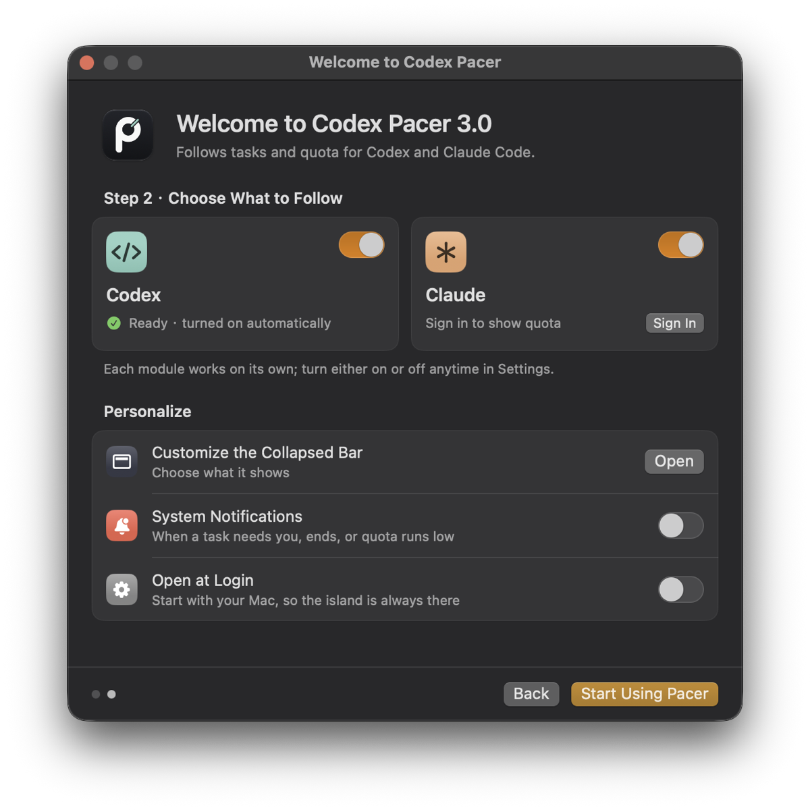
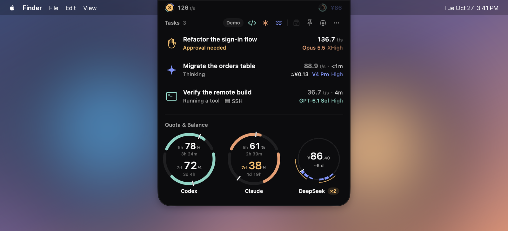

# Codex Pacer User Guide

[简体中文](guide.zh-CN.md) · [README](../README.md)

This guide covers everyday use of Codex Pacer 3. For installation, see the [README](../README.md#install).

- [First launch](#first-launch)
- [The collapsed bar](#the-collapsed-bar)
- [The expanded island](#the-expanded-island)
- [Codex](#codex)
- [Claude Code](#claude-code)
- [SSH hosts and Remote Control](#ssh-hosts-and-remote-control)
- [Settings](#settings)
- [Notifications](#notifications)
- [Privacy and stored data](#privacy-and-stored-data)
- [Troubleshooting](#troubleshooting)
- [Uninstall](#uninstall)

## First launch

The first time you open Codex Pacer 3, or the first launch after upgrading from 2.x, a two-step guide appears.

1. **Meet the island** labels the parts of the collapsed bar, shows the three badge states and demonstrates hover to expand.
2. **Choose what to follow** turns the Codex and Claude modules on or off, shows whether each one is ready, and offers shortcuts to customize the collapsed bar, turn on notifications and open Pacer at login.

Each module is independent. Pacer turns a module on automatically when it finds that service installed; once you flip a switch, your choice sticks. You can change it any time in **Settings → Codex** or **Settings → Claude**, and reopen the guide from **Settings → Help**.

After later 3.x updates, a short **What's New** note appears once instead. It lists the highlights, offers any new setting it mentions in place, and **Release Notes** opens the full list.

## The collapsed bar

| Component | Meaning |
| --- | --- |
| Task badge | Number of active tasks. An orbit turns while tasks run, in teal for Codex and orange for Claude. Solid amber: a task needs your reply or approval. A check, cross or pause: a task finished, failed or stopped and you have not looked yet. With one task, the badge can show its status icon instead of the number. |
| Speed (t/s) | Combined output speed of running tasks. |
| Quota rings and value | Remaining quota, outer ring Codex and inner ring Claude. The number alternates between the services every few seconds and can show remaining quota or pace. |
| Warnings | Shown only while the condition lasts: 5-hour quota below 20% (outlined `5h`) or exhausted (solid `5h`), an SSH host disconnected, or quota not updated. Choose which warnings appear in **Settings → Reminders**. |

Optional components include status text and the latest time to first output. Arrange everything in **Settings → Collapsed Bar**: drag components between the left and right of the camera, click × to hide one, or restore the defaults. Each service's quota can show its 5-hour or 7-day window; accounts with only a weekly limit always show 7 days.

On a display with a notch the bar sits around the camera and stays black so it blends in. On other displays, or when you choose Floating, it is a capsule just below the menu bar.

## The expanded island

**Hover** over the bar to expand it and **move away** to collapse it. Click the top, or the pin button, to keep it open; press Esc to close it.

### Tasks

Tasks from both services share one list: tasks that need you come first, then running tasks, then ended ones, most recent first within each group. Each row shows:

- the task title and its current stage (thinking, running a tool, responding, waiting for you, ended);
- how long the current turn has run, which service it belongs to, and the SSH host or Remote Control source when it is not local;
- the latest output speed and time to first output. White numbers were updated in the last 15 seconds; gray numbers are older.

Agents that a task spawns are grouped under it with their running count and combined speed. With more than three tasks, use the arrows beside the page number or Option + ← / → to page through them.

Click a task to open its conversation. Codex opens the chat in the Codex app. Claude opens a matching Claude Desktop session when it can, otherwise it resumes the session in Terminal. Opening never sends a prompt.

When a turn ends, its card stays until you open it or the retention time passes (30 minutes by default; set it in **Settings → Reminders**).

### Quota

Each service gets a ring for its 7-day window:

- the colored arc is the quota left, with the reset countdown in the middle;
- the white tick is where an even pace would put you today. *Ahead* means you are using less than that, *On pace* about the same, *Fast* more;
- the 5-hour window and its reset appear on the line below. Accounts that report only a weekly limit show a PRO placeholder there.

With only one service on, its 5-hour and 7-day windows appear as two rings side by side.

If quota cannot be read, the ring says why and offers a retry. Hover over a ring for the source and last update. Quota history, credits and banked resets are in **Settings → Codex** and **Settings → Claude**.

The ⋯ menu in the task header refreshes data or quits Pacer; the gear opens Settings.

## Codex

Pacer finds the Codex app or CLI in the usual places, including Homebrew, npm managers such as nvm, fnm, Volta, asdf, mise and pnpm, and a moved Codex.app. **Settings → Codex → This Mac** shows what it found; hover for the exact path, or pick another CLI or data folder under **Custom locations**. A custom path that stops working is reported rather than silently replaced.

Codex quota comes from your own Codex sign-in through the CLI. API-key or Amazon Bedrock sign-ins do not have ChatGPT subscription limits, and Pacer says so.

## Claude Code

Pacer uses `~/.claude`, or `CLAUDE_CONFIG_DIR` when set; choose another folder under **Settings → Claude → Custom locations**.

**Task tracking sets itself up.** While the Claude module is on, Pacer adds its own hooks and a local-only telemetry endpoint to your Claude settings and wraps any existing status-line command so its output stays the same. It writes nothing when the settings are already current, never creates a Claude folder, and leaves conflicting telemetry settings untouched. Restart running Claude Code sessions to pick up the change. Turning the module off by hand removes Pacer's entries.

**Quota needs one sign-in.** Click **Sign in to Claude** (or **Sign In** in the welcome guide) to open Pacer's own claude.ai window and sign in as usual. If your account belongs to several organizations, choose one. The session lives in Pacer's private WebKit storage and is reused across restarts until the website ends it; Pacer never reads other apps' Keychain items or browser cookies. When Claude Code's status line already reports fresh quota for the same account, Pacer uses that instead.

## SSH hosts and Remote Control

Pacer follows the SSH hosts you already use in Codex and Claude, including Claude Desktop's saved connections. Each host is monitored once, with its saved port and identity file. It needs existing non-interactive OpenSSH access and Python 3.6 or later on the host; Pacer never stores passwords or accepts new host keys.

On connected hosts that have Claude Code, Pacer sets up its Claude hooks the same way as on your Mac. A host that fails shows **Retry** and is tried again after 30 minutes.

Codex Remote Control tasks come through the Codex desktop app. Keep Codex open, connected to the remote host and with the conversation loaded.

**Settings → Connections** lists every source with problems first, each SSH host with its Codex and Claude status side by side, and the switches for SSH hosts and Remote Control.

## Settings

Settings apply as you change them; there is no Save button. Text fields apply when you press Return or leave them, and keep the last valid value if the new one is invalid.

| Page | What you can change |
| --- | --- |
| General | Updates, Open at Login, language (follow macOS, English or Simplified Chinese), Hide Project Names. |
| Appearance | Solid black or Liquid Glass, Automatic / Notch / Floating, which display, and whether to show in full-screen spaces. |
| Collapsed Bar | Which components appear and on which side of the camera, the single-task badge, remaining quota or pace, and each service's 5-hour or 7-day window. |
| Reminders | Collapsed-bar warnings, system notifications, and how long ended tasks stay. |
| Codex, Claude | Turn each module on or off, what Pacer found on this Mac, custom locations, Claude sign-in, quota history and details. |
| Connections | Status of every task source and quota, SSH hosts and Remote Control. |
| Help | A legend of every mark on the island, the welcome guide, and links to this guide and the issue tracker. |

**Open at Login** uses the macOS login item, so it also appears in **System Settings → General → Login Items**. If Pacer is switched off there, Settings says so and offers a **Login Items** button to allow it again.

## Notifications

Everything that needs attention already shows on the collapsed bar. Turn on **Settings → Reminders → System Notifications** to also get a macOS notification when a task needs your reply or approval, a turn ends or is interrupted, or a quota window drops to 15%. macOS asks for permission the first time; if you decline, the switch turns back off.

## Privacy and stored data

- Pacer has no account and sends no analytics. It connects only to your SSH hosts, the services' quota endpoints (Codex through your CLI, Claude at claude.ai) and GitHub for updates.
- From session logs it keeps task titles, stages, timing and token counts, never the content of prompts, responses or tool output.
- Preferences are stored under `com.codexpacer.app`. Quota history and a short record of the ended tasks you have opened live in `~/Library/Application Support/CodexPacerIsland`.
- *Hide Project Names* replaces task titles on the island and in notifications, which helps when sharing your screen.

## Troubleshooting

- **macOS will not open the app.** Pacer is notarized by Apple, so download it again from the [latest release](https://github.com/RyanZhangNTU/codex-pacer/releases/latest) in case your copy is incomplete. Versions before 3.0.1 were unsigned and need **Open Anyway** in **System Settings → Privacy & Security**.
- **A service shows no tasks.** Check that its module is on and that **Settings → Codex/Claude → This Mac** found it. For Claude, restart Claude Code sessions after the first setup.
- **Claude quota asks you to sign in.** The claude.ai session ended; sign in again in Pacer's window. Network errors and rate limits retry on their own.
- **An SSH host is disconnected.** Make sure `ssh <host>` works without a password prompt, then use **Retry** in Settings → Connections.
- **Speeds look high right after Pacer starts.** When Pacer joins a task midway, the first estimate can include output from before it started watching. It settles with the next measurement.
- **Something else.** [Open an issue](https://github.com/RyanZhangNTU/codex-pacer/issues) with the app and macOS versions, the source type (local, SSH or Remote Control) and steps to reproduce. Hide private task titles and account details in screenshots.

## Uninstall

1. In **Settings → Claude**, turn the Claude module off to remove Pacer's hooks from your local Claude settings.
2. Turn off **Open at Login** in **Settings → General**, quit Pacer from **Settings → Quit Codex Pacer** and move it from Applications to the Trash.
3. Optionally remove its data: `~/Library/Application Support/CodexPacerIsland` and the preferences (`defaults delete com.codexpacer.app`).

Entries Pacer added on SSH hosts stay there and point to `~/.claude/pacer` on each host. Remove them from that host's Claude settings if you no longer use Pacer.
