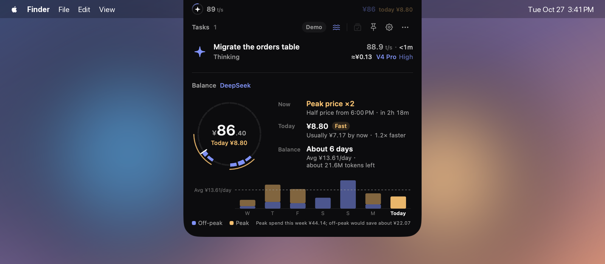

# Codex Pacer User Guide

[简体中文](guide.zh-CN.md) · [README](../README.md)

This guide covers everyday use of Codex Pacer 4. For installation, see the [README](../README.md#install).

- [First launch](#first-launch)
- [The collapsed bar](#the-collapsed-bar)
- [The expanded island](#the-expanded-island)
- [Codex](#codex)
- [Claude Code](#claude-code)
- [DeepSeek Harness](#deepseek-harness)
- [SSH hosts and Remote Control](#ssh-hosts-and-remote-control)
- [Settings](#settings)
- [Notifications](#notifications)
- [Privacy and stored data](#privacy-and-stored-data)
- [Troubleshooting](#troubleshooting)
- [Uninstall](#uninstall)

## First launch

The first time you open Codex Pacer 4, or the first launch after upgrading from 3.x, a two-step guide appears.

1. **Meet the island** labels the parts of the collapsed bar, shows the three badge states and demonstrates hover to expand.
2. **Choose what to follow** turns the Codex, Claude and DeepSeek modules on or off, shows whether each one is ready, and offers shortcuts to customize the collapsed bar, turn on notifications and open Pacer at login.

Each module is independent. Pacer turns a module on automatically when it finds that service installed; once you flip a switch, your choice sticks. You can change it any time in **Settings → Codex**, **Settings → Claude** or **Settings → DeepSeek**, and reopen the guide from **Settings → Help**.

After later 4.x updates, a short **What's New** note appears once instead. It lists the highlights, offers any new setting it mentions in place, and **Release Notes** opens the full list. Settings → What's New keeps every note to read again.

## The collapsed bar

| Component | Meaning |
| --- | --- |
| Task badge | Number of active tasks. An orbit turns while tasks run, in teal for Codex, orange for Claude and blue for DeepSeek. Solid amber: a task needs your reply or approval. A check, cross or pause: a task finished, failed or stopped and you have not looked yet. With one task, the badge can show its status icon instead of the number. |
| Speed (t/s) | Combined output speed of running tasks. |
| Quota rings and value | Remaining quota, outer ring Codex and inner ring Claude. The number alternates between the services every few seconds and can show remaining quota or pace; DeepSeek adds its balance, such as ¥86. With only DeepSeek on, the bar shows the balance and today's spend, which turns amber when today runs ahead of a usual day. |
| Warnings | Shown only while the condition lasts: 5-hour quota below 20% (outlined `5h`) or exhausted (solid `5h`), an SSH host disconnected, quota not updated, or the DeepSeek balance low (outlined `¥`) or used up (solid `¥`). An optional blue `×2` marks a DeepSeek task running at peak price; it is off until you turn it on. Choose which warnings appear in **Settings → Reminders**. |

Optional components include status text and the latest time to first output. Arrange everything in **Settings → Collapsed Bar**: drag components between the left and right of the camera, click × to hide one, or restore the defaults. Each service's quota can show its 5-hour or 7-day window; accounts with only a weekly limit always show 7 days.

Until you choose otherwise, the bar sits around the camera on a display with a notch and stays black so it blends in; on other displays it is a capsule just below the menu bar.

**Settings → Appearance → Position** offers **Notch** and **Custom**. Notch keeps the bar at the top center of any display. Custom shows **Screen Position** below it: Center is the capsule below the menu bar, and a corner (bottom left when you first switch from Notch) makes the bar a narrow vertical strip with its long edge against the side of the screen, 10 points from the menu bar or the Dock. The strip stacks its components: the left group at the top, the right group at the bottom, each number above its unit. Status text and the quota label don't fit, so they stay in tooltips and the panel. Hover the strip and the panel opens beside it, with the two groups holding its top and bottom edges.

## The expanded island

**Hover** over the bar to expand it and **move away** to collapse it. Click the top, or the pin button, to keep it open; press Esc to close it.

### Tasks

Tasks from all services share one list: tasks that need you come first, then running tasks, then ended ones, most recent first within each group. Each row shows:

- the task title and, below it, its current stage (thinking, running a tool, responding, waiting for you, ended), the number of running agents it spawned and the SSH host or Remote Control source when it is not local;
- on the right, the latest output speed and the turn's time: how long it has run, or how long it took once it ended. White numbers were updated in the last 15 seconds; gray numbers are older. Hover the speed for the time to first output;
- below the speed, the model and its reasoning effort in the service's color. Until the model is known, the service name appears there. DeepSeek tasks also show the turn's estimated cost first, such as `≈¥0.42`.

The icon shows the stage in the service's color, amber when a task needs you and red when it failed. Ended tasks you have opened or marked as read turn gray; unread ones keep their color.

Agents that a task spawns are grouped under it with their running count and combined speed. With more than three tasks, use the arrows beside the page number or Option + ← / → to page through them.

Click a task to open its conversation. Codex tasks open in the Codex app. A task started in another app shows that app's name and switches to it, relaunching the app if it quit. This covers Claude tasks started in a terminal or an editor, and Claude or Codex tasks from apps that embed them, such as a Zotero plugin. Claude Desktop sessions open in Claude Desktop, and Claude sessions on SSH hosts resume in Terminal. DeepSeek tasks bring DeepSeek Harness forward on its session list, since Harness has no link to a single conversation. Pacer only learns which app started a task while the task is running; if it doesn't know, it says so, and the message disappears after 30 seconds. Opening never sends a prompt.

To open Codex, Claude or DeepSeek Harness without a task, use the app buttons just left of the panel controls in the task header, one per enabled module in its color. A click brings that desktop app forward, launching it if needed, without opening a conversation. A module whose desktop app isn't installed shows no button; turn them all off with *Show App Buttons* in **Settings → General**.

When a turn ends, its card stays until you open it, clear it with **Mark All as Read** or the retention time passes (30 minutes by default; set it in **Settings → Reminders**). **Mark All as Read** is the button next to the pin in the expanded island. It clears every ended card on all pages at once and leaves running tasks and anything waiting for your reply or approval. Cleared cards don't come back after a restart.

### Quota

**Settings → Appearance → Expanded Quota** offers **Split Ring** (the default) and **Classic**. The choice applies immediately and is remembered. Classic keeps the previous weekly rings with 5-hour details underneath, or two period rings when only one service is on.

In Split Ring, each service gets one ring. When it reports a 5-hour limit, the shorter upper arc shows **5h** and the longer lower arc shows **7d**, with each period’s remaining percentage and reset countdown inside the ring. The same layout applies with only one service on.

- Each colored arc shows the quota left in its own window. Its white tick marks the remaining-time fraction; quota beyond the tick is ahead of an even pace.
- When a period has 15% or less left, or is being used too fast, its label and percentage turn amber; the 5-hour arc turns amber too. Hover each value for the pace verdict, reset date and freshness.
- An unknown value shows a dash and a dotted arc. Accounts without a 5-hour limit show a 7-day gauge that opens at the bottom, with **7d** in the opening.
- With only one service on, its ring sits on the left. On the right, the 5-hour and 7-day groups face their arcs and show the pace verdict and percentage, the reset time and a forecast. The forecast extends your spending so far to the reset: how much will be left, or when quota would run out (in amber). Early in a window it waits for more data. Accounts without a 5-hour limit show pace, reset and forecast as three rows. Codex limits that are neither 5-hour nor 7-day still appear as quota bars.

DeepSeek has a balance instead of quota windows, so its ring is a **day dial**: today on a 24-hour face with midnight at the top. Each hour's segment gets thicker the more that hour cost, the white tick is now, and amber arcs outside the dial mark the peak hours, when DeepSeek charges double (weekdays 09:00–12:00 and 14:00–18:00 Beijing time, shown in your time zone). The balance sits in the middle, white normally, amber when low, red when used up and gray when it could not be updated, with today's spend below it. **Peak** appears beside the name while prices are doubled, and a short runway such as **~2 d** replaces it when the balance would run out within three days. With two or three services on, the section is called **Quota & Balance**.

With only DeepSeek on, the dial sits on the left and three groups sit beside it: **Now** (the current price and when it changes), **Today** (spend so far against your usual spend by this time) and **Balance** (how many days it lasts at your recent average, and the platform's token estimate when signed in on the web). Below them, one bar per day for the last week splits spend into off-peak and peak, with the dashed line at your daily average and how much moving peak spend off-peak would have saved.

If quota cannot be read, the ring says why and offers a retry. Hover over a ring for the source and last update. Quota history, credits and banked resets are in **Settings → Codex** and **Settings → Claude**.

The ⋯ menu in the task header refreshes data or quits Pacer; the gear opens Settings.

## Codex

Pacer finds the Codex app or CLI in the usual places, including Homebrew, npm managers such as nvm, fnm, Volta, asdf, mise and pnpm, and a moved Codex.app. **Settings → Codex → This Mac** shows what it found; hover for the exact path, or pick another CLI or data folder under **Custom locations**. A custom path that stops working is reported rather than silently replaced.

Codex quota comes from your own Codex sign-in through the CLI. API-key or Amazon Bedrock sign-ins do not have ChatGPT subscription limits, and Pacer says so.

**Sessions from other apps.** Apps that embed Codex, such as a Zotero plugin, show their sessions with the app's name. To hide those sessions and their reminders, turn off **Settings → Codex → Show Codex Sessions from Other Apps**. Codex app, Terminal and VS Code sessions always show. Translations from the Zotero Agent plugin are never shown.

## Claude Code

Pacer uses `~/.claude`, or `CLAUDE_CONFIG_DIR` when set; choose another folder under **Settings → Claude → Custom locations**.

**Task tracking sets itself up.** While the Claude module is on, Pacer adds its own hooks and a local-only telemetry endpoint to your Claude settings and wraps any existing status-line command so its output stays the same. It writes nothing when the settings are already current, never creates a Claude folder, and leaves conflicting telemetry settings untouched. Restart running Claude Code sessions to pick up the change. Turning the module off by hand removes Pacer's entries.

**Quota needs one sign-in.** Click **Sign in to Claude** (or **Sign In** in the welcome guide) to open Pacer's own claude.ai window and sign in as usual. If your account belongs to several organizations, choose one. The session lives in Pacer's private WebKit storage and is reused across restarts until the website ends it; Pacer never reads other apps' Keychain items or browser cookies. When Claude Code's status line already reports fresh quota for the same account, Pacer uses that instead.

**Sessions from other apps.** Apps that embed Claude Code through the Claude Agent SDK, such as a Zotero plugin, show their sessions with the app's name. To hide those sessions and their reminders, turn off **Settings → Claude → Show Claude Sessions from Other Apps**. Terminal, VS Code and Claude Desktop sessions always show.

## DeepSeek Harness

Pacer reads DeepSeek Harness's session logs in `~/.dsh`, or `DSH_HOME` when set; choose another folder under **Settings → DeepSeek → Custom locations**. It follows the stage of each turn, its speed and time to first output, approvals, questions that wait for your reply, and how the turn ended, from the token counts and timing only. Harness saves each reply when its step finishes, so speed and cost update step by step rather than while text streams. Harness sessions on SSH hosts are not followed yet.

**Turn cost.** Pacer estimates each turn's cost from its tokens and DeepSeek's published prices, doubled at peak times, and shows it before the model name. Public holidays are not known, so a holiday weekday is priced at peak. The platform bill is authoritative. Turn the estimate off with **Settings → DeepSeek → Show each turn's estimated cost**.

**Balance follows how Harness signs in.** When Harness uses a DeepSeek account, click **Sign In** (on the dial, in the welcome guide or in Settings) to open the DeepSeek platform in Pacer's own window and sign in as usual; the session stays in Pacer's private WebKit storage. When Harness uses an API key, paste a key in **Settings → DeepSeek**; it is kept in your login keychain and used only to read the balance. Pacer never reads Harness's own sign-in or key. **Balance source** in Settings lets you choose web sign-in or an API key instead of the automatic choice.

**Low balance.** The balance counts as low below the alert line you set on the DeepSeek platform, or below **Low balance warning** in Settings (¥10 by default) when the platform has none, or when it would run out within three days at your recent average.

## SSH hosts and Remote Control

Pacer follows the SSH hosts you already use in Codex and Claude, including Claude Desktop's saved connections. Each host is monitored once, with its saved port and identity file. It needs existing non-interactive OpenSSH access and Python 3.6 or later on the host; Pacer never stores passwords or accepts new host keys.

On connected hosts that have Claude Code, Pacer sets up its Claude hooks the same way as on your Mac. A host that fails shows **Retry** and is tried again after 30 minutes.

Codex Remote Control tasks come through the Codex desktop app. Keep Codex open, connected to the remote host and with the conversation loaded.

**Settings → Connections** lists every source with problems first, each SSH host with its Codex and Claude status side by side, and the switches for SSH hosts and Remote Control.

## Settings

Settings apply as you change them; there is no Save button. Text fields apply when you press Return or leave them, and keep the last valid value if the new one is invalid.

| Page | What you can change |
| --- | --- |
| General | Updates, Open at Login, language (follow macOS, English or Simplified Chinese), Hide Project Names, Show App Buttons. |
| Appearance | Solid black or Liquid Glass, Notch or Custom with its screen position (center or a corner strip), which display, and whether to show in full-screen spaces. |
| Collapsed Bar | Which components appear and on which side of the camera, the single-task badge, remaining quota or pace, and each service's 5-hour or 7-day window. |
| Reminders | Collapsed-bar warnings, system notifications, and how long ended tasks stay. |
| Codex, Claude, DeepSeek | Turn each module on or off, what Pacer found on this Mac, custom locations, Claude sign-in, each service's sessions from other apps, quota history and details; for DeepSeek, the balance source, sign-in or API key, the low-balance line and the turn-cost estimate. |
| Connections | Status of every task source and quota, SSH hosts and Remote Control. |
| What's New | The highlights of every update since 3.1, newest first, with the same switches as the update note and a link to the full release notes. |
| Help | A legend of every mark on the island, the welcome guide, and links to this guide and the issue tracker. |

**Open at Login** uses the macOS login item, so it also appears in **System Settings → General → Login Items**. If Pacer is switched off there, Settings says so and offers a **Login Items** button to allow it again.

## Notifications

Everything that needs attention already shows on the collapsed bar. Turn on **Settings → Reminders → System Notifications** to also get a macOS notification when a task needs your reply or approval, a turn ends or is interrupted, a quota window drops to 15%, or the DeepSeek balance becomes low or runs out. A turn that ends by asking you to choose the next step, like Claude's next-step box, sends just the reply notification. macOS asks for permission the first time; if you decline, the switch turns back off.

## Privacy and stored data

- Pacer has no account and sends no analytics. It connects only to your SSH hosts, the services' quota endpoints (Codex through your CLI, Claude at claude.ai, DeepSeek at platform.deepseek.com or api.deepseek.com) and GitHub for updates.
- From session logs it keeps task titles, stages, timing and token counts, never the content of prompts, responses or tool output.
- Preferences are stored under `com.codexpacer.app`. Quota history and a short record of the ended tasks you have opened live in `~/Library/Application Support/CodexPacerIsland`.
- *Hide Project Names* replaces task titles on the island and in notifications, which helps when sharing your screen.

## Troubleshooting

- **macOS will not open the app.** Pacer is notarized by Apple, so download it again from the [latest release](https://github.com/RyanZhangNTU/codex-pacer/releases/latest) in case your copy is incomplete. Versions before 3.0.1 were unsigned and need **Open Anyway** in **System Settings → Privacy & Security**.
- **A service shows no tasks.** Check that its module is on and that **Settings → Codex/Claude → This Mac** found it. For Claude, restart Claude Code sessions after the first setup.
- **Claude quota asks you to sign in.** The claude.ai session ended; sign in again in Pacer's window. Network errors and rate limits retry on their own.
- **The DeepSeek balance asks you to sign in or paste a key.** The platform session ended or the key was rejected. Sign in again or paste a new key in **Settings → DeepSeek**; tasks and turn costs keep working meanwhile.
- **An SSH host is disconnected.** Make sure `ssh <host>` works without a password prompt, then use **Retry** in Settings → Connections.
- **Speeds look high right after Pacer starts.** When Pacer joins a task midway, the first estimate can include output from before it started watching. It settles with the next measurement.
- **Something else.** [Open an issue](https://github.com/RyanZhangNTU/codex-pacer/issues) with the app and macOS versions, the source type (local, SSH or Remote Control) and steps to reproduce. Hide private task titles and account details in screenshots.

## Uninstall

1. In **Settings → Claude**, turn the Claude module off to remove Pacer's hooks from your local Claude settings.
2. In **Settings → DeepSeek**, sign out or remove the API key to clear Pacer's DeepSeek session and keychain item.
3. Turn off **Open at Login** in **Settings → General**, quit Pacer from **Settings → Quit Codex Pacer** and move it from Applications to the Trash.
4. Optionally remove its data: `~/Library/Application Support/CodexPacerIsland` and the preferences (`defaults delete com.codexpacer.app`).

Entries Pacer added on SSH hosts stay there and point to `~/.claude/pacer` on each host. Remove them from that host's Claude settings if you no longer use Pacer.
