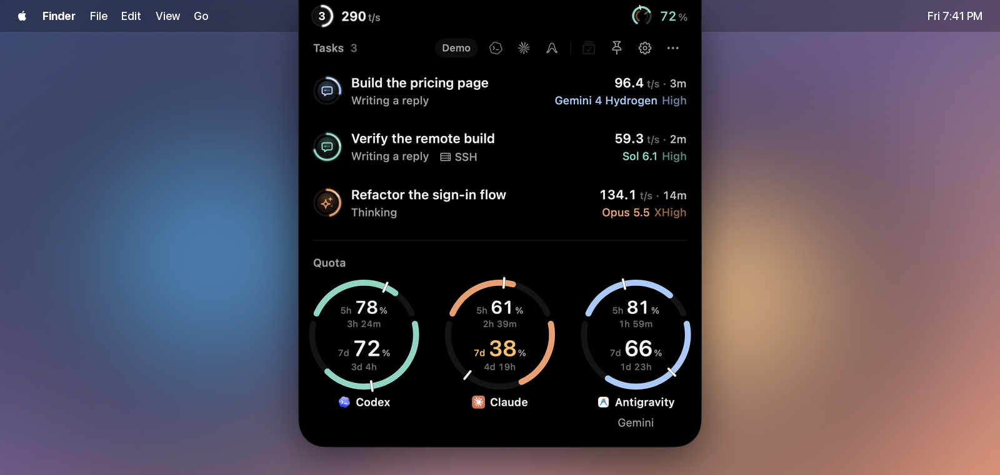
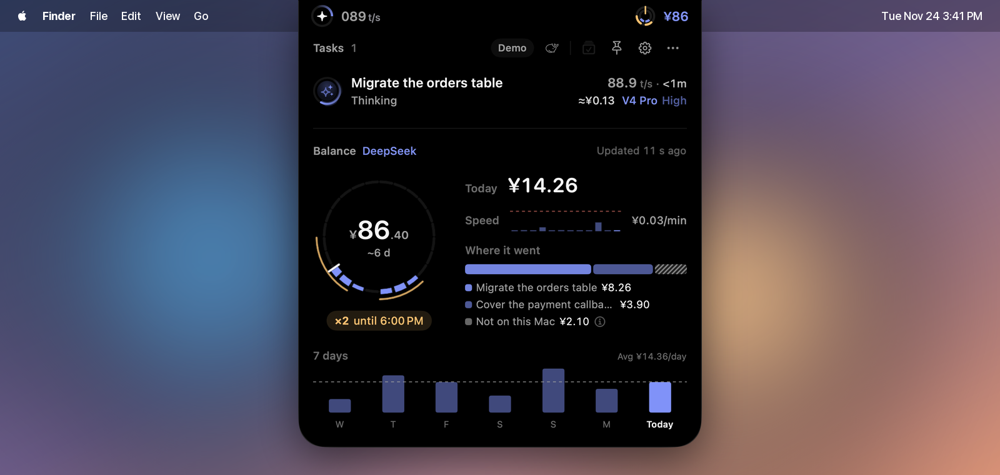

# Codex Pacer User Guide

[简体中文](guide.zh-CN.md) · [README](../README.md)

- [Getting started](#getting-started)
- [The collapsed bar](#the-collapsed-bar)
- [The expanded island](#the-expanded-island)
- [Progress rings](#progress-rings)
- [Quota and balance](#quota-and-balance)
- [Services](#services)
- [The main window](#the-main-window)
- [Privacy](#privacy)
- [Troubleshooting](#troubleshooting)
- [Uninstall](#uninstall)

## Getting started

The first time you open Codex Pacer, a short guide walks you through it:

1. What each part of the collapsed bar means.
2. **Island**, which sits at the top center of the screen around the notch, or **Free Move**, which you drag anywhere.
3. Which services to follow: Codex, Claude, DeepSeek and WorkBuddy (and WorkBuddy AI, the international version, if you have it). Pacer turns on the ones it finds on this computer; the others wait under **more not found on this computer**.
4. Progress rings, notifications and opening at login.

You can open the guide again from **Help & Updates**. After each update, a short **What's New** note shows the highlights once.

Three services need a sign-in for their numbers:

- **Claude quota:** click **Sign in to Claude** and sign in to claude.ai in Pacer's own window.
- **DeepSeek balance:** sign in to the DeepSeek platform in Pacer's window, or paste an API key if DeepSeek Harness uses one.
- **WorkBuddy credits:** click **Sign In** on the WorkBuddy page and sign in with the account you use in WorkBuddy. WorkBuddy AI has its own page and account.

Codex quota needs nothing extra.

## The collapsed bar

| Part | What it tells you |
| --- | --- |
| **Task badge** | How many tasks are running. Its ring shows which services are working, or their average progress. Amber means a task needs your reply or approval; a check means one just finished. |
| **Speed** | The combined output speed of your running tasks, in tokens per second. Shows `000` when no rate is available. |
| **Quota** | Quota left for Codex and Claude, your DeepSeek balance or budget, or your WorkBuddy credits. |
| **Warnings** | Appear only when something needs attention, such as low quota, low credits or a disconnected SSH host. |

**Hover** to expand the island, **move away** to collapse it. Click the top to keep it open, and press Esc to close it. In **Settings → Expanded Panel**, choose **On click** to open the island with one click and close it with another.

Choose what the bar shows in **Collapsed Bar**: drag items on the live preview to reorder them or move them to the other side of the camera, and click one to see its options. In the list of items, the round button at the end of each one adds it to the bar or removes it. The badge's ring can show the services that are running, the average progress, or one segment per task.

To move the island, choose **Free Move** in **Appearance**, then drag the bar by its status area. Release it near a screen edge and it snaps there. **Return to Top Center** puts it back. If you move it often, you can add this button to the expanded island's header: in **Expanded Panel**, select **Buttons** and turn on **Return to Top Center**. With several displays, each one remembers its own place.

## The expanded island

All your tasks share one list. Tasks that need you come first, then running tasks, then finished ones. Each row shows the task's title and current step, where it runs if not on this computer, its output speed, how long the turn has taken, and the model.

- **Click a task** to open its conversation in the app that runs it.
- **A finished task** stays as a card until you open it, or until its retention time passes (30 minutes by default, set on the task list in **Expanded Panel**). **Mark All as Read** clears every finished card at once.
- **A task whose status is unconfirmed** (Pacer lost track of it, for example because the app running it quit or crashed) clears the same way: open it, or use **Mark All as Read**. It comes back if the task starts working again.
- **Each subagent has a dot.** The provider’s color means running, the attention color means it’s waiting for you, red means it failed, and grey means it ended. A one-line task shows up to five dots and a two-line task shows eight. While the task works, the two-line view lists up to three subagents, showing active ones first and then the most recently ended. The rest share a summary line. Only working subagents contribute to the task’s speed.
- Claude subagents show their description, with a tag for a specialized agent’s type. Codex subagents show their task name as a tag, as Codex lists them, followed by what they are doing now; a role other than the default adds a second tag. Each line shows live speed, time, and the model with its reasoning level when available. Once it ends, the outcome replaces the speed. Codex for Claude runs carry a task, review or resume tag. On Mac, the panel widens first. If space is still tight, the title shortens, then the model and time drop away in that order. The speed stays visible.
- **App buttons** in the header open Codex, Claude, DeepSeek Harness or WorkBuddy directly. Buttons you take out of the header wait in the **⋯** menu, beside **Refresh** and **Quit**.
- With more tasks than fit on a page (three by default), use the arrows to page through them.

### Arranging the panel

The panel is a column of blocks: the task list, a quota block for each service, DeepSeek's balance, where today's DeepSeek spend went, its last 7 days, and WorkBuddy's credits. On the **Expanded Panel** page, drag a block in the outline to move it and click it to see its choices. In the list below, the round button at the end of each block adds it to the panel or removes it. Until you change anything, the panel follows the services you turn on. **Restore Automatic** goes back to that.

- **Task list:** 3 to 6 tasks per page, rows of two lines or one, and which details each row shows.
- **Quota:** each service can show both windows, only the week or only 5 hours. Quotas next to each other share a row; choose **One row each** to give every service its own row with its pace, reset and forecast beside it. The style and the pace tick are here too.
- **DeepSeek:** the budget or today's dial, the peak-price chip, how many tasks the spend bar names, whether spend from elsewhere shows, and the 7-day reference line.

## Progress rings

Codex, Claude Code, DeepSeek Harness, WorkBuddy and Antigravity each report how much of your request is done. Pacer draws it as a ring around the task's icon.

| You see | It means |
| --- | --- |
| A comet circling | The task is working and hasn't sent an estimate yet. |
| An arc with light running along it | The latest estimate, while the task works. |
| A breathing ring with a moon | The task is waiting for background work and will continue. |
| An amber disc | The task needs your reply or approval. |
| A full ring and a check | The request is done. |

Estimates are the agent's own guess, so a ring can move back. Rings are on by default; turn them off for each service with **Progress Ring** on its page in the main window. Start a new session after turning a ring on.

On Mac, turn on the Antigravity module and its **Progress Ring**. Pacer adds its plugin automatically. Start a new Antigravity conversation with a task that uses tools. When asked, always allow Pacer’s progress tool, or add `mcp(codex-pacer_pacer_progress/*)` in Antigravity **Settings → Permissions → MCP tools**. The ring shows the estimate on the conversation that reported it. Each subagent reports its own estimate.

Codex tasks on SSH hosts, and in WSL on Windows, report too: Pacer sets reporting up on each connected host that runs Codex, including hosts added directly in Codex Desktop. Tasks that were already running pick it up once Codex reconnects to the host.

Turn on **Dot Tasks** on the Codex page to see Dot Durable tasks. It is off by default because checking them uses more power; after an upgrade it stays on if Dot tasks already reported progress on this computer. Pacer labels Dot tasks assigned to this computer with `Dot`, even when their chats are closed. On Windows this works with the Microsoft Store version of Codex Desktop and its default profile. The Codex **Progress Ring** switch sets up percentage reporting. Restart Codex Desktop after turning the ring on so Dot tasks pick it up. Turning the ring off stops new reports right away. Pacer still shows whether the task is running or has finished.

## Quota and balance

**Codex and Claude.** Each service has one ring: the upper arc is the 5-hour quota and the lower arc the weekly quota, each with its percentage left and a reset countdown. A white tick marks how much of the time is left: if the arc reaches past the tick, you're ahead of an even pace. Values turn amber when they run low or fast. With only one service on, Pacer also shows its pace and a forecast for the reset.

**Codex banked resets.** A small capsule under the Codex quota shows your available banked resets and when the next one expires; click it to open every expiry in **History**. When a reset is about to expire, the collapsed bar warns you and a system notification follows; set how many days ahead on the **Notifications** page (three days by default). To hide the capsule, select the Codex block on the **Expanded Panel** page and turn off **Banked resets**.

**DeepSeek.** DeepSeek uses a balance instead of quota. Its dial shows today on a 24-hour face, with what each hour cost and the peak hours, when prices double. The balance sits in the middle. Switch to **Budget** on the DeepSeek page to set daily and weekly budgets, which the dial then paces like quota. Budgets only remind you; Pacer never blocks a request. Each DeepSeek task also shows an estimated cost for its turn.

Spend made elsewhere on your account, such as web searches or another device, is included in today's total and budgets.

**WorkBuddy.** WorkBuddy uses account credits. Once you sign in, its ring shows what is left of this month's credits, which refresh every plan cycle. Above the figure, the ring counts down to the refresh, or shows extra credits about to expire. Rewards and top-ups never refresh, so the ring's gap shows them as an amount, such as **+1,300**. When you have none, it says **This month**. The figure in the middle can show this month's share, this month's credits or everything available; choose it on the **Expanded Panel** page. The bar shows everything available by default. Each WorkBuddy task shows the credits its turn used.

## Services

**Codex.** Pacer finds the Codex app or CLI on its own. Tasks from apps that embed Codex show that app's name; hide them with **Sessions from Other Apps**.

**Claude Code.** Task tracking sets itself up when the Claude module is on. Restart running Claude Code sessions once afterwards. With **Show Claude cloud Projects** on, Pacer also follows your cloud Project threads and tells you when one ends or waits for you.

**Codex for Claude.** Enable both the Claude and Codex modules, then turn on **Claude calls Codex** in **Settings → Collaboration**. Claude Code can hand a task, an investigation, a review or a fix to Codex through Pacer's `/pacer:codex` skill. Just ask Claude, for example "have Codex review this change". Claude works and replies as it always does; Pacer only adds the tool. Each run shows under the Claude task that started it, with its progress, speed and model; hover over a running one to stop it. While Codex works, a green light runs around the task ring in the collapsed bar. A task shows up to three runs, the ones still working first; older finished runs fold into one line. The first time you open **Settings → Collaboration**, a short guide shows what happens in a looping demo and walks you through three steps: turn it on, ask in Claude, and watch it in Pacer. Each step ticks once you have done it. Close the guide when you like; **How It Works** next to **Pairs** brings it back, and **Help → Collaboration** shows the same guide.

The Collaboration page lists the pairs, each with its switch; Claude calls Codex is the first. Its basic settings choose when Claude may call Codex, the model, reasoning effort and fast mode (or follow Codex's own), and when the conversations Pacer leaves in Codex are cleared. The advanced settings set Codex's file access, whether it works in the project or a separate worktree, standing instructions added to every request, Codex's memories, how many runs go at once and a quota floor below which Claude won't start new runs.

**DeepSeek Harness.** Pacer follows local Harness sessions, their speed and cost.

**WorkBuddy.** Pacer follows WorkBuddy's tasks on this computer: running work, questions waiting for you and finished turns. Click a task to return to its conversation. To see your credits, click **Sign In** on the WorkBuddy page; the window closes by itself once you're signed in. The page lists this month's credits, extra credits and the total, then what each kind has left and when it refreshes or expires. The **⋯** menu next to the account refreshes, switches account or signs out. History shows the credits you used each day of the last week. WorkBuddy AI, the international version, works the same way on its own page and account.

The progress ring is on by default. The first time, the WorkBuddy page shows the steps under the switch, and each one ticks itself:

1. Pacer adds its tool to WorkBuddy.
2. WorkBuddy reads new tools only when it starts. If it was already open, click **Restart WorkBuddy**: Pacer closes it and opens it again at its connectors. If a WorkBuddy task is running, Pacer asks first.
3. Click **Open** to show WorkBuddy's connectors.
4. Click **Custom Connector** at the top right of that page.
5. Click **Trust** on `pacer_progress`.

Once you trust it, the steps fold away into one line: it works in new WorkBuddy conversations. That line goes too once WorkBuddy first reports progress.

After you click **Open** or **Restart**, a small floating guide shows in the corner of your screen. WorkBuddy takes some seconds to start and show its connectors, so the guide first asks you to wait, then shows steps 4 and 5, each with a picture of what to click. It follows along as you click, even with Settings closed, and needs no permission. It closes by itself when you're done, or with its close button. If you turn the tool off or remove it in WorkBuddy and then turn the ring off and on, Pacer asks you to restart WorkBuddy so it reads the tool again. If a Pacer update changes the tool, WorkBuddy asks you to trust it again, and the sidebar, Overview and the expanded panel say so. Turning the ring off removes the tool. If WorkBuddy keeps its data elsewhere, choose the folder under **Custom Locations**.

**SSH hosts.** Pacer follows the hosts you already use in Codex and Claude, including hosts added directly in Codex Desktop. A machine you reach through more than one entry is followed once. A host needs SSH access without a password prompt and Python 3. If a host disconnects, use **Retry** on the **Remote** page. You can turn monitoring off or back on for each host on the **Remote** page.

**WSL on Windows.** Turn on WSL monitoring in **Settings → Remote** when you need it. At least one distribution must be installed. Monitoring increases power use. Use **Refresh Now** after installing a distribution or to check which ones are running.

**Codex tasks.** Pacer follows Codex through hooks that Codex asks you to allow once. The welcome guide's last page (or, after an update, the update note) lists two steps: update Codex if it's too old, then choose **Open Codex** and follow the small guide beside it. You can also do it yourself: in Codex, choose **Review hooks** next to the message box, or open **Settings → Hooks**, and allow Codex Pacer's hooks. Until then Pacer shows no Codex tasks and the collapsed bar shows a Codex mark. **Task monitoring**, the first row of the Codex page, shows whether tracking works.

## The main window

Click the gear in the expanded island to open the main window.

| Page | What's there |
| --- | --- |
| **Overview** | Anything that needs you, each service at a glance and the running tasks. |
| **History** | Each service's quota over the current period, and the last 7 days of DeepSeek spend and WorkBuddy credits. |
| **Codex, Claude, DeepSeek, WorkBuddy** | Turn each service on or off. Every service page starts with the same status: **Task monitoring** (whether Pacer reads its tasks on this computer), **Account** and **Usage**; then what it shows, its usage settings if it has any, and custom folders. Only services found on this computer, or turned on, are listed. |
| **Module Library** | Every service Pacer can follow. Those found on this computer come first; the rest are folded away. Turn any of them on or off, or follow the link to get one. |
| **Collaboration** | Pairs like Claude calls Codex: the switch, and how Codex runs for Claude. |
| **Remote** | Tasks on other machines: SSH hosts and, on Windows, WSL. |
| **Appearance** | Theme, accent color, the island's material and size, Island or Free Move, and which display it uses. |
| **Collapsed Bar** | What the bar shows and each item's options. |
| **Expanded Panel** | The panel's blocks, their order and each block's options, including how long finished tasks stay. |
| **Notifications** | Which events show on the bar or as system notifications, DeepSeek alerts, and for WorkBuddy the credits that count as low how many days before credits expire you're reminded, and how many days before a Codex banked reset expires. |
| **General** | Open at Login, the Dock icon, language and **Hide Project Names** for screen sharing. |
| **Help & Updates** | Updates, What's New and help. |

Changes apply right away. When an update is available, it shows in the sidebar and on Overview; **Update and Restart** installs it.

## Privacy

- Pacer has no account and sends no analytics.
- It reads the logs your agents already write and keeps only what the island shows: task titles, stages, timing and token counts. It never keeps your prompts or replies.
- Sign-ins happen in Pacer's own window. Pacer never reads other apps' passwords or browser cookies.
- **Hide Project Names** replaces task titles on screen and in notifications.
- Codex for Claude's conversations are cleared when Claude's turn ends, unless you choose a later time or to keep them. Pacer keeps no history of the runs.

## Troubleshooting

- **A service shows no tasks.** Check that the service is on and that its page says it was found. For Claude Code, restart running sessions once after setup.
- **Claude quota or the DeepSeek balance asks you to sign in.** The session has ended. Sign in again on the service's page.
- **A ring keeps circling.** Start a new session of that agent after turning its ring on. Claude cloud Projects can't report estimates, so their ring circles until they finish.
- **An SSH host is disconnected.** Check that you can connect with `ssh <host>` without typing a password, then click **Retry** on the **Remote** page.
- **Settings says Claude's TPS is estimated.** Your own or your organization's telemetry settings already use the same Claude Code feature Pacer needs, so Pacer kept them as they are. Speeds are estimated but still update while a task runs. If those settings go away, Pacer switches back on its own.
- **Speeds look high right after Pacer starts.** The first reading can include earlier output. It settles within a moment.
- **On Windows, tasks stop updating and Pacer asks you to reopen it.** Reopen Pacer. Please also [open an issue](https://github.com/RyanZhangNTU/codex-pacer/issues) and attach the newest file from `%LOCALAPPDATA%\CodexPacer\CrashLogs`. It holds no task content.
- **Windows says the installer is unrecognized.** Choose **More info → Run anyway**. The installer isn't code signed yet.
- **Something else.** [Open an issue](https://github.com/RyanZhangNTU/codex-pacer/issues) with your Pacer and system versions and the steps to reproduce. Hide private task titles and account details in screenshots.

## Uninstall

1. Turn off the Claude module and each **Progress Ring**, so Pacer removes what it added to your agents' settings.
2. Sign out of DeepSeek or remove the API key on the DeepSeek page.
3. Turn off **Open at Login**, then quit Pacer.
4. On a Mac, move Codex Pacer from Applications to the Trash. On Windows, uninstall it from **Apps** in Windows Settings.
