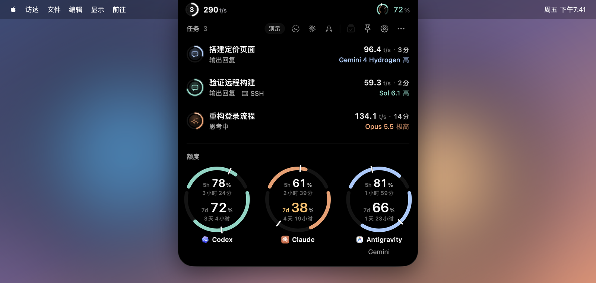
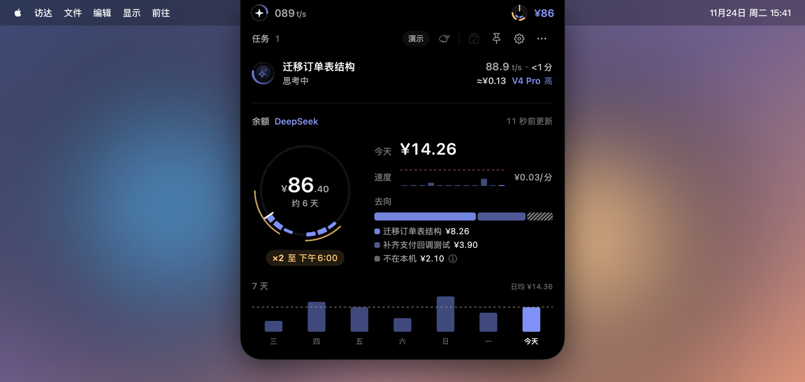

# Codex Pacer 使用指南

[English](guide.md) · [README](../README.zh-CN.md)

- [开始使用](#开始使用)
- [折叠栏](#折叠栏)
- [展开的灵动岛](#展开的灵动岛)
- [进度圆环](#进度圆环)
- [额度与余额](#额度与余额)
- [各项服务](#各项服务)
- [主窗口](#主窗口)
- [隐私](#隐私)
- [常见问题](#常见问题)
- [卸载](#卸载)

## 开始使用

第一次打开 Codex Pacer 时，会有一段简短的引导：

1. 介绍折叠栏各部分的含义。
2. 选择**灵动岛模式**（贴在屏幕顶部中央，和刘海连在一起）或**自由拖动模式**（可以拖到任意位置）。
3. 选择要追踪的服务：Codex、Claude、DeepSeek、Mac 版 Antigravity 和 WorkBuddy（装了海外版 WorkBuddy AI 时也会列出）。这台电脑上找到的服务会自动开启，其余的收在“未在这台电脑上找到”里。
4. 进度圆环、通知和登录时打开。

之后可以在“帮助与更新”中再次打开引导。每次更新后，会显示一次简短的“更新内容”。

有三项数据需要登录：

- **Claude 额度：** 点“登录 Claude”，在 Pacer 自己的窗口里登录 claude.ai。
- **DeepSeek 余额：** 在 Pacer 的窗口里登录 DeepSeek 开放平台；如果 DeepSeek Harness 用的是 API Key，粘贴一个 Key 即可。
- **WorkBuddy 积分：** 在 WorkBuddy 页点“登录”，用你在 WorkBuddy 里登录的账号登录。WorkBuddy AI（海外版）有自己的页面和账号。

Codex 额度无需额外设置。

## 折叠栏

| 部分 | 含义 |
| --- | --- |
| **任务徽标** | 正在运行的任务数。外圈显示哪些服务在工作，或者它们的平均进度。变成琥珀色表示有任务等你回复或审批；出现对勾表示有任务刚完成。 |
| **速度** | 所有运行中任务的合计输出速度，单位是 token/秒。没有可用速率时显示 `000`。 |
| **额度** | Codex、Claude 和 Antigravity 的剩余额度、DeepSeek 的余额或预算，或 WorkBuddy 的积分。 |
| **警告** | 只在需要注意时出现，比如额度不足、积分偏低、SSH 主机断开。 |

**悬停**展开灵动岛，**移开**收起。点击顶部可以保持展开，按 Esc 收起。在“设置 → 展开面板”中选择“点击后展开”，即可点击折叠栏展开或收起灵动岛。

在“折叠栏”页可以决定显示哪些内容：在实时预览上拖动组件调整顺序，或移到摄像头另一侧；点一个组件查看它的选项。组件列表里每项末尾的圆形按钮用来加入或移除。任务徽标的外圈可以显示正在工作的服务、平均进度，或每个任务一段。

想移动灵动岛，先在“外观”中选“自由拖动”，再按住状态区域拖动。靠近屏幕边缘松手会自动吸附。“回到顶部中央”可以放回原处。经常移动的话，可以把这个按钮加到展开面板的标题栏：在“展开面板”页选中“操作按钮”，打开“回到顶部中央”。有多块屏幕时，每块屏幕单独记住位置。

## 展开的灵动岛

所有任务都在一个列表里：等你处理的排最前，其次是运行中的，最后是已完成的。每一行显示任务标题和当前步骤、不在本机时的运行位置、输出速度、本轮用时和模型。

- **点击任务**，在运行它的应用里打开对应对话。
- **完成的任务**会留一张卡片，直到你打开它，或保留时间到期（默认 30 分钟，在“展开面板”页的任务列表里修改）。“全部标为已读”一次清掉所有完成的卡片。
- **状态未确认的任务**（Pacer 跟丢了它，比如运行它的应用退出或崩溃了）也一样：打开它，或用“全部标为已读”清掉。这个任务重新开始工作时，会再次显示。
- **任务启动的子代理**各有一个圆点。服务色表示运行中，提醒色表示正在等待你操作，红色表示失败，灰色表示已结束。单行模式最多显示五个圆点，双行模式最多显示八个。任务运行时，双行模式还会列出最多三个子代理，优先显示正在工作的，其次是最近结束的，其余合并成一行。只有仍在工作的子代理才计入任务速度。
- Claude 子代理用任务描述作标题，专用类型显示为小标签。Codex 子代理和 Codex 自己的列表一样，用任务名作标签，后面显示它正在做什么；指定了非默认角色时再加一个角色标签。行尾显示实时速度、用时，以及模型和思考等级，结束后用结果代替速度。Codex for Claude 的运行标签显示“任务”“审查”或“续问”。Mac 面板会先加宽，空间仍不足时先缩短标题，再依次隐藏模型和用时，保留速度。
- 标题栏的**应用按钮**可以直接打开 Codex、Claude、DeepSeek Harness、WorkBuddy 或 Antigravity。从标题栏拿掉的按钮会收进 **⋯** 菜单，和“刷新”“退出”放在一起。
- 任务超过一页（默认每页三个）时，用箭头翻页。

### 安排面板

面板由一列区块组成：任务列表、每个服务的额度、DeepSeek 余额、今天 DeepSeek 的花费去向、最近 7 天，以及 WorkBuddy 积分。在“展开面板”页，拖动示意图里的区块可以换顺序，点一下查看它的选项；下方列表里每个区块末尾的圆形按钮用来加入或移除。没改过之前，面板跟随你启用的服务；“恢复自动”可以回到这个状态。

- **任务列表**：每页 3 到 6 个，两行或一行，以及每行显示哪些信息。
- **额度**：每个服务可以显示两个周期、只看 7 天或只看 5 小时。相邻的额度并排；选“各占一行”后，每个服务单独一行，旁边写配速、重置时间和预测。样式和配速刻度也在这里。
- **DeepSeek**：预算表盘或今日时间表盘、高峰提示、花费去向列出几个任务、是否显示本机以外的花费，以及最近 7 天的参考线。

## 进度圆环

Codex、Claude Code、DeepSeek Harness、WorkBuddy 和 Antigravity 都会报告你的请求完成了多少，Pacer 把它画成任务图标外的一圈圆环。

| 看到的样子 | 含义 |
| --- | --- |
| 一颗彗星在绕圈 | 任务在工作，还没给出估计。 |
| 一段弧，光沿着它流动 | 最新的估计，任务正在工作。 |
| 圆环在呼吸，中间是月亮 | 任务在等后台工作，之后会继续。 |
| 琥珀色实心圆 | 任务等你回复或审批。 |
| 圆环填满并出现对勾 | 请求已完成。 |

估计来自代理自己的判断，所以圆环偶尔会往回走。圆环默认开启；可以在主窗口各服务页面的“任务进度圆环”中分别关闭。打开圆环后，新开的会话才会开始报告。

在 Pacer 的 Antigravity 页面打开“任务进度圆环”。设置期间，这里会显示 Antigravity 授权卡片的示意图。如果使用 Windows，先重启 Antigravity，让它载入进度工具。

1. 在设置或浮动指南中，点击示例旁的“复制”。打开 Antigravity，新建对话，粘贴这句话，让它查一下今天的日期和电脑的名字。如果 Pacer 发现这个对话没有加载进度工具，浮动指南会提醒你再新建一个对话，粘贴同一句话。
2. 当 Antigravity 针对 Pacer 的进度工具询问 **“Allow using this MCP tool?”** 时，Pacer 会自动弹出浮动指南。点击第 3 项 **“Yes, and always allow”**，再点击 **“Submit”** 或按回车键。Antigravity 使用外部工具前会先询问。选“Yes, allow this time”，下次报告进度时还会再问。选“Yes, and always allow in this conversation”，新对话中还会再问。只有“Yes, and always allow”能让它以后都不再询问。
3. Antigravity 保存授权后，Pacer 就会显示“已就绪”。任务报告进度时，圆环会随之更新。关闭再打开圆环或模块，Antigravity 仍会记得这项授权。

SSH 主机上的 Codex 任务（以及 Windows 上 WSL 里的 Codex 任务）也会报告进度：Pacer 会在每台已连接、装有 Codex 的主机上设置好。已经在运行的任务，要等 Codex 重新连接到该主机后才会开始报告。

在 Codex 页打开“Dot 任务”后才会显示 Dot 的 Durable 任务。它默认关闭，因为检查这些任务会增加耗电；升级时，如果这台电脑上已有 Dot 任务上报过进度，会保持开启。Dot 分派到这台电脑的任务会标注 `Dot`，聊天关闭时也能看到。Windows 上需要使用 Microsoft Store 版 Codex Desktop 和它的默认配置。Codex 页的“任务进度圆环”开关控制百分比上报。打开圆环后请重启 Codex Desktop，Dot 任务才会开始上报。关闭圆环会立即停止上报，Pacer 仍会显示任务是正在运行还是已经结束。

## 额度与余额

**Codex 和 Claude。** 每个服务一个圆环：上弧是 5 小时额度，下弧是每周额度，各自显示剩余百分比和重置倒计时。白色刻度表示还剩多少时间：弧线超过刻度，说明你用得比匀速慢。额度偏低或用得太快时，数值变成琥珀色。只开一个服务时，还会显示配速和到重置时的预计。

**Codex 重置券。** Codex 额度下方的小胶囊显示可用的重置券和最近一张还有多久过期，点一下打开“历史”里每张的到期列表。快到期时，折叠栏会出现提醒并发系统通知；提前几天提醒在“通知”页设置，默认 3 天。不想显示胶囊，可以在“展开面板”页选中 Codex 区块后关掉“重置券”。

**DeepSeek。** DeepSeek 按余额计费，没有额度窗口。它的表盘是今天的 24 小时钟面，显示每个小时花了多少，并标出价格翻倍的高峰时段，中间是余额。在 DeepSeek 页切换到“预算”可以设置每日和每周预算，表盘会像额度一样显示配速。预算只做提醒，Pacer 不会拦截任何请求。每个 DeepSeek 任务还会显示这一轮的估算花费。

账户在别处产生的花费，比如联网搜索或其他设备，也会计入今天的花费和预算。

**Antigravity（Mac）。** Gemini 有自己的额度，Claude 和 GPT 共用另一组额度。在 Antigravity 设置页选择模型组，岛上就会显示这组模型的短期和每周额度。未使用的模型组可能显示满额，但没有重置日期。你可以在“历史”中查看两组额度，以及有重置日期的每周用量走势。

**WorkBuddy。** WorkBuddy 按账户积分计费。登录后，圆环显示本月积分还剩多少，本月积分每个套餐周期刷新一次。数字上方显示还有几天刷新，或者即将到期的额外积分。平台奖励和加油包积分不会刷新，所以圆环底部开口处只显示数量，比如“+1,300”；没有额外积分时显示“本月”。中间的数字可以显示本月剩余比例、本月剩余积分或全部可用积分，在“展开面板”页选择。折叠栏默认显示全部可用积分。每个 WorkBuddy 任务都会显示本轮用掉的积分。

## 各项服务

**Codex。** Pacer 会自动找到 Codex 应用或命令行。嵌入 Codex 的其他应用里的任务会显示该应用的名字，可以用“其他应用中的会话”隐藏。

**Claude Code。** 开启 Claude 模块后，任务追踪会自动配置好；之后把正在运行的 Claude Code 会话重启一次即可。打开“显示 Claude 云端项目”后，Pacer 还会跟随你的云端项目线程，在结束或等你时提醒你。

**Claude 调用 Codex。** 先启用 Claude 和 Codex 模块，再到“设置 → 协作”打开“Claude 调用 Codex”。Claude Code 就能通过 Pacer 的 `/pacer:codex` 技能，把任务、调查、审查或修改交给 Codex。直接跟 Claude 说就行，比如“让 Codex 审一下这个改动”。Claude 的工作方式和回复都不变，Pacer 只是多给它一件工具。每次执行都显示在发起它的 Claude 任务下面，带进度、速度和模型；鼠标移到正在运行的那一行上可以停止。Codex 工作时，折叠栏的任务圆环上会有一道绿光在走。一个任务下最多显示三次执行，正在运行的一定显示，更早结束的会收成一行。第一次打开“设置 → 协作”时，页面顶部会出现一段简短的引导：左边的循环演示展示整个过程，右边三步带你上手——打开开关、在 Claude 里交代、在 Pacer 里看进度，做完一步就打一个勾。引导可以随时关掉，“协作组合”旁边的“使用方法”能再打开；“帮助 → 协作”里也是同一份引导。

协作页先列出协作组合，每个都有自己的开关，“Claude 调用 Codex”是第一个。基本设置决定 Claude 什么时候可以调用 Codex、用哪个模型、思考强度和快速模式（也可以跟随 Codex 自己的设置），以及 Pacer 在 Codex 里留下的对话什么时候清理。高级设置包括 Codex 的文件权限、在当前项目还是独立工作树里修改、每次附加的固定指令、Codex 记忆、同时运行的数量，以及额度低于多少时不再调用。

**DeepSeek Harness。** Pacer 会跟随本机 Harness 会话的进度、速度和花费。

**Antigravity（Mac）。** 每项任务都会显示当前阶段、首次输出时间，以及各个子智能体的角色和状态。任务等待子智能体、需要你回答问题或批准操作时，岛上会显示相应提示。结束的任务会保留最近一次测得的回复速度。点击任务或对应的任务通知会打开 Antigravity，你可以在应用里选择对话；已结束的任务点一下也会清掉。

**WorkBuddy。** Pacer 会跟随这台电脑上的 WorkBuddy 任务：正在进行的工作、等你回答的问题和完成的轮次。点击任务可以回到对应的对话。要查看积分，在 WorkBuddy 页点“登录”；登录完成后窗口会自动关闭。页面会列出本月积分、额外积分和合计，下面是每类积分还剩多少、什么时候刷新或到期。账户旁的 **⋯** 菜单可以刷新、切换账户或退出登录。“历史”页会显示近 7 天每天用掉的积分。WorkBuddy AI（海外版）用法相同，有自己的页面和账号。

进度圆环默认开启。第一次时，WorkBuddy 页的开关下面会列出几步，每一步完成后会自动打勾：

1. Pacer 把进度工具加进 WorkBuddy。
2. WorkBuddy 只在启动时读取新加的工具。如果它已经开着，点“重启 WorkBuddy”：Pacer 会关闭它，再在连接器页重新打开。WorkBuddy 有任务正在进行时，Pacer 会先问你。
3. 点“打开”，进入 WorkBuddy 的连接器。
4. 点这一页右上角的“自定义连接器”。
5. 在 `pacer_progress` 上点“信任”。

信任之后，这些步骤会收起，只留一句“在 WorkBuddy 新开的对话里生效”；WorkBuddy 第一次报告进度后，这句话也会去掉。

点“打开”或“重启”后，屏幕角落会出现一个小浮窗。WorkBuddy 启动并跳到连接器页面需要十几秒，浮窗会先请你稍候，然后用文字和示意图说明第 4、5 步该点哪里。你每点完一步它会自动跟上，关掉设置窗口也不影响，不需要任何权限；完成后会自动关闭，也可以直接关掉。如果你在 WorkBuddy 里关闭或删除了这个工具，再在 Pacer 里关开圆环，Pacer 会请你重启 WorkBuddy，好让它重新读到工具。如果 Pacer 更新换了进度工具，WorkBuddy 会要求再信任一次，侧边栏、概览和展开面板都会提示。关闭圆环会移除这个工具。如果 WorkBuddy 的数据放在别处，可以在“自定义位置”里选择文件夹。

**SSH 主机。** Pacer 会跟随你在 Codex 和 Claude 里已经在用的 SSH 主机。主机需要能免密码连接，并装有 Python 3。主机断开时，在“远程”页点“重试”。在“远程”页，可以单独关闭或重新开启每台主机的监测。

**Windows 上的 WSL。** 需要时在“设置 → 远程”开启 WSL 监测。至少要安装一个发行版。开启后会增加能耗。安装发行版后，或需要查看哪些发行版正在运行时，点“立即刷新”。

**Codex 任务。** Pacer 通过 Codex 的 hook 跟踪任务，第一次需要你在 Codex 里允许。欢迎向导的最后一页（升级的用户是更新说明）会列出两步：Codex 较旧时先更新，再点“打开 Codex”，按旁边小浮窗的提示允许。也可以自己在 Codex 输入框旁点“Review hooks”，或打开“设置 → Hooks”，允许 Codex Pacer 的 hook。允许之前，Pacer 不显示 Codex 任务，收起栏会显示一个 Codex 标记。Codex 页第一行的“任务监测”可以看到跟踪是否正常。

## 主窗口

点展开灵动岛里的齿轮按钮打开主窗口。

| 页面 | 内容 |
| --- | --- |
| **概览** | 需要你处理的事、各服务一览和正在运行的任务。 |
| **历史** | 各服务当前周期的额度变化，以及 DeepSeek 花费和 WorkBuddy 积分的近 7 天。 |
| **Codex、Claude、DeepSeek、WorkBuddy、Antigravity** | 开关服务。每个服务页开头都是同样的状态：**任务监测**（Pacer 能否读到这台电脑上的任务）、**账号**和**用量**；下面是显示选项、用量设置（有的服务才有）和自定义文件夹。这里只列出这台电脑上找到的或已开启的服务。 |
| **模块库** | Pacer 能追踪的所有服务。这台电脑上找到的排在前面，其余的折叠起来。可以在这里开关任何一个服务，或打开链接去获取。 |
| **协作** | Claude 调用 Codex 等协作组合：开关，以及 Codex 怎么为 Claude 运行。 |
| **远程** | 其他机器上的任务：SSH 主机，以及 Windows 上的 WSL。 |
| **外观** | 主题、强调色、灵动岛的材质和大小、灵动岛或自由拖动，以及显示在哪块屏幕。 |
| **折叠栏** | 折叠栏显示的内容和各组件的选项。 |
| **展开面板** | 面板里的区块、顺序和各区块的选项，包括完成的任务保留多久。 |
| **通知** | 哪些事件显示在折叠栏或发系统通知、DeepSeek 提醒，以及 WorkBuddy 低于多少积分算偏低、积分到期前几天提醒、Codex 重置券到期前几天提醒。 |
| **通用** | 登录时打开、程序坞图标、语言，以及共享屏幕时用的“隐藏项目名称”。 |
| **帮助与更新** | 更新、更新内容和帮助。 |

修改即时生效。有新版本时，侧边栏和概览会提示，点“更新并重启”即可安装。

## 隐私

- Pacer 没有账号，不做统计上报。
- 它读取代理本来就会写下的日志，只保留灵动岛要显示的内容：任务标题、阶段、时间和 token 数，从不保存你的提示词或回复。
- 登录都在 Pacer 自己的窗口里进行。Pacer 不读取其他应用的密码或浏览器 Cookie。
- “隐藏项目名称”会替换屏幕上和通知里的任务标题。
- Claude 调用 Codex 留下的对话默认在 Claude 这一轮结束时清理，也可以选择定时清理或保留。Pacer 不保存运行记录。

## 常见问题

- **某个服务没有任务。** 确认该服务已开启，且它的页面显示已找到。Claude Code 首次配置后，需要把正在运行的会话重启一次。
- **Claude 额度或 DeepSeek 余额要求登录。** 登录已过期，在该服务的页面重新登录即可。
- **圆环一直在绕圈。** 打开圆环后需要新开一个会话。Claude 云端项目无法报告估计，圆环会一直绕圈直到完成。
- **SSH 主机断开。** 确认用 `ssh <主机名>` 连接时不需要输入密码，然后在“远程”页点“重试”。
- **设置里提示 Claude 的 TPS 为估算值。** 你自己或组织的遥测设置已经占用了 Pacer 需要的同一项 Claude Code 功能，所以 Pacer 保留了它们。速度改为估算，任务运行时仍会持续更新。这些设置移除后，Pacer 会自动恢复。
- **刚启动时速度偏高。** 第一次读数可能包含之前的输出，稍后就会恢复正常。
- **在 Windows 上任务停止更新，Pacer 提示重新打开。** 重新打开 Pacer 即可。也请[提交 issue](https://github.com/RyanZhangNTU/codex-pacer/issues)，附上 `%LOCALAPPDATA%\CodexPacer\CrashLogs` 里最新的文件，其中不含任务内容。
- **Windows 提示无法识别安装包。** 点**更多信息 → 仍要运行**。安装包暂未做代码签名。
- **其他问题。** [提交 issue](https://github.com/RyanZhangNTU/codex-pacer/issues)，写明 Pacer 和系统版本以及复现步骤。截图时请隐去私密的任务标题和账号信息。

## 卸载

1. 关闭 Claude 模块和各服务的“任务进度圆环”，Pacer 会移除它添加到代理设置里的内容。
2. 在 DeepSeek 页退出登录或删除 API Key。
3. 关闭“登录时打开”，然后退出 Pacer。
4. Mac 上把 Codex Pacer 从“应用程序”移到废纸篓；Windows 上在系统设置的“应用”中卸载。
