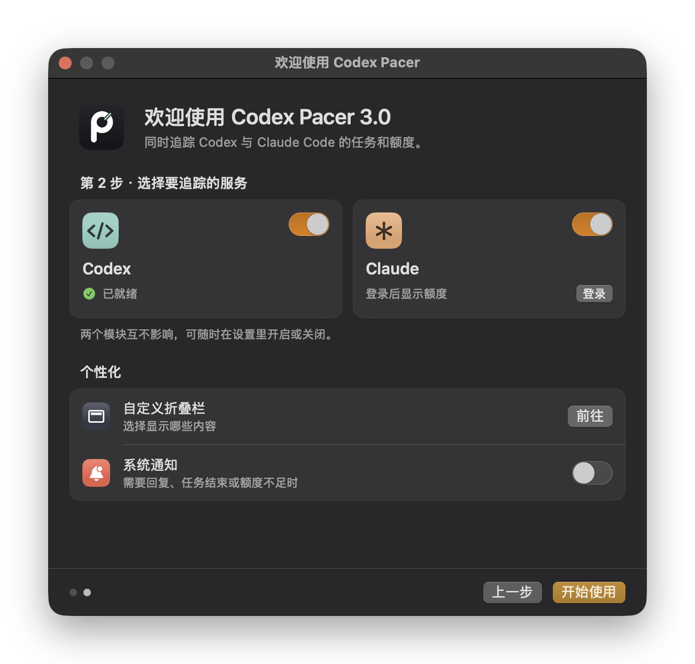
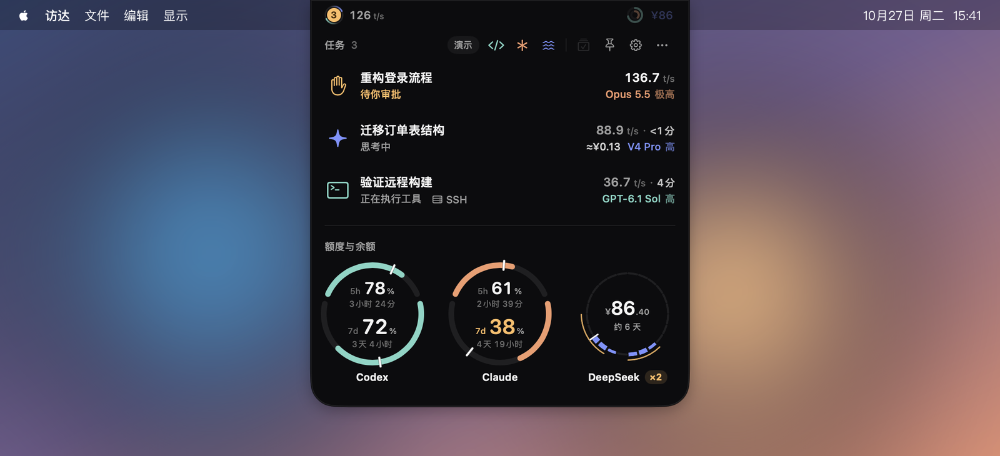

# Codex Pacer 使用指南

[English](guide.md) · [README](../README.zh-CN.md)

本指南介绍 Codex Pacer 3 的日常使用。安装步骤见 [README](../README.zh-CN.md#安装)。

- [首次启动](#首次启动)
- [折叠栏](#折叠栏)
- [展开的灵动岛](#展开的灵动岛)
- [Codex](#codex)
- [Claude Code](#claude-code)
- [SSH 主机与 Remote Control](#ssh-主机与-remote-control)
- [设置](#设置)
- [通知](#通知)
- [隐私与本地数据](#隐私与本地数据)
- [常见问题](#常见问题)
- [卸载](#卸载)

## 首次启动

首次打开 Codex Pacer 3，或从 2.x 升级后第一次启动时，会出现两步入门引导。

1. **认识灵动岛**：标注折叠栏的各个部分，展示徽标的三种状态，并演示悬停展开。
2. **选择要追踪的服务**：分别开关 Codex 与 Claude 模块，查看是否已就绪，并可前往自定义折叠栏、打开系统通知或设置登录时打开。

两个模块互不影响。检测到某个服务已安装时，Pacer 会自动开启对应模块；你手动拨动开关后，会一直按你的选择来。之后可在“设置 → Codex”或“设置 → Claude”中修改，也可以在“设置 → 帮助”中再次打开引导。

之后的 3.x 更新不会再显示引导，而是显示一次简短的“更新内容”：列出新版亮点，涉及的新设置可以直接在其中开关，“发布说明”可查看完整列表。之后也可以在“设置 → 更新内容”中重新查看每一次的更新内容。

## 折叠栏

| 组件 | 含义 |
| --- | --- |
| 任务徽标 | 进行中的任务数。任务运行时有光弧环绕，青绿色是 Codex，暖橙色是 Claude。实心琥珀色：有任务等你回复或审批。对勾、叉或暂停：有任务完成、失败或中断，你还没有查看。只有一个任务时，可以改为显示它的状态图标。 |
| 速度（t/s） | 运行中任务的合计输出速度。 |
| 额度圆环与数值 | 剩余额度，外环是 Codex，内环是 Claude。数值每隔几秒在两个服务之间切换，可显示剩余额度或配速。 |
| 警告 | 只在问题存在时显示：5 小时额度低于 20%（空心 `5h`）或已耗尽（实心 `5h`）、SSH 主机未连接、额度没有按时更新。在“设置 → 提醒”中选择显示哪些警告。 |

可选组件还有状态文字和最近一次首输出时间。所有组件都在“设置 → 折叠栏”中调整：在摄像头左右两侧拖动排序、点 × 隐藏，或恢复默认。每个服务的额度可选显示 5 小时或 7 天窗口；只有每周限制的账户固定显示 7 天。

在你选择之前，有刘海的屏幕上折叠栏位于摄像头两侧并保持纯黑，与刘海融为一体；其他屏幕上它是菜单栏下方的一枚胶囊。

“设置 → 外观 → 位置”提供“刘海”和“自定义”。刘海让折叠栏在任何屏幕上都固定在顶部正中。选择自定义后，下方会出现“屏幕位置”：“中间”是菜单栏下方的胶囊；选一个角（第一次从刘海切换过来时默认左下角），折叠栏会变成一根窄竖条，长边贴住屏幕侧边，离菜单栏或 Dock 10 点。竖条里的组件上下排列：左侧组在上段，右侧组在下段，数字在上、单位在下。状态文字和额度标签放不进竖条，仍可在悬停提示和面板中看到。悬停竖条，面板会从它旁边展开，上段和下段分别贴住面板的顶部和底部。

## 展开的灵动岛

把鼠标**悬停**在折叠栏上即可展开，**移开**后自动收起。点击顶部或固定按钮可以保持展开；按 Esc 收起。

### 任务

两个服务的任务共用一个列表：等你处理的排在最前，其次是运行中的任务，最后是已结束的，每组内按最近更新排序。每一行显示：

- 任务标题和当前阶段（思考中、正在执行工具、正在回复、等你处理、已结束）；
- 本轮已运行的时长、所属服务，以及非本机任务的 SSH 主机或 Remote Control 来源；
- 最近的输出速度和首输出时间。白色数字表示 15 秒内更新过，灰色表示较早的数据。

任务派生的子代理会归在它下面，并显示运行中的数量和合计速度。超过三个任务时，用页码两侧的箭头或 Option + ← / → 翻页。

点击任务即可打开对应会话。Codex 任务会在 Codex 应用中打开。在其他应用中启动的任务会显示该应用名称，点击后切换到该应用，应用已退出时会重新启动它；这包括在终端或编辑器中启动的 Claude 任务，以及 Zotero 插件等内嵌 Claude 或 Codex 的应用发起的任务。Claude 桌面端会话在桌面端打开，SSH 主机上的 Claude 会话在“终端”中恢复。Pacer 只能在任务运行时识别是哪个应用启动了它；不知道时会显示提示，30 秒后自动消失。打开会话不会发送任何提示词。

想在没有任务时打开 Codex 或 Claude，可以用任务标题栏里控制按钮左边的应用按钮：每个已启用的模块一个，显示为该服务的颜色。点击会把对应的桌面版切到前台，未运行时先启动它，不会打开任何会话。未安装桌面版的模块不显示按钮；可在“设置 → 通用”中关闭“显示应用按钮”。

一轮结束后，它的卡片会保留到你打开它、点击“全部标为已读”或保留时间到期（默认 30 分钟，可在“设置 → 提醒”中修改）。“全部标为已读”是展开后固定按钮旁的按钮，会一次清除所有页面中已结束的卡片；运行中以及等你回复或审批的任务不受影响。清除后即使重启也不会再出现。

### 额度

每个服务一个圆环，显示 7 天窗口：

- 彩色弧线是剩余额度，中间是重置倒计时；
- 白色刻度是按时间均匀使用时今天应剩的位置。“充裕”表示用得比这少，“正常”表示差不多，“偏快”表示用得更多；
- 下一行是 5 小时窗口及其重置时间。只有每周限制的账户在此处显示 PRO 占位。

只开启一个服务时，它的 5 小时和 7 天窗口会以两个圆环并排显示。

无法读取额度时，圆环会说明原因并提供重试。悬停圆环可查看数据来源和更新时间。额度历史、Credit 和重置券在“设置 → Codex”和“设置 → Claude”中查看。

任务标题右侧的 ⋯ 菜单用于刷新数据或退出 Pacer，齿轮按钮打开设置。

## Codex

Pacer 会在常见位置查找 Codex 应用或 CLI，包括 Homebrew、nvm、fnm、Volta、asdf、mise、pnpm 等 npm 管理工具，以及移动过位置的 Codex.app。“设置 → Codex → 本机”显示找到的结果，悬停可查看具体路径；也可以在“自定义位置”中选择其他 CLI 或数据目录。自定义路径失效时会明确提示，不会悄悄换用别的 CLI。

Codex 额度通过 CLI 使用你自己的 Codex 登录读取。使用 API Key 或 Amazon Bedrock 登录时没有 ChatGPT 订阅额度，Pacer 会说明这一点。

**其他应用中的会话。** Zotero 插件等内嵌 Codex 的应用，其会话会标出应用名称。不想看到这些会话及其提醒时，关闭“设置 → Codex → 显示其他应用中的 Codex 会话”。Codex 应用、终端和 VS Code 的会话始终显示。Zotero Agent 插件的翻译请求不会显示。

## Claude Code

Pacer 默认使用 `~/.claude`，设置了 `CLAUDE_CONFIG_DIR` 时使用该目录；也可以在“设置 → Claude → 自定义位置”中选择其他目录。

**任务追踪自动配置。** Claude 模块开启时，Pacer 会在你的 Claude 设置中追加自己的 hooks 和仅限本机的遥测端点，并包装已有的状态栏命令，让它的输出保持不变。配置已是最新时不会写入任何内容，不会创建 Claude 目录，遇到冲突的遥测设置时保留原样。已在运行的 Claude Code 会话需要重启才会生效。手动关闭模块会移除 Pacer 添加的条目。

**额度只需登录一次。** 点击“登录 Claude”（入门引导中为“登录”）打开 Pacer 自带的 claude.ai 窗口，正常登录即可。账号属于多个组织时，需要选择其中一个。会话保存在 Pacer 私有的 WebKit 存储中，重启后可以继续使用，直到网站让它过期；Pacer 不读取其他应用的钥匙串条目或浏览器 Cookie。如果 Claude Code 的状态栏已经为同一账户提供了最新额度，Pacer 会优先使用它。

**其他应用中的会话。** Zotero 插件等通过 Claude Agent SDK 内嵌 Claude Code 的应用，其会话会标出应用名称。不想看到这些会话及其提醒时，关闭“设置 → Claude → 显示其他应用中的 Claude 会话”。终端、VS Code 和 Claude 桌面端的会话始终显示。

## SSH 主机与 Remote Control

Pacer 会跟随你在 Codex 和 Claude 中已经使用的 SSH 主机，包括 Claude 桌面端保存的连接。每台主机只监测一次，并沿用已保存的端口和身份文件。需要能免交互地通过 OpenSSH 连接，主机上需有 Python 3.6 及以上；Pacer 不保存密码，也不接受新的主机密钥。

在已连接且装有 Claude Code 的主机上，Pacer 会像在本机一样配置 Claude hooks。配置失败的主机显示“重试”，并在 30 分钟后自动重试。

Codex Remote Control 任务通过 Codex 桌面端获取。请保持 Codex 开启、连接远程主机并载入对应会话。

“设置 → 连接”会列出所有来源（有问题的排在最前），每台 SSH 主机并排显示 Codex 与 Claude 的状态，SSH 主机和 Remote Control 的开关也在这里。

## 设置

设置修改后立即生效，没有“保存”按钮。文本框在按回车或离开输入框后生效；输入无效时保留上一次的有效值。

| 页面 | 可以调整的内容 |
| --- | --- |
| 通用 | 更新、登录时打开、语言（跟随 macOS、简体中文或 English）、隐藏项目名称、显示应用按钮。 |
| 外观 | 纯黑或液态玻璃；刘海或自定义及其屏幕位置（中间或四角竖条）；显示器；是否在全屏空间中显示。 |
| 折叠栏 | 显示哪些组件、放在摄像头哪一侧，单个任务时的徽标，剩余额度或配速，以及每个服务的 5 小时或 7 天窗口。 |
| 提醒 | 折叠栏警告、系统通知、结束的任务保留多久。 |
| Codex、Claude | 开关模块、本机检测结果、自定义位置、Claude 登录、各服务在其他应用中的会话、额度历史与详情。 |
| 连接 | 所有任务来源和额度的状态，SSH 主机与 Remote Control。 |
| 更新内容 | 自 3.1 起每次更新的亮点，最新的在前，提供与更新提示相同的开关，并附完整发布说明的链接。 |
| 帮助 | 灵动岛上所有标识的图例、入门引导，以及本指南和问题反馈的链接。 |

“登录时打开”使用 macOS 的登录项，因此也会出现在“系统设置 → 通用 → 登录项”中。如果在那里关闭了 Pacer，设置页会提示，并提供“登录项…”按钮以便重新允许。

## 通知

需要你注意的事情都会直接显示在折叠栏上。如果还想收到 macOS 通知，打开“设置 → 提醒 → 系统通知”：有任务等你回复或审批、一轮结束或中断、某个额度窗口降到 15% 时各发一条通知。一轮以请你选择下一步结束时（例如 Claude 的下一步提示框），只发“待你回复”这一条。第一次打开时 macOS 会请求授权；如果拒绝，开关会自动关闭。

## 隐私与本地数据

- Pacer 没有账号，不做任何统计上报。它只连接你的 SSH 主机、各服务的额度接口（Codex 通过你的 CLI，Claude 通过 claude.ai），以及用于检查更新的 GitHub。
- 从会话日志中，它只保留任务标题、阶段、时间和 token 数，从不保存提示词、回复或工具输出的内容。
- 偏好设置保存在 `com.codexpacer.app`。额度历史和已打开的结束任务记录保存在 `~/Library/Application Support/CodexPacerIsland`。
- “隐藏项目名称”会替换灵动岛和通知中的任务标题，适合共享屏幕时使用。

## 常见问题

- **macOS 不让打开应用。** Pacer 已通过 Apple 公证，请从[最新版本](https://github.com/RyanZhangNTU/codex-pacer/releases/latest)重新下载，以防下载不完整。3.0.1 之前的版本未签名，需要在“系统设置 → 隐私与安全性”中选择“仍要打开”。
- **某个服务没有任务。** 确认对应模块已开启，并且“设置 → Codex / Claude → 本机”能找到它。Claude 首次配置后，需要重启 Claude Code 会话。
- **Claude 额度要求登录。** claude.ai 会话已过期，在 Pacer 的窗口中重新登录即可。网络错误和限流会自动重试。
- **SSH 主机未连接。** 确认 `ssh <主机>` 不需要输入密码即可连接，然后在“设置 → 连接”中点击“重试”。
- **刚启动时速度偏高。** Pacer 中途接入任务时，第一次估算可能包含接入前的输出，下一次测量后会恢复正常。
- **其他问题。** 请[提交 issue](https://github.com/RyanZhangNTU/codex-pacer/issues)，附上应用和 macOS 版本、来源类型（本机、SSH 或 Remote Control）以及复现步骤。截图前请隐藏私密的任务标题和账户信息。

## 卸载

1. 在“设置 → Claude”中关闭 Claude 模块，移除 Pacer 在本机 Claude 设置中添加的 hooks。
2. 在“设置 → 通用”中关闭“登录时打开”，通过“设置 → 退出 Codex Pacer”退出，然后把应用从“应用程序”移到废纸篓。
3. 如需清除数据，删除 `~/Library/Application Support/CodexPacerIsland`，并执行 `defaults delete com.codexpacer.app` 删除偏好设置。

Pacer 在 SSH 主机上添加的条目会保留，它们指向各主机上的 `~/.claude/pacer`。不再使用 Pacer 时，可以从该主机的 Claude 设置中删除。
