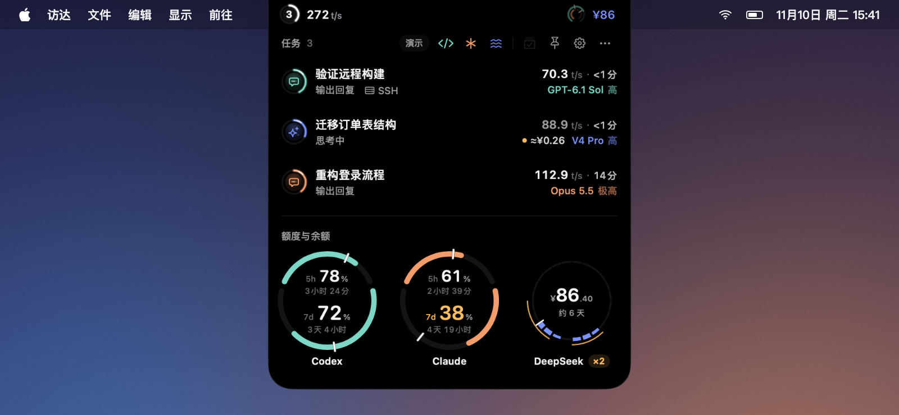
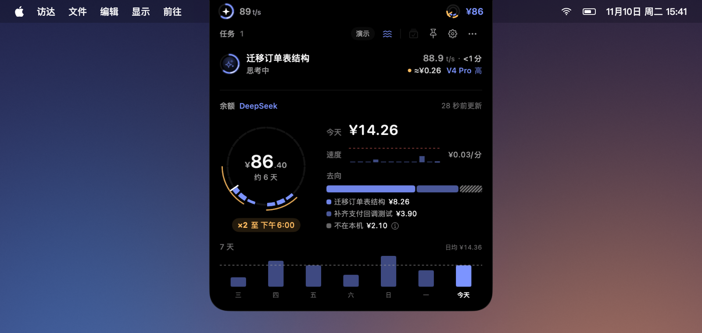

# Codex Pacer 使用指南

[English](guide.md) · [README](../README.zh-CN.md)

- [开始使用](#开始使用)
- [折叠栏](#折叠栏)
- [展开的灵动岛](#展开的灵动岛)
- [进度圆环](#进度圆环)
- [额度与余额](#额度与余额)
- [各项服务](#各项服务)
- [主窗口](#主窗口)
- [隐私](#隐私)
- [常见问题](#常见问题)
- [卸载](#卸载)

## 开始使用

第一次打开 Codex Pacer 时，会有一段简短的引导：

1. 介绍折叠栏各部分的含义。
2. 选择**灵动岛模式**（贴在屏幕顶部中央，和刘海连在一起）或**自由拖动模式**（可以拖到任意位置）。
3. 选择要追踪的服务：Codex、Claude 和 DeepSeek。已安装的服务会自动开启。
4. 进度圆环、通知和登录时打开。

之后可以在“帮助与更新”中再次打开引导。每次更新后，会显示一次简短的“更新内容”。

有两项数据需要登录：

- **Claude 额度：** 点“登录 Claude”，在 Pacer 自己的窗口里登录 claude.ai。
- **DeepSeek 余额：** 在 Pacer 的窗口里登录 DeepSeek 开放平台；如果 DeepSeek Harness 用的是 API Key，粘贴一个 Key 即可。

Codex 额度无需额外设置。

## 折叠栏

| 部分 | 含义 |
| --- | --- |
| **任务徽标** | 正在运行的任务数。外圈显示哪些服务在工作，或者它们的平均进度。变成琥珀色表示有任务等你回复或审批；出现对勾表示有任务刚完成。 |
| **速度** | 所有运行中任务的合计输出速度，单位是 token/秒。 |
| **额度** | Codex 和 Claude 的剩余额度，或 DeepSeek 的余额、预算。 |
| **警告** | 只在需要注意时出现，比如额度不足、SSH 主机断开。 |

**悬停**展开灵动岛，**移开**收起。点击顶部可以保持展开，按 Esc 收起。

在“折叠栏”页可以决定显示哪些内容：在实时预览上拖动组件调整顺序，或移到摄像头另一侧；点一个组件查看它的选项。任务徽标的外圈可以显示正在工作的服务、平均进度，或每个任务一段。

想移动灵动岛，先在“外观”中选“自由拖动”，再按住状态区域拖动。靠近屏幕边缘松手会自动吸附。“回到顶部中央”可以放回原处。有多块屏幕时，每块屏幕单独记住位置。

## 展开的灵动岛

所有任务都在一个列表里：等你处理的排最前，其次是运行中的，最后是已完成的。每一行显示任务标题和当前步骤、不在本机时的运行位置、输出速度、本轮用时和模型。

- **点击任务**，在运行它的应用里打开对应对话。
- **完成的任务**会留一张卡片，直到你打开它，或保留时间到期（默认 30 分钟，可在“通知”页修改）。“全部标为已读”一次清掉所有完成的卡片。
- **任务启动的子代理**归在它下面。
- 标题栏的**应用按钮**可以直接打开 Codex、Claude 或 DeepSeek Harness。
- 任务超过三个时，用箭头翻页。

## 进度圆环

Codex、Claude Code 和 DeepSeek Harness 都会报告你的请求完成了多少，Pacer 把它画成任务图标外的一圈圆环。

| 看到的样子 | 含义 |
| --- | --- |
| 一颗彗星在绕圈 | 任务在工作，还没给出估计。 |
| 一段弧，光沿着它流动 | 最新的估计，任务正在工作。 |
| 圆环在呼吸，中间是月亮 | 任务在等后台工作，之后会继续。 |
| 琥珀色实心圆 | 任务等你回复或审批。 |
| 圆环填满并出现对勾 | 请求已完成。 |

估计来自代理自己的判断，所以圆环偶尔会往回走。圆环默认开启；可以在主窗口各服务页面的“任务进度圆环”中分别关闭。打开圆环后，新开的会话才会开始报告。

在 macOS 上，Pacer 会给 Dot 分派到这台 Mac 的 Durable Codex 任务标注 `dot`。目标聊天可以保持关闭。用 Codex 页同一个“任务进度圆环”开关设置百分比上报。executor 正在忙时，设置会在可以刷新或重新连接后生效。关闭圆环会立即停止上报，Codex 模块仍可显示任务状态。

## 额度与余额

**Codex 和 Claude。** 每个服务一个圆环：上弧是 5 小时额度，下弧是每周额度，各自显示剩余百分比和重置倒计时。白色刻度表示还剩多少时间：弧线超过刻度，说明你用得比匀速慢。额度偏低或用得太快时，数值变成琥珀色。只开一个服务时，还会显示配速和到重置时的预计。

**DeepSeek。** DeepSeek 按余额计费，没有额度窗口。它的表盘是今天的 24 小时钟面，显示每个小时花了多少，并标出价格翻倍的高峰时段，中间是余额。在 DeepSeek 页切换到“预算”可以设置每日和每周预算，表盘会像额度一样显示配速。预算只做提醒，Pacer 不会拦截任何请求。每个 DeepSeek 任务还会显示这一轮的估算花费。

账户在别处产生的花费，比如联网搜索或其他设备，也会计入今天的花费和预算。

## 各项服务

**Codex。** Pacer 会自动找到 Codex 应用或命令行。嵌入 Codex 的其他应用里的任务会显示该应用的名字，可以用“其他应用中的会话”隐藏。

**Claude Code。** 开启 Claude 模块后，任务追踪会自动配置好；之后把正在运行的 Claude Code 会话重启一次即可。打开“显示 Claude 云端项目”后，Pacer 还会跟随你的云端项目线程，在结束或等你时提醒你。

**DeepSeek Harness。** Pacer 会跟随本机 Harness 会话的进度、速度和花费。

**SSH 主机和 WSL。** Pacer 会跟随你在 Codex 和 Claude 里已经在用的 SSH 主机，以及 Windows 上的 WSL。主机需要能免密码连接，并装有 Python 3。主机断开时，在“远程”页点“重试”。

**Codex Remote Control。** 请保持 Codex 应用开启并连接到远程主机。

## 主窗口

点展开灵动岛里的齿轮按钮打开主窗口。

| 页面 | 内容 |
| --- | --- |
| **概览** | 需要你处理的事、各服务一览和正在运行的任务。 |
| **历史** | 各服务当前周期的额度变化，以及 DeepSeek 近 7 天。 |
| **Codex、Claude、DeepSeek** | 开关服务、登录、进度圆环和自定义文件夹。 |
| **远程** | SSH 主机、WSL 和 Remote Control。 |
| **外观** | 主题、强调色、灵动岛的材质和大小、灵动岛或自由拖动，以及显示在哪块屏幕。 |
| **折叠栏** | 折叠栏显示的内容和各组件的选项。 |
| **通知** | 哪些事件显示在折叠栏或发系统通知、DeepSeek 提醒，以及完成的任务保留多久。 |
| **通用** | 登录时打开、程序坞图标、语言，以及共享屏幕时用的“隐藏项目名称”。 |
| **帮助与更新** | 更新、更新内容和帮助。 |

修改即时生效。有新版本时，侧边栏和概览会提示，点“更新并重启”即可安装。

## 隐私

- Pacer 没有账号，不做统计上报。
- 它读取代理本来就会写下的日志，只保留灵动岛要显示的内容：任务标题、阶段、时间和 token 数，从不保存你的提示词或回复。
- 登录都在 Pacer 自己的窗口里进行。Pacer 不读取其他应用的密码或浏览器 Cookie。
- “隐藏项目名称”会替换屏幕上和通知里的任务标题。

## 常见问题

- **某个服务没有任务。** 确认该服务已开启，且它的页面显示已找到。Claude Code 首次配置后，需要把正在运行的会话重启一次。
- **Claude 额度或 DeepSeek 余额要求登录。** 登录已过期，在该服务的页面重新登录即可。
- **圆环一直在绕圈。** 打开圆环后需要新开一个会话。Claude 云端项目无法报告估计，圆环会一直绕圈直到完成。
- **SSH 主机断开。** 确认用 `ssh <主机名>` 连接时不需要输入密码，然后在“远程”页点“重试”。
- **刚启动时速度偏高。** 第一次读数可能包含之前的输出，稍后就会恢复正常。
- **在 Windows 上任务停止更新，Pacer 提示重新打开。** 重新打开 Pacer 即可。也请[提交 issue](https://github.com/RyanZhangNTU/codex-pacer/issues)，附上 `%LOCALAPPDATA%\CodexPacer\CrashLogs` 里最新的文件，其中不含任务内容。
- **Windows 提示无法识别安装包。** 点**更多信息 → 仍要运行**。安装包暂未做代码签名。
- **其他问题。** [提交 issue](https://github.com/RyanZhangNTU/codex-pacer/issues)，写明 Pacer 和系统版本以及复现步骤。截图时请隐去私密的任务标题和账号信息。

## 卸载

1. 关闭 Claude 模块和各服务的“任务进度圆环”，Pacer 会移除它添加到代理设置里的内容。
2. 在 DeepSeek 页退出登录或删除 API Key。
3. 关闭“登录时打开”，然后退出 Pacer。
4. Mac 上把 Codex Pacer 从“应用程序”移到废纸篓；Windows 上在系统设置的“应用”中卸载。
