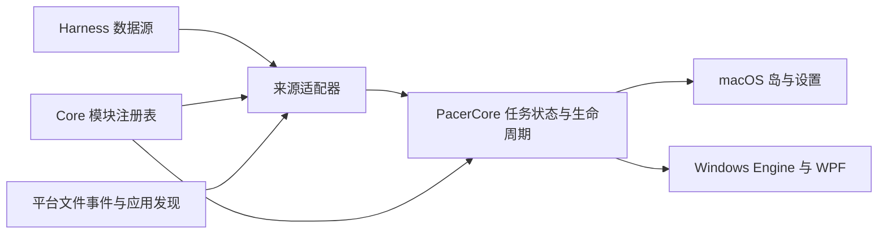

# Pacer 的 Harness 接入框架

设计基线为 `origin/develop` 的 `90d53d6`（`v4.4.3`）。Harness 指实际运行任务、保存会话的应用。WorkBuddy 即使用了 DeepSeek 模型，任务也归 WorkBuddy。

Codex、Claude Code、DeepSeek 和 WorkBuddy 都通过同一个适配器表启动、刷新、切换来源和停止。每个模块用自己的采集规则确认任务状态，再交给共享任务层。WorkBuddy 等本地模块由注册表生成适配器，两个宿主共用文件监听预算和来源更新逻辑。

## 调研依据

GitHub Star 数为 2026-11-13 查阅时页面显示的近似值。

| 项目 | 对 Pacer 的启发 | 来源 |
| --- | --- | --- |
| CodexBar，约 23.1k | 模块描述符集中声明名称、默认值和采集策略。应用与 CLI 共用同一注册和采集入口。Pacer 可以用同样的方式生成模块设置和可用能力。 | [仓库](https://github.com/steipete/CodexBar) · [Provider authoring guide](https://github.com/steipete/CodexBar/blob/main/docs/provider.md) |
| AgentsView，约 6.4k | 解析器与目录监视分开，启动同步和实时变更共用来源。Pacer 可以复用这种读取分工，向上只交付任务元数据。 | [仓库](https://github.com/kenn-io/agentsview) · [解析器](https://github.com/kenn-io/agentsview/tree/main/internal/parser) · [同步说明](https://github.com/kenn-io/agentsview/blob/main/docs/usage.md#sync) |
| CASS，约 1.2k | Connector 把 JSONL、SQLite 等来源投影成同一模型。来源边界标记何时整批读取完成，也保留远端来源归属。Pacer 的局部更新同样需要标明覆盖范围。 | [仓库](https://github.com/Dicklesworthstone/coding_agent_session_search) · [Connector 契约](https://github.com/Dicklesworthstone/franken_agent_detection#connectors) |
| ccusage，约 19.4k | 用量可以统一汇总，去重、缓存计数和定价仍由各来源解释。比如 Codex 的压缩计数要和响应 ID 对账。Pacer 的任务状态、Token 统计和订阅配额各自消费有明确单位的数据。 | [仓库](https://github.com/ccusage/ccusage) · [Codex 用量规则](https://github.com/ccusage/ccusage/blob/main/docs/guide/codex/index.md) |

ACP v1 的能力协商、`session/update` 和请求结束信号可以作为适配器的事件来源。`session/list` 的范围是当前连接的 Agent 所知道的会话。接入已有桌面会话前，需要验证该客户端实际向 Pacer 开放的会话和事件。 [ACP 会话列表](https://agentclientprotocol.com/protocol/v1/session-list) · [ACP 请求生命周期](https://agentclientprotocol.com/protocol/v1/prompt-turn)

## 这次改造解决的问题

- 旧代码在多个地方各存一份平台名单。现在模块 ID、默认开关和显示能力由注册表统一声明。 [注册表](../native/Sources/PacerCore/HarnessRegistry.swift) · [模块设置](../native/Sources/PacerCore/ProviderModules.swift)
- 两端复用来源绑定、更新顺序、历史基线和账号切换。任务状态继续使用共享收件箱和提醒策略。已经验证的采集方式仍由各自模块维护。 [来源接口](../native/Sources/PacerCore/HarnessActivity.swift) · [任务状态](../native/Sources/PacerCore/ActivityApplicationState.swift)
- 任务来源不一定提供配额。配额布局只看具备配额或余额能力的模块，加入 WorkBuddy 后也保留原来的 Codex、Claude 和 DeepSeek 布局。 [折叠栏](../native/Sources/PacerCore/CompactBarPresentation.swift) · [展开布局](../native/Sources/PacerCore/ExpandedPanelLayout.swift)

## 共享接口



在 `PacerCore` 建一个随应用编译的有序注册表。每个 Harness 注册稳定 ID、显示名、图标、支持的系统、默认开关和来源探测规则，再按实际支持的能力提供适配器。两个宿主继续注入现有的文件事件、时钟、进程和应用激活接口。SQLite 已由两端的 Core 构建引入。 [平台接口](../native/Sources/PacerCore/PlatformPorts.swift) · [Core 的 SQLite 读取示例](../native/Sources/PacerCore/SessionIndex.swift)

| 接口 | 职责 |
| --- | --- |
| 模块描述符 | 设置、模块检测和通用图标从同一描述符取数据。描述符声明能力上限，探测结果给出安装状态、来源健康和当前可用能力。任务模块使用通用设置行，带账号连接等特有操作的模块可以保留自己的设置页。 |
| 任务适配器 | 接收已绑定来源，提供启动、刷新、刷新策略变更和停止。解析来源记录，判断事件归属、顺序和可信度，输出 `SessionActivity`、请求与健康状态。进度、首字延迟、性能计数、父子关联按来源证据提供。 |
| 用量与配额 | 可选入口。分别携带口径、单位、账号范围、采样时间和新鲜度。窗口配额、积分、金额和本地估算保留各自含义。Codex、Claude 的配额协调器和 DeepSeek 的钱包可先原样挂接。 |
| 导航 | 可选入口。适配器解析可信的应用或会话目标，由宿主执行。Core 在确认打开所绑定的会话后核销提醒，兼容层保留现有已验证的宿主激活语义。 |

来源适配器可以读追加日志、SQLite 或带版本的事件流。优先用已验证、覆盖所需会话的只读接口。同一 Harness 有多个入口时，由适配器合并证据，避免一项任务生成两张卡。`ActivityLogWatcher` 默认监听 `.jsonl` 和 `.zstd`；WorkBuddy 用同一个监听器，传入数据库、WAL、账号快照和转录文件。 [文件监视接口](../native/Sources/PacerCore/ActivityLogWatcher.swift)

重复出现的来源格式可以提炼成随应用编译的配置，描述探测位置、版本、字段映射和状态枚举，由同一个读取器消费。两个来源证明游标和更新语义一致后再抽取。带归属规则或多来源合并的 Harness 继续用类型化适配器。

### 任务更新与身份

本地监视器使用同一个契约。现有监视器保留自己的解析器和状态机，再把结果交给共享任务状态。

```text
probe(host, settings) -> source bindings and capabilities
start(binding, generation, refreshPolicy, publish)
refresh(binding)
updateRefreshPolicy(binding, policy)
stop(binding, deadline)

ActivityBatch(source, generation, sequence, health, change)
change = baseline(rows) | snapshot(rows) | delta(upserts, removals) | health(status)
rows = activity, pending requests and optional measurements for the source
```

通用本地监视器按来源键提交更新。Core 只接收当前绑定代次和更高序号的数据。增量带上明确的移除项，序号中断时重新提交该来源的快照。Codex、Claude 和 DeepSeek 的采集器提交已核对的完整结果，沿用各自的读取上限和通知基线。

来源键由 Harness ID、逻辑来源和不透明的配置或账号范围组成。会话键再加原生会话 ID，同一会话的日志和实时流可归到同一逻辑来源，跨主机或账号的会话各自保留。适配器在来源内部决定字段优先级，Core 以归一后的会话和轮次处理分组、提醒及导航。旧的 Codex 合并规则继续在 Codex 适配器内使用。 [ActivitySourceMerger](../native/Sources/PacerCore/ActivitySourceMerger.swift)

为 `SessionActivity` 增加类型化的状态入口，供新适配器表达已观察到的会话状态、已归属轮次及终态。仅有会话状态的来源可以展示粗粒度活动。轮次计时、审批、完成提醒和进度环各自需要相应证据。每个来源独立建立提醒基线，基线内的旧结束记录可恢复为已读卡片。进入实时观察后，只有匹配到已归属轮次的明确结束才产生完成通知。改标题或补记用量只更新对应字段。 [SessionActivity](../native/Sources/PacerCore/Activity.swift) · [AttentionPolicy](../native/Sources/PacerCore/Attention.swift) · [CompletionInbox](../native/Sources/PacerCore/CompletionInbox.swift)

Core 复用 `ApplicationWorkRegistry` 和 `ApplicationLifecycleCoordinator`。通用本地来源按注册数分配监视句柄，最多 512 个。Windows 的通用任务每帧最多投影 256 条，先给每个来源留位置，同一来源里等待输入的任务优先。原有三个平台保留自己的采集上限。禁用、睡眠或切换来源会撤销旧回调的发布权。普通文件事件继续按展开 1 秒、收起 5 秒合并，读不到完整状态时由适配器重试。 [工作登记](../native/Sources/PacerCore/ApplicationWorkRegistry.swift) · [刷新策略](../native/Sources/PacerCore/ActivityRefreshPolicy.swift)

### 设置和协议兼容

- 把 `AgentProvider` 演进为可哈希、按单个字符串编解码的稳定 ID 类型，保留现有内建常量。注册表决定可激活的 ID 和顺序，适配器负责原生会话 ID 校验。旧模块继续生成原有活动 ID 和完成核销摘要。新模块的内部会话键用结构化字段组成，投影时编码成稳定的字符串。迁移测试应逐项对比活动 ID、核销摘要、通知引用、远端路由和配额历史键。
- 模块模式继续使用 `providerModule.<id>` 和 `automatic/enabled/disabled`。新版偏好编辑器保留格式有效的未知模块设置，注册表只启动当前宿主支持的模块。现有三个模块的默认值、显示顺序、`expandedPanelLayout` 和折叠栏选项延续。任务列表按任务能力投影，配额布局按配额和余额能力投影。
- Windows 保留 `protocolVersion: 1` 和现有字符串 ID。`hello` 增加可选的模块 ID 清单，`initialize` 增加可选的通用模块能力声明，`modules` 增加可选的显示信息和来源状态。引擎继续接受现有 `enabledProviders` 和 `providerModes`。只有两端都声明支持时才投影新模块，任一端缺少握手字段时使用三个旧模块。 [引擎协议](../windows/EngineSupport/EngineProtocol.swift) · [Windows 偏好格式](windows-shell.md#preferences-file)

## WorkBuddy 首个适配器

### 本机证据

| 检查 | 结果 |
| --- | --- |
| Windows 安装登记与安装包 | 登记和 Electron 包版本一致，均为 WorkBuddy AI `5.9.4`。本机的程序是 `%ProgramFiles%\WorkBuddyAI\WorkBuddyAI.exe`，数据根是 `%USERPROFILE%\.workbuddy-ai`。安装包支持覆盖配置根，其他版本和 macOS 的路径待实测。 |
| 只读 SQLite 查询 | `workbuddy.db` 使用 WAL，带 `-wal`、`-shm`，`user_version` 为 `0`。发送测试任务前，`sessions` 和 `session_usage` 都是空表。任务运行期间，会话行先后出现 `active`、`working` 和 `completed`，时间为毫秒。 |
| 正常结束、停止与问询 | WorkBuddy 把正常结束和手动停止都记作 `completed`。Pacer 对照 `projects/<workspace>/<session>.jsonl` 的同轮记录，确认最终回复或中止标记。问询同时要求数据库处于 `pending` 且同轮存在尚未回答的工具调用。 |
| 查询范围 | WorkBuddy 的近期活动索引只覆盖云端。Pacer 限制本地发现为 512 个最近插入位置，已观察的会话继续按主键查询。很久以前创建的会话若不在这两个集合中，重新打开时可能暂时看不到。 |
| 任务范围 | 读取本机交互会话，包括从首页新建的任务。本地自动化运行有独立的状态和身份，已通过夹具测试。云端会话和远程助手发起的任务仍待验证。 |
| 自报进度 | 设置页的进度环开关同时管理 MCP 工具和上报规则。只有调用名、轮次、参数和成功回执都匹配时，Pacer 才显示百分比。模型跳过工具时，圆环保持等待。 |
| 用量与额度 | `session_usage` 提供会话上下文和单轮积分。账号可用积分、总额和预留积分从 WorkBuddy 网站账单读取，显示在设置、概览和展开岛。两种读数分别取数。 [官方用量说明](https://www.workbuddy.ai/docs/workbuddy/usage) · [CodexBar 的账单接口记录](https://github.com/steipete/CodexBar/blob/main/docs/workbuddy.md) |

Windows 实机验证了运行、问询、完成、中断、重启后恢复待答任务，以及跳回原会话。明确要求调用进度工具时，Pacer 在同一轮运行中收到 37% 和 73%。另一次普通任务走到了完成，模型没有调用进度工具。Mac 共用本地监视代码，编译和实机运行仍待验收。 [WorkBuddy 配置位置](https://www.workbuddy.ai/docs/workbuddy/From-Beginner-to-Expert-Guide/Function-Description/Model-Configuration) · [自定义连接器](https://www.workbuddy.ai/docs/workbuddy/From-Beginner-to-Expert-Guide/Function-Description/Connector)

Windows 容量夹具注册了 100 个模拟来源，每个提交 8 条任务。每个来源在帧里至少有一个代表任务；关闭其中一个不影响其余 99 个，100 份设置也能保存并读回。该测试说明注册、设置和状态投影可以容纳这些来源，未覆盖百个真实应用同时读盘的开销。

各平台的实测范围见 [验收记录](harness-validation.md)。

## 现有 Harness 保留的采集规则

| 批次 | 迁移内容 | 对照验证 |
| --- | --- | --- |
| WorkBuddy | 使用通用本地监视器入口。 | 无数据、未知格式、来源换账号、手动停止、问询、进度回执和跳转。 |
| DeepSeek Harness | 保留 `DeepSeekActivityMonitor` 的 Zstd、轮次和后台作业处理，钱包仍有独立数据源。 | 分帧、截断、作业唤醒、每轮费用、余额和预算。 [DeepSeek 数据语义](development.md#deepseek-harness) |
| Claude Code 与 Claude cloud Projects | 保留本地转录、hooks、OTLP、SSH/WSL 和云项目规则。云项目仍有独立开关。 | 无主轮次、Stop hook 后续执行、后台子代理、镜像去重、用量回退和云端已读同步。 [Claude Code](development.md#claude-code) · [Claude cloud Projects](development.md#claude-cloud-projects) |
| Codex | `CodexActivityInput` 合并既有 rollout 与 Desktop IPC。SSH/WSL、Remote Control 和 Dot Durable 保留原路由。 | 日志与实时流交叉、目标跨轮次延续、内部审查过滤、账号隔离、远程跳转和已读摘要。 [Codex 数据语义](development.md#codex) |

新增适配器时，先用合成记录覆盖基线静默、更新丢失、来源切换和账号隔离；再用真实任务核对提醒与跳转。支持新平台通常只需加一个监视器、一个注册项和测试。另有专用会话链接、账号用量或进度配置时，再补对应的入口。 [Windows 性能检查](windows-engine.md#idle-cpu-checks) · [验证范围](releasing.md#validation-scope)
