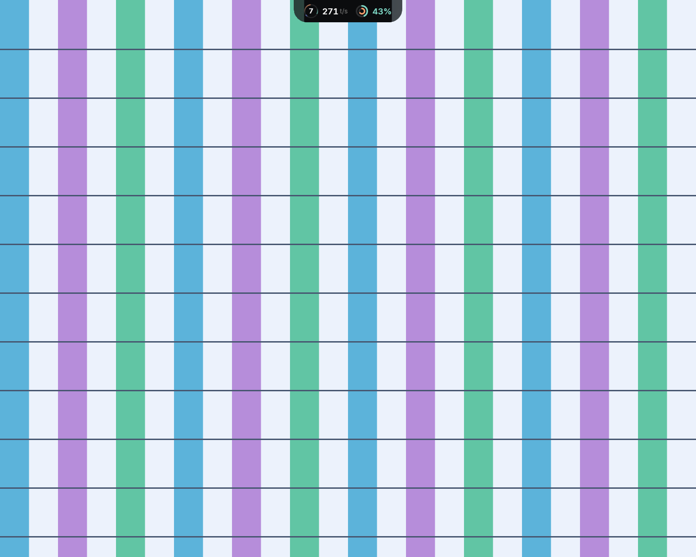
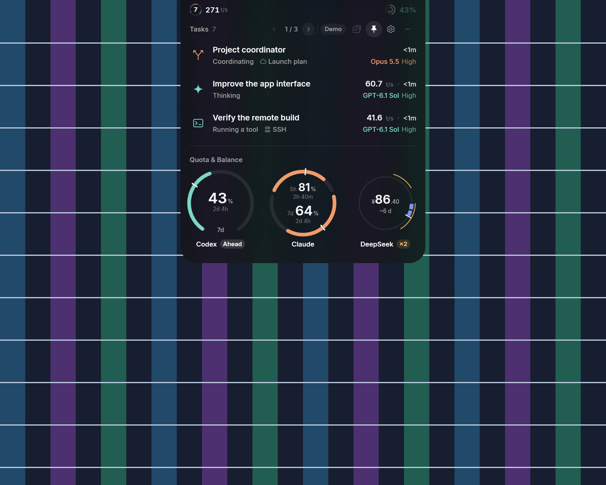
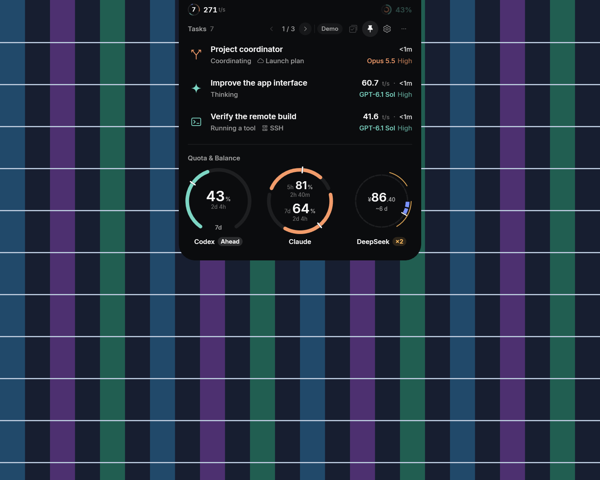
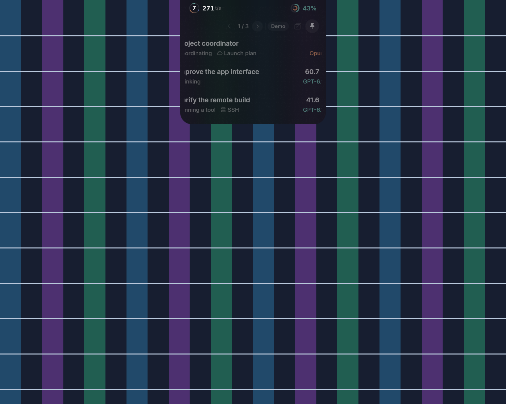

# Windows Composition glass

Windows 的 Liquid Glass 使用路线 B：原生 Composition 背景窗口承载模糊材质，现有分层 WPF 窗口承载内容。Classic 保留 Black 表面。

## 接入方式

`islandAppearance` 使用与 Mac 相同的 `classic`、`liquidGlass` 值。Windows 设置立即保存选择，不重启引擎、不刷新额度或重建采集器。缺失或未知值采用 Liquid Glass；系统不支持时显示 Black，并保留选择和回退原因。

背景 HWND 使用 `WS_EX_NOREDIRECTIONBITMAP`、`WS_EX_NOACTIVATE` 和工具窗口样式，位于内容 HWND 正下方。`CreateDispatcherQueueController` 接入 WPF 的 UI 线程消息循环；`DesktopWindowTarget` 承载 `CreateHostBackdropBrush()`、18 DIP 高斯模糊、亮度层、深色着色和固定噪点纹理。HostBackdropBrush 没有 Mac regular 材质自带的深色底，因此着色不透明度取 0.72，以便在浅色背景上保留现有浅色文字。纹理生成一次，缩放和动画不重画噪点。

两个 HWND 复用同一份 WPF 轮廓、实际设备像素原点和 DPI。背景使用 `CompositionGeometricClip`，两个 HWND 同时设置相同的原生区域。仅靠两个绘图系统各自的裁剪并不够：首轮动画截图中，WPF 分层位图提交晚于背景，文字短暂超出了玻璃轮廓。原生区域把可见内容和输入范围立即限制在当前轮廓内。

WPF 保留默认硬件路径；透明内容底使用 1/255 alpha，避免空白内区穿透。背景窗口不接收输入，其 UIA provider 排除在控件和内容视图之外；原有 WPF 控件、名称、动作和展开模式继续供辅助功能使用。普通点击不激活岛，显式的用户激活仍可由外壳处理。两个窗口均不出现在任务栏中。

窗口、徽章和内容动画仍调用共享 Swift 曲线。刘海模式收起时，头部使用共享的 Black 渐入；减少动画会完成几何和 Black 渐入两个阶段，再提交静止帧。DPI 改变时在新坐标系重建运动状态，避免跨缩放比例插值。

## 回退与资源

`UISettings.AdvancedEffectsEnabledChanged` 和 `AccessibilitySettings.HighContrastChanged` 驱动系统回退。读取失败也回退 Black。Windows build 小于 22621 时不加载原生背景 DLL，设置中说明最低版本。

创建或更新背景失败、图形设备丢失时，内容恢复为不透明 Black。设备丢失通知使用 D3D11 事件，不依赖下一次动画。旧背景的迟到事件不能影响替代实例。设置恢复后重建背景；设备丢失或 API 失败也会在显示或 DWM 恢复消息后重试，还可通过 Classic → Liquid Glass 手动重试。用户偏好始终保留。

空闲时没有材质轮询、绘图计时器或持续帧订阅。隐藏、换样式和关闭都会释放对应 HWND、设备事件、Composition 对象和系统订阅；UI 线程的 DispatcherQueue 与进程同寿命。

## 验证范围

本机为 Windows 11 25H2 x64，build 26200。截图组检测到一块 2868 × 1320 显示器、125% 缩放；后续输入组的会话报告 150%，仍只有一块显示器。测试使用离线引擎、合成任务和独立合成背景，没有读取真实任务或拍摄其他窗口。

| 项目 | 验证方式 |
| --- | --- |
| 内容承载与非激活外观 | 真实分层 WPF 内容叠在原生玻璃上，浅色、深色背景分别抓取收起和展开态 |
| 外部透明 | 与单独拍摄的合成背景逐像素比较；排除 1 个设备像素的抗锯齿边缘 |
| 输入范围 | 原生输入组在 150% 下验证：圆角外恰好一次点击到达背景，岛内 Pin 按钮切换，点击未激活岛；动画帧的原生窗口边界一致 |
| 正常、反向和减少动画 | 真实共享曲线、WPF UIA 展开/收起，以及每帧完整轮廓参数回归 |
| DPI | 截图实际 125%、输入组实际 150%；另向 125% 测试窗口注入 150% 的 `WM_DPICHANGED`，验证重排、动画与恢复，不修改系统缩放 |
| 系统透明效果、高对比度 | 注入系统状态，断言 Black 和偏好保留，再断言恢复；未宣称实际切换系统设置 |
| 旧系统、API 失败、设备丢失 | 版本模拟、创建失败注入及真实 D3D11 设备事件通路注入 |
| 辅助功能 | 保留控件名称、Invoke、ExpandCollapse 和可见状态；真人读屏验收见下文 |
| 截图隐私 | 保存前后检查合成背景覆盖和 Z 序；另用未授权叠窗验证抓图会拒绝且不落盘 |

真实系统设置保持原状。所有屏幕测试分段运行，结束后关闭各自的窗口和子进程。

最终截图组通过 42 项检查，记录 1,014 个共享动画帧。18 张截图均为非激活状态，轮廓外像素差全部为 0。屏幕工具没有列出本机测试窗口；实际点击由只允许命中测试岛及其自有合成背景的原生输入回归执行，指针在结束后恢复。

后续原生输入组也验证了设备事件：空闲时注入设备丢失即回退 Black，再向正式内容 HWND 发送显示变化消息，玻璃恢复且偏好仍为 `liquidGlass`。这覆盖生产消息接线，仍不等同于真实重置显卡。









仓库只保留上述 4 张代表图，以及 [windows-composition](images/windows-composition/) 中的 `cpu.json`、`motion.json`、`outside-pixels.json`、`input.json` 和 `recovery.json`。完整截图、背景参考和逐图轮廓文件 `acceptance.json` 留在本地忽略目录，不作为仓库参考产物提交。

重跑前先协调其他会话的屏幕使用，构建 desktop，然后运行以下命令。像素检查需要 Python 的 Pillow 和 NumPy。每次使用新的输出目录；原生背景不可用会报告失败，不会把 Black 当作玻璃通过。

```powershell
./scripts/windows/test-backdrop.ps1 -Mode overlay
./scripts/windows/test-backdrop.ps1 -Mode input
./scripts/windows/test-backdrop.ps1 -Mode cpu
```

`overlay` 模式会在 `output/windows/backdrop/<本次标识>/` 下重新生成完整截图、两张背景参考、`acceptance.json` 和像素检查结果；也可用 `-Output` 指定一个新的本地输出目录。无需从仓库保存的代表图还原完整证据。

`interactive` 模式最多保留合成窗口 180 秒，便于工具或用户点击；在该次输出目录创建 `finish` 文件可提前结束。背景和引擎子进程均受当前测试的 Job 管理，测试退出时一并关闭。

## CPU 与帧间隔

同一合成窗口、同一离线引擎，在当前 150% 会话下先预热两种表面 60 秒，再按 Black → Glass → Glass → Black 测量。每种表面的收起空闲、展开空闲和动画各取两次 15 秒样本。数值为均值；单核 100% 表示占满一个逻辑核，整机占比将外壳与引擎的进程 CPU 相加后除以本机的 16 个逻辑核。

| 状态 | Black 单核 / 整机占比 | Glass 单核 / 整机占比 |
| --- | --- | --- |
| 收起空闲 | 9.72% / 0.61% | 9.35% / 0.58% |
| 展开空闲 | 8.57% / 0.54% | 8.06% / 0.50% |
| 连续收起/展开 | 20.77% / 1.30% | 31.33% / 1.96% |

本机未见空闲 CPU 增加；玻璃动画多用约 10.56 个单核百分点，即整机 0.66 个百分点。空闲段记录到 0–1 个几何帧，不存在持续的材质帧循环。引擎使用冻结的合成快照，额度读取不会干扰比较。

`cpu.json` 还记录了系统总忙度。Black 三种状态的均值为 16.28%、22.10%、16.68%，Glass 为 9.93%、7.75%、10.10%。本机同时运行其他工作，这些总忙度不能用来推断材质让整机负载下降。进程 CPU 不包括 DWM 的单独开销，也未采集 GPU 利用率。

另用每种表面 10 次完整转场测帧间隔，只收集转场内部相邻回调，既不计两次转场之间的等待，也不剔除长帧。Black 的 784 个间隔中位数 6.95 ms、P95 8.76 ms、最大 31.49 ms；Glass 的 870 个间隔中位数 6.92 ms、P95 8.58 ms、最大 26.27 ms。两组均无超过 33.34 ms 的间隔。该数据测的是 WPF 交付节奏，配合轮廓像素检查使用，不能替代其他设备上的实际观感验收。

原始数据见 `cpu.json` 和 `motion.json`。`cpu.json` 内的辅助间隔字段混有转场之间的短间歇；帧间隔结论使用 `motion.json` 的独立测量。可用 `test-backdrop.ps1 -Mode motion` 重跑。

## 限制

上述结果只来自一台设备。系统设置的实际切换、多屏与混合 DPI、Narrator 朗读、睡眠/锁屏/远程桌面/显卡切换后的恢复，以及其他显卡和驱动上的观感与 CPU/GPU 开销，都不在自动化范围内。
